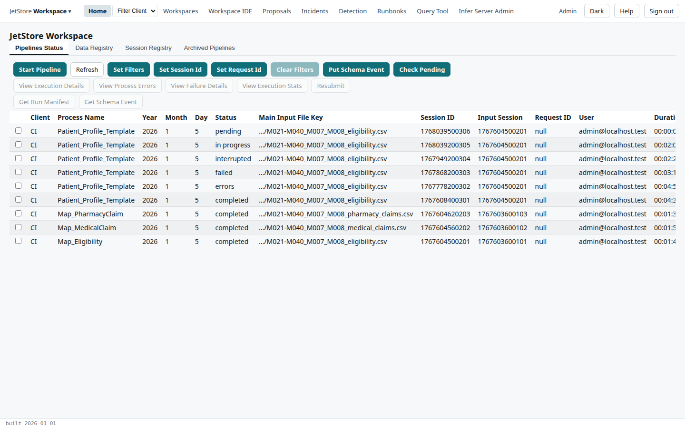
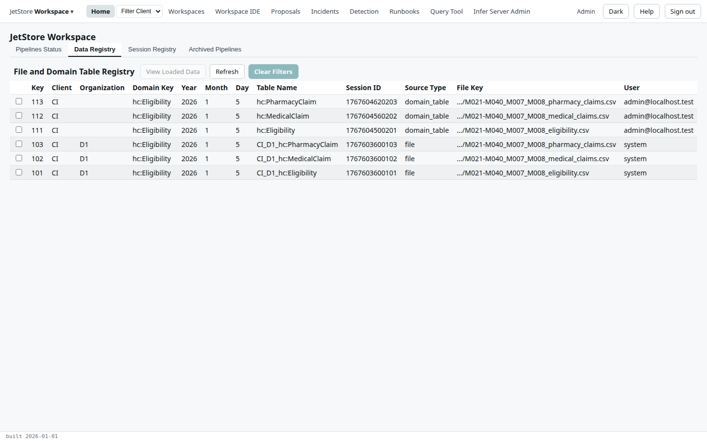

Every screenshot in the User Guide is taken by a script, from a JetStore running on your
workstation, with the same invented data every time. The script lives in `docs/screenshots/`, a
small npm package of its own that the documentation site does not depend on. For each page with
images there is a **spec**: a Playwright test that performs the page's steps in the browser and takes
a screenshot after each step that has one.

**A spec that fails means its page is owed an update.** The spec does what the page says to do, so
when a screen changes and a spec can no longer find a button or a column, the page describing that
screen no longer matches it either. Fix the page and its spec together.



## Before you start

You need, on a Linux workstation:

- Docker, to run PostgreSQL;
- Node 24, Go, CMake and a C++ compiler, to build JetStore;
- Google Chrome, which Playwright drives (`/usr/bin/google-chrome`; nothing is downloaded);
- `socat`, and a kernel that lets a user create network namespaces (`unshare -rn true` succeeds);
- a clone of the `jets_ws` workspace repository.

Then, once, from `docs/screenshots/`:

```sh
npm ci
export JETS_BIN_DIR=$HOME/jetstore-bin     # any directory outside the repository
npm run build-bin                          # builds JetStore's binaries into it
```

`JETS_BIN_DIR` holds the binaries the stack runs: the apiserver, `update_db`, the workspace
compiler, the rule engine and the rest, built from your checkout, with a `BUILD_INFO` file naming the
commit. Rebuild it when the Go or C++ code you are documenting changes. Several checkouts can share
one directory. Never use `/usr/local/bin`: what is there was installed from somewhere else.

## Take the screenshots

From `docs/screenshots/`:

```sh
export JETS_BIN_DIR=$HOME/jetstore-bin
export JETS_WS_REPO=/path/to/jets_ws       # the jets_ws repository to export
npm run shots                              # every spec
npm run shots -- specs/example             # one folder of specs
npm run shots -- specs/example/home-tabs.spec.ts
```

`JETS_WS_REPO` defaults to `../workspaces/jets_ws` beside the `jetstore` checkout, and
`JETS_WS_REF`, the commit taken from it, defaults to the one the screenshots were last taken at; set it
to take them against another.

A run does all of this, and takes everything down at the end, whether the specs passed or not and
when you press Ctrl-C:

1. builds the binaries if `JETS_BIN_DIR` is empty, and rebuilds `jetsclient_ide/dist` and `docs/dist`
   when their sources are newer;
2. exports `jets_ws` with `git archive` into a temporary directory, installs JetStore's own assets
   into it and compiles it;
3. starts `postgres:16-alpine` on a free port, in a container named for your checkout;
4. migrates the database with `update_db`, and loads the workspace's configuration for the client
   `CI`, `process_config/ci_workspace_init_db.sql`, as an installation loads a client's configuration;
5. sets every user email in the configuration to the stack's admin, `admin@localhost.test`, then
   applies the fixtures in `docs/screenshots/fixtures/`, in name order;
6. starts the apiserver with git access off, serving your `jetsclient_ide/dist` and `docs/dist`;
7. runs the specs, with a 1440 × 900 window, the light theme and a device scale of 1;
8. stops the apiserver, removes the container and the temporary directory.

The admin's password is generated for each run and given to the specs in the environment. It is
written nowhere.

A full run takes well under a minute once the binaries and the two web builds exist. At the end it
says which images it wrote:

```text
[shots] 0 new, 1 rewritten, 3 unchanged
  written src/assets/screenshots/developer/contributing/screenshots/home-data-registry.png
```

**An image is rewritten only when it differs from the committed one** by more than a small share of
its pixels, so a second run with no change to the screens writes nothing, and `git status` shows
exactly the images that changed. Look at each one before you commit it.

### Several checkouts at once

Each checkout gets its own database container, its own free port for the apiserver, and its own
temporary directories, so two or three can take screenshots at the same time on one workstation. The
script runs each apiserver in a network namespace of its own, on port 8080 there, and connects it to a
free port of `127.0.0.1`. (It was written when the apiserver could listen on 8080 only; the apiserver
now takes `-listenAddr`.)

### When a run fails

The stack's logs are in `docs/screenshots/.stack/`: `update_db.log`, `compile_workspace.log`,
`apiserver.log` and the others. A failing spec leaves a trace and a screenshot of the failure in
`docs/screenshots/test-results/`; open the trace with `npx playwright show-trace <file>`. If a run is
killed before it can clean up, the next run takes its stack down first, or run `npm run stack:down`.

## Add a spec

A spec is `docs/screenshots/specs/<area>/<page>.spec.ts`, one per documentation page, and it writes
its images to `docs/src/assets/screenshots/<the page's path>/`. The example,
`specs/example/home-tabs.spec.ts`, captures the four tabs of Home for this page:

```ts
import { test } from "@playwright/test";
import { openScreen, openTab, screenshotsFor, signIn, waitForTable } from "../../lib/shots";

const { shot } = screenshotsFor("developer/contributing/screenshots");

test("Home, one image per tab", async ({ page }) => {
  await signIn(page);
  await openScreen(page, "Home");
  await waitForTable(page);
  await shot(page, "home-pipelines-status");

  await openTab(page, "Data Registry");
  await waitForTable(page);
  await shot(page, "home-data-registry");
  // ...
});
```

The helpers, in `docs/screenshots/lib/shots.ts`:

| Helper | What it does |
|---|---|
| `signIn(page)` | Signs in as the stack's admin, in the light theme. |
| `openScreen(page, label)` | Opens a screen from the top bar: `Home`, `Workspaces`, `Query Tool`… |
| `openFlowMenu(page, label)` | Opens an entry of the menu under *JetStore Workspace*: a configuration flow, *Rules Configuration* or *User Administration*. |
| `openTab(page, label)` | Selects a tab by its label. |
| `waitForTable(page, table?)` | Waits for a data table, the first on the page by default, to have its rows; returns it. |
| `settle(page)` | Waits until nothing is loading and the page has stopped changing. |
| `screenshotsFor(pagePath)` | Returns `shot` for the page at `docs/src/content/docs/<pagePath>.md`. |
| `shot(target, name, { mask })` | Takes `<name>.png` of the whole window, or of one element when `target` is a locator, and writes it if it changed. `mask` paints over regions that change at every run. |

**Reach every screen through the app's own links**, as a user would: the session is held in the
browser's memory, so loading an address directly signs you out. **Perform the page's steps**: if the
page says to select a row and press a button, the spec selects the row and presses the button, then
takes the screenshot. Name images in lower case with hyphens, after what they show.

A page shows an image with ordinary Markdown and a path relative to the page's own file. From
`user/screens/home.md`, four folders up reaches `src/`:

```md

```

**The alt text says what the image shows**, for search and for screen readers, not "screenshot".
The build optimises every image.

## Add a fixture

A fixture is an SQL file in `docs/screenshots/fixtures/`, applied with `psql` after the client's
configuration, in name order. `00_base.sql` holds the data every page can rely on; add your own
file, numbered after it, for data only your pages need. A fixture:

- holds **data only**: the configuration comes from `jets_ws`, so the screens show the
  configuration the workspace really has;
- uses **fixed dates and fixed keys**, so the screens are the same at every run. Take keys from your
  file's own range (`10_` from 10000, `20_` from 20000, `30_` from 30000); `00_base.sql` keeps
  below 10000, and the sequences continue at 100000 for rows a spec creates through the app;
- reads a data file as `/fixture-data/<file>`, which is `docs/screenshots/data/<file>` copied into
  the database container: `\copy my_table FROM '/fixture-data/my_file.csv' WITH (FORMAT csv, HEADER true)`.

What `00_base.sql` provides, all for the client `CI` and its org `D1`:

| Data | Where |
|---|---|
| The three files loaded on 2026-01-05, eligibility (22 rows), medical claims (301) and pharmacy claims (257) | `input_loader_status`, `input_registry`, `session_registry`, and the staging tables `CI_D1_hc:Eligibility`, `CI_D1_hc:MedicalClaim` and `CI_D1_hc:PharmacyClaim` |
| `Map_Eligibility`, `Map_MedicalClaim` and `Map_PharmacyClaim`, completed | `pipeline_execution_status` and its details; the domain tables `hc:Eligibility`, `hc:MedicalClaim` and `hc:PharmacyClaim`, registered in `input_registry` |
| `Patient_Profile_Template` runs: completed, with errors, failed, interrupted, in progress and pending | `pipeline_execution_status`, `pipeline_execution_details`, `cpipes_execution_status_details`, `pipeline_execution_channel_details`; the completed run's 22 records in `cintel:Patient_Profile`; the run with errors' 27 rows in `process_errors` |
| Two archived runs, one of a session a user deleted | `pipeline_execution_status_archive`, `session_deletion` |

No pipeline runs on the stack: running one needs an S3 bucket. So a screen that shows a pipeline's
results is captured from rows a fixture put in the database, and a page whose steps start a pipeline
shows the seeded result and says that the run itself takes place on the installation. Two screens read
AWS directly and have no screenshots: *Infer Server Admin* and *Input File Preview*.

## The data, and what must not be in it

`jetstore` is a public repository, and its images are as public as its pages. The screenshots show
`jets_ws`'s *22 Patients* data set, in `docs/screenshots/data/`: 22 invented members, M007, M008 and
M021 to M040, with 301 medical and 257 pharmacy claim lines from 2025, and a profile of each member
written by an earlier version of the `Patient_Profile` pipeline (`patient_profiles_expected.csv`). Every name, date of birth and ZIP code in
it is made up, and every identifying column (addresses, subscriber and provider identifiers) is empty.

So, in a fixture, a spec or anything a spec types into a screen:

- **invent every value**, in the same style: no real person's name or address, no real client's
  name, no value copied from an installation's database, logs or files;
- **use the client `CI`**, its org `D1` and the `jets_ws` workspace, which the screens already show,
  and `admin@localhost.test`, or another address at `localhost.test`, for a user;
- **look at every image before you commit it**, for anything the fixtures did not put there.

Pages follow the same rules: see [Writing the documentation](/docs/developer/contributing/documentation/).
