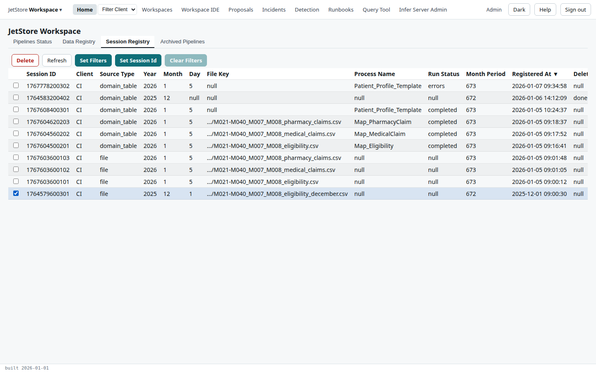
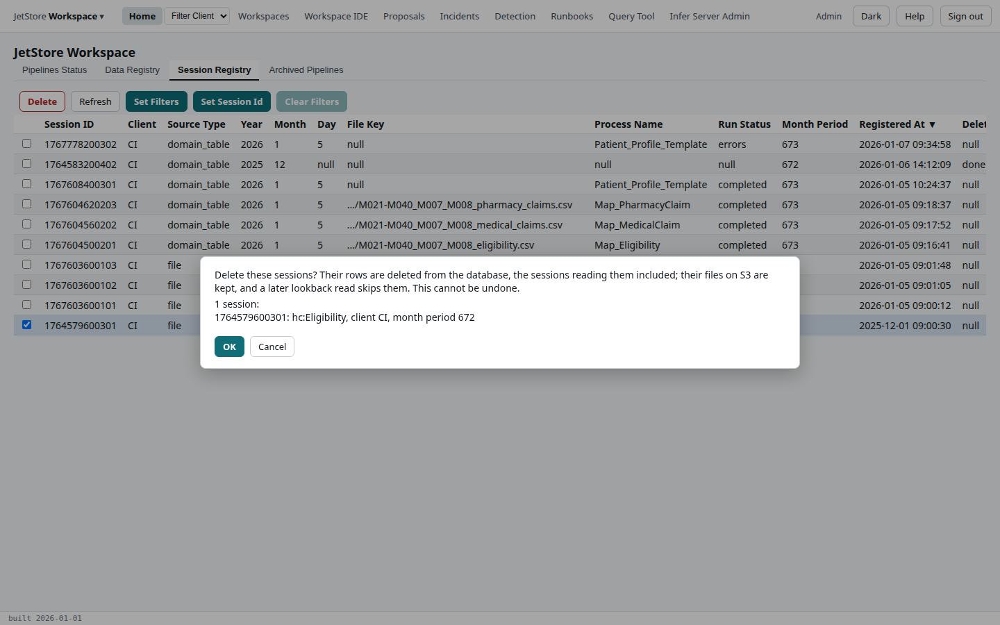
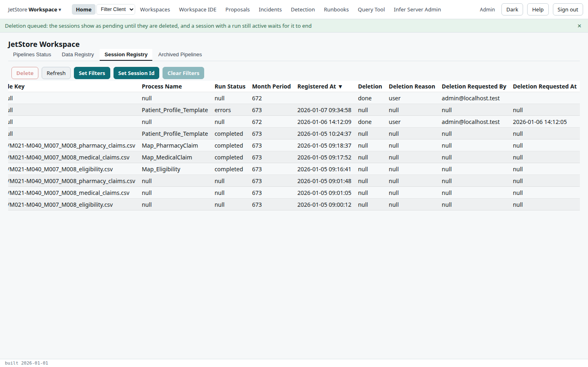

**Before you start**: your account has `delete_session`. A deletion cannot be undone: every row the
session wrote, in every table, is deleted, with the sessions that read it, and theirs in turn. Its
files in the bucket are kept. [Pipelines and sessions](/docs/user/concepts/pipelines-and-sessions/#deleting-a-session)
explains why the session is the unit of deletion.

The example deletes a December 2025 eligibility file of `CI` that was registered and never mapped.

1. On **Home**, open the **Session Registry** tab, and tick the session to delete. **Set Session Id**
   finds one by its id.

   

2. Press **Delete**. The confirmation lists every session the deletion reaches: the one you ticked
   and, below it, each session derived from it. Read the list.

   

3. Press **OK**. The deletion is queued, and the tab shows each session's deletion as `pending`.

4. Press **Refresh**. When the deletion has run, its status is `done`. A session that a pending or
   submitted run is reading waits until that run ends.

   

**How to tell it worked**: the session's deletion is `done`, its rows are gone from the **Data
Registry** tab, and any runs it had are on the **Archived Pipelines** tab. If the deletion is
`failed`, nothing was deleted; the [Home](/docs/user/screens/home/) page describes the tab's columns.
