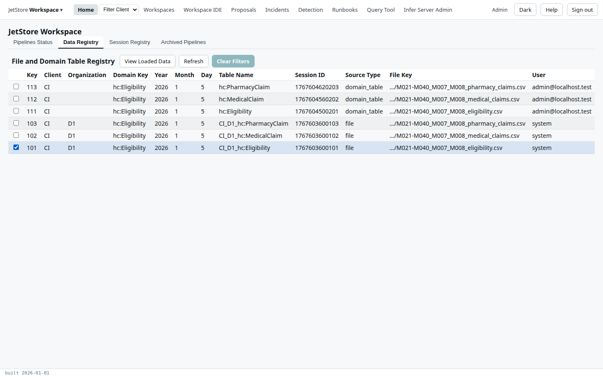
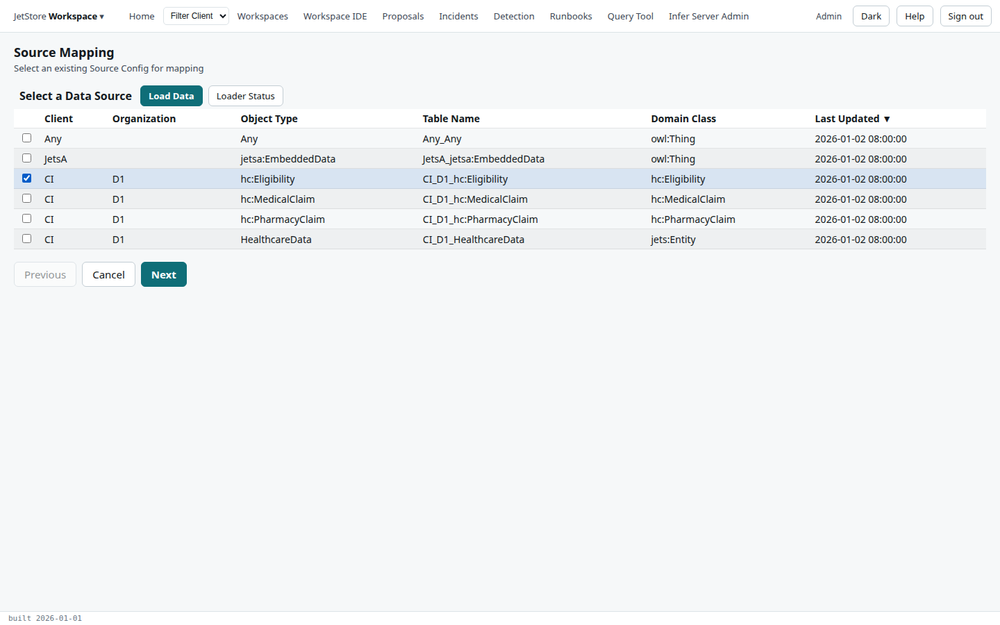
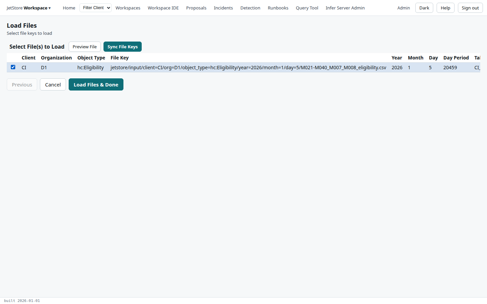
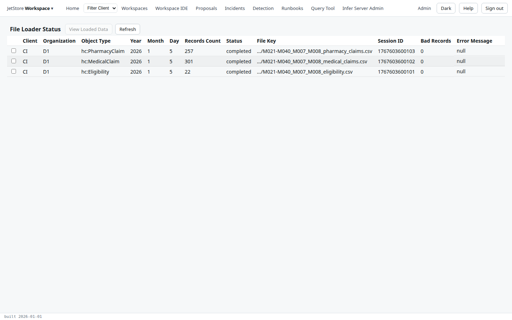
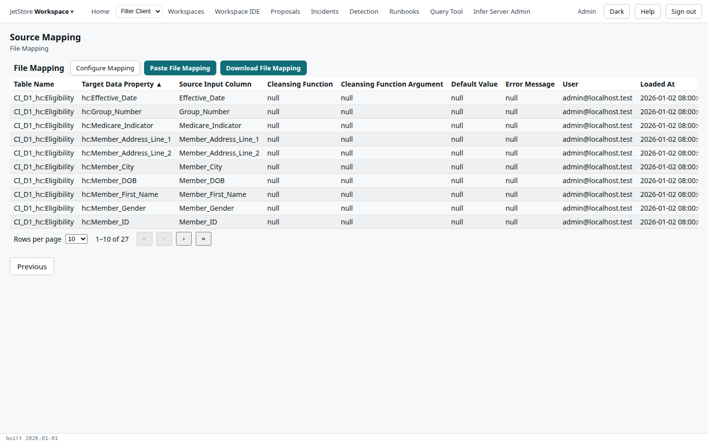
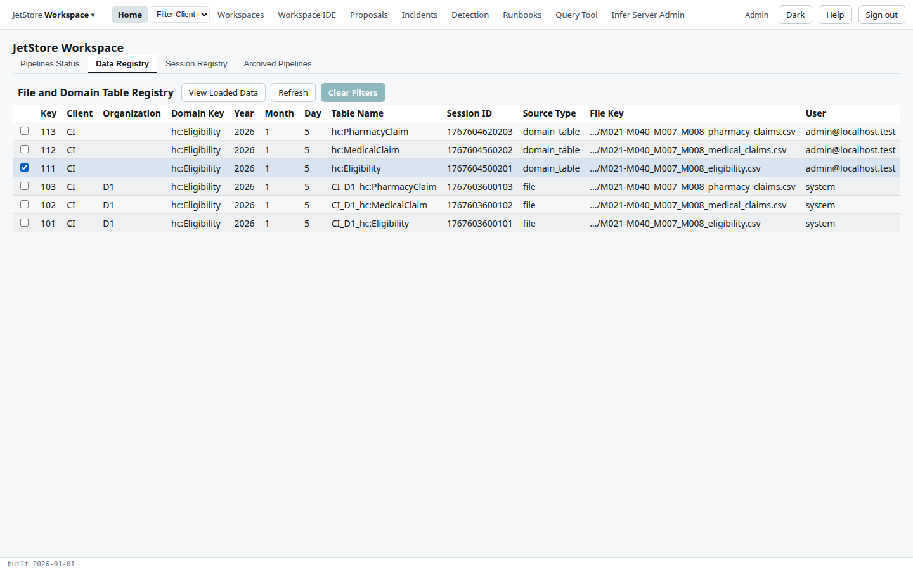

**Before you start**: the file's source configuration exists for its client, organisation and object
type (the *Source Configuration* flow), and your account has `run_pipelines`. The example is `CI`'s
eligibility file from `D1` for January 2026.

1. **Put the file in the bucket** at the path its source configuration expects, for example
   `jetstore/input/client=CI/org=D1/object_type=hc:Eligibility/year=2026/month=1/day=5/<file name>`.
   [Files and the input registry](/docs/user/concepts/files-and-the-input-registry/) explains the path.

2. **Check it registered.** On **Home**, open the **Data Registry** tab. The file has a row with
   source type `file`, its staging table and a session id. It appears within seconds of landing; if
   it does not, see the Installation Guide's [troubleshooting ingest](/docs/install/how-to/troubleshoot-ingest/).

   

3. **Choose its source.** Open the brand menu, **JetStore Workspace**, choose **Source Mapping**, and
   tick the source, here `CI_D1_hc:Eligibility`.

   

4. **Load it.** Press **Load Data**, tick the file in the [Load Files](/docs/user/screens/flows/load-files/)
   list, and press **Load Files & Done**. The loader copies the file's rows into the staging table, in
   the background.

   

5. **Check the load.** Open **Source Mapping** again and press **Loader Status**. The file's row says
   `completed`, with the records loaded and the bad records. A bad record is a row the loader could not
   read; the error message column says why.

   

   To see the rows, tick the file and press **View Loaded Data**: see
   [Look at loaded data](/docs/user/how-to/look-at-loaded-data/).

6. **Check the mapping.** Open **Source Mapping**, tick the source and press **Next**. Each row maps a
   data model property to one of the file's columns, with an optional cleansing function. Every
   source input column should be one the loaded file has; **Configure Mapping** changes the mapping,
   which needs `client_config`. See [Source Mapping](/docs/user/screens/flows/source-mapping/).

   

7. **Run the mapping pipeline**, here `Map_Eligibility`, with the file as its main input: see
   [Run a pipeline](/docs/user/how-to/run-a-pipeline/).

**How to tell it worked**: when the run completes, the **Data Registry** tab has a new
`domain_table` row for the mapped table, `hc:Eligibility`, with the run's session id and the file's
key.

Loading (steps 4 and 5) is for looking at a file; the mapping pipeline reads the file from the bucket
whether it was loaded or not.
