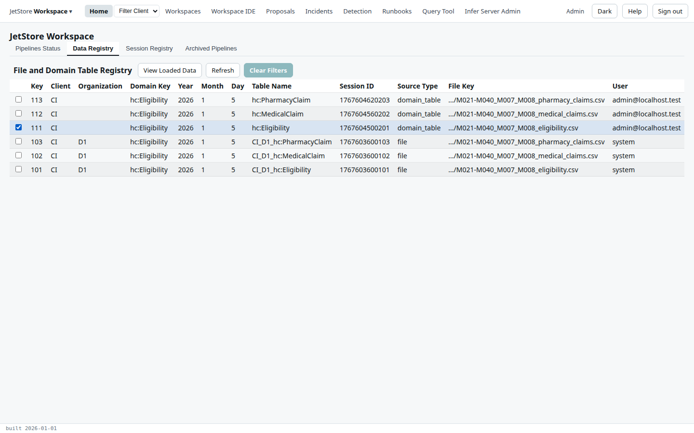
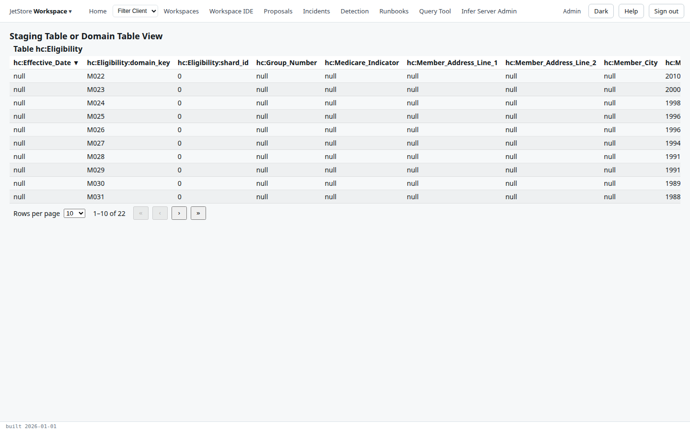
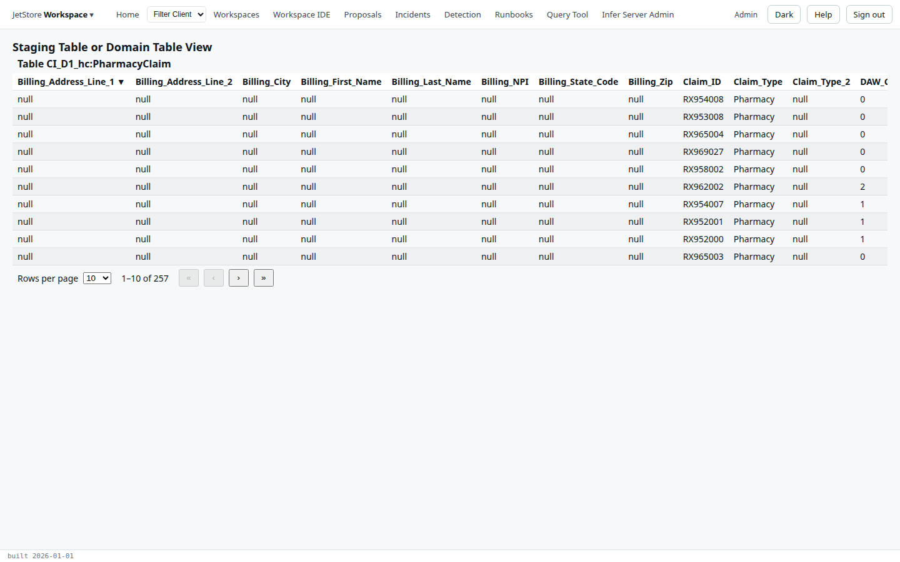

**Before you start**: your account has `jetstore_read`. A file's rows are in the database only once it
has been loaded (see [Load and map a file](/docs/user/how-to/load-and-map-a-file/)); a pipeline's
table, once its run has completed.

1. On **Home**, open the **Data Registry** tab.
2. Tick the row you want. A `file` row is a file and its staging table, such as
   `CI_D1_hc:PharmacyClaim`; a `domain_table` row is a table a pipeline wrote, such as
   `hc:Eligibility`. Each row is one session of that table.

   

3. Press **View Loaded Data**. The table opens on that session's rows only, ten to a page; the
   columns sort when you press their names.

   A domain table carries the data model's properties, with the member as its domain key:

   

   A staging table carries the vendor's own columns, as they arrived:

   

**Other ways to the same rows**: the *File Loader Status* screen's **View Loaded Data** opens a loaded
file's staging table, and the [Query Tool](/docs/user/how-to/query-the-data/) can select any of them
by `session_id`. The [table view](/docs/user/screens/table-view/) page describes the screen.
