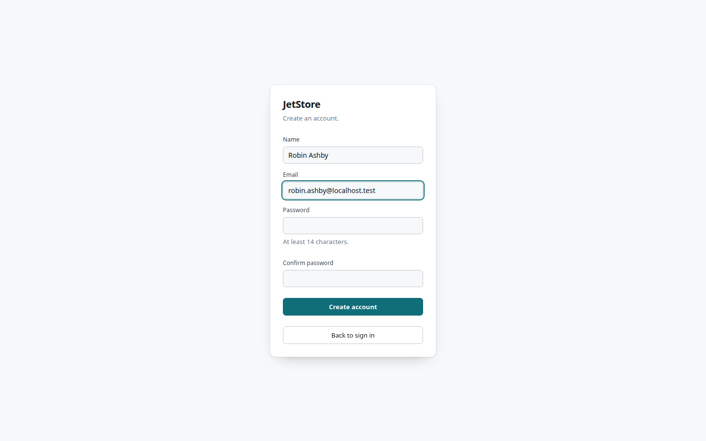
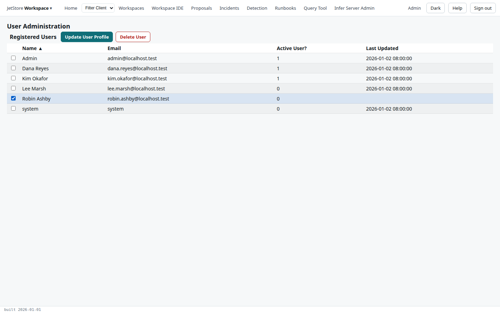
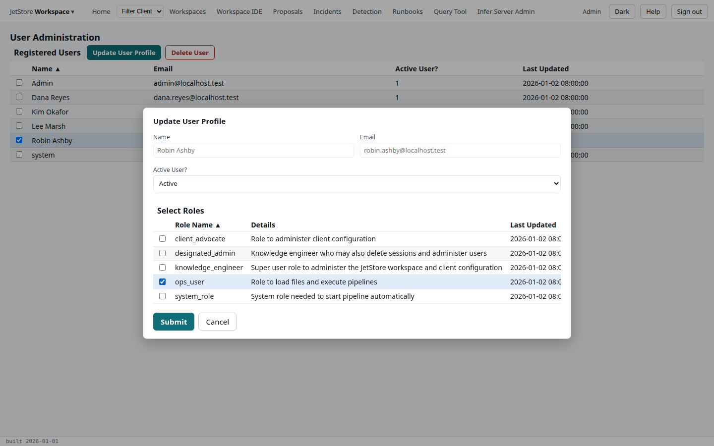
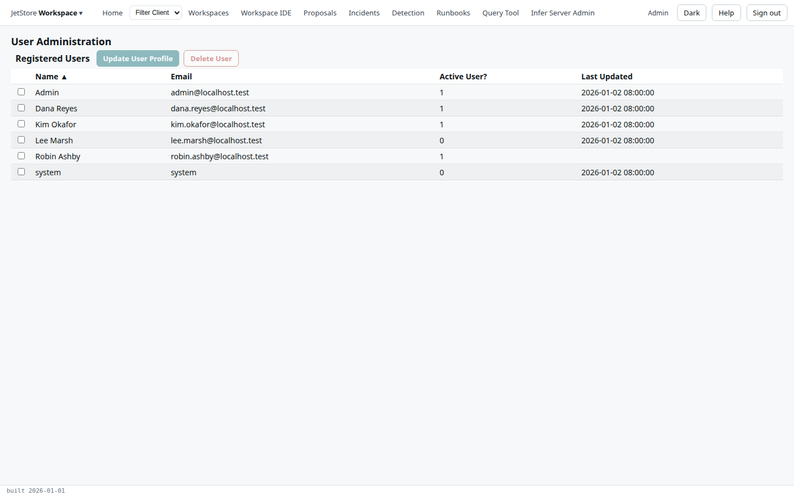

**Before you start**: your account has `user_admin`. [Users, roles and capabilities](/docs/user/concepts/users-and-capabilities/)
explains which role grants what.

## Activate a new account

1. **The person registers.** On the sign-in page they choose **Create one**, and enter their name,
   email and a password of at least 14 characters. The account is created inactive.

   

2. Open the brand menu, **JetStore Workspace**, and choose **User Administration**. The new account is
   listed with **Active User?** at `0`.

   

3. Tick the account and press **Update User Profile**.
4. Set **Active User?** to **Active**, and tick the roles it should hold: here `ops_user`, to load
   files and run pipelines. Press **Submit**.

   

**How to tell it worked**: the account shows **Active User?** at `1`, and the person can now sign in.

## Change an account's roles, or deactivate it

Tick the account, press **Update User Profile**, change the roles or set **Active User?** to
**Inactive**, and press **Submit**.

## Delete an account

Tick the account, press **Delete User**, and confirm with **OK**. The account leaves the list.

The installation's administrator account cannot be changed or deleted here, so the installation
always keeps an account that can manage users. The [User Administration](/docs/user/screens/user-administration/)
page describes the screen, and [Sign in](/docs/user/screens/sign-in/) the registration form.
