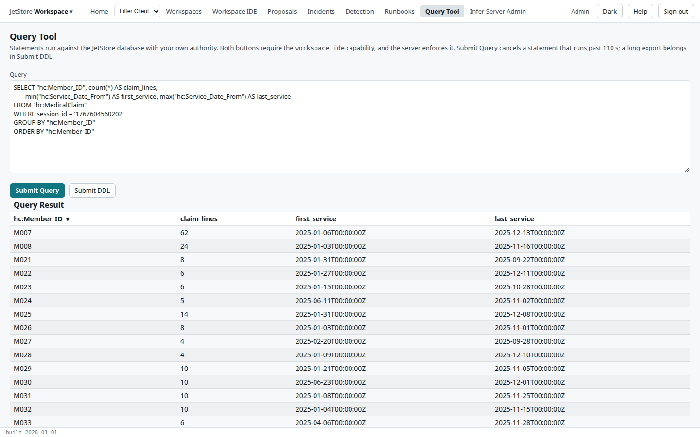
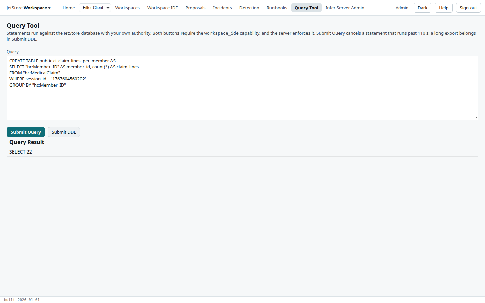

**Before you start**: your account has `workspace_ide`. Both buttons run your SQL against the
installation's database as you, and neither is read only: a `DROP TABLE` runs as willingly as a
`SELECT`.

## Run a query

1. Open the **Query Tool** from the top bar.
2. Type or paste one `SELECT` statement. Quote table and column names that have a colon, such as
   `"hc:MedicalClaim"`, and select a pipeline's rows by `session_id`.

   ```sql
   SELECT "hc:Member_ID", count(*) AS claim_lines,
          min("hc:Service_Date_From") AS first_service, max("hc:Service_Date_From") AS last_service
   FROM "hc:MedicalClaim"
   WHERE session_id = '1767604560202'
   GROUP BY "hc:Member_ID"
   ORDER BY "hc:Member_ID"
   ```

3. Press **Submit Query**. The rows appear under **Query Result**.

   

A query that runs longer than 110 seconds is cancelled; run a long one with **Submit DDL** instead.

## Run a statement

1. Type the statement, or several separated by `;`. Here, a table of the result above:

   ```sql
   CREATE TABLE public.ci_claim_lines_per_member AS
   SELECT "hc:Member_ID" AS member_id, count(*) AS claim_lines
   FROM "hc:MedicalClaim"
   WHERE session_id = '1767604560202'
   GROUP BY "hc:Member_ID"
   ```

2. Press **Submit DDL**. The result is the statement's command tag: here `SELECT 22`, the 22 rows
   written.

   

3. Query the new table with **Submit Query**, as above.
4. Drop it when you are done, with **Submit DDL**: `DROP TABLE public.ci_claim_lines_per_member`. The
   result is `DROP TABLE`.

**How to tell it worked**: a query returns its rows; a statement returns its command tag. An error
shows the database's message in the result instead, such as `relation "nothing" does not exist`. The [Query Tool](/docs/user/screens/query-tool/) page
describes the screen.
