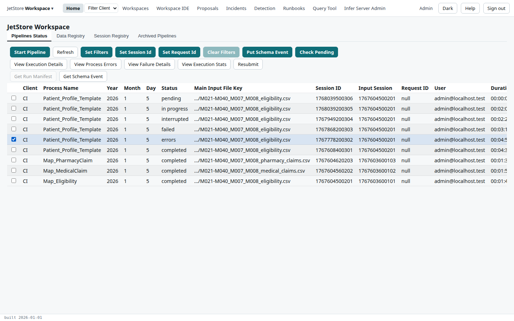
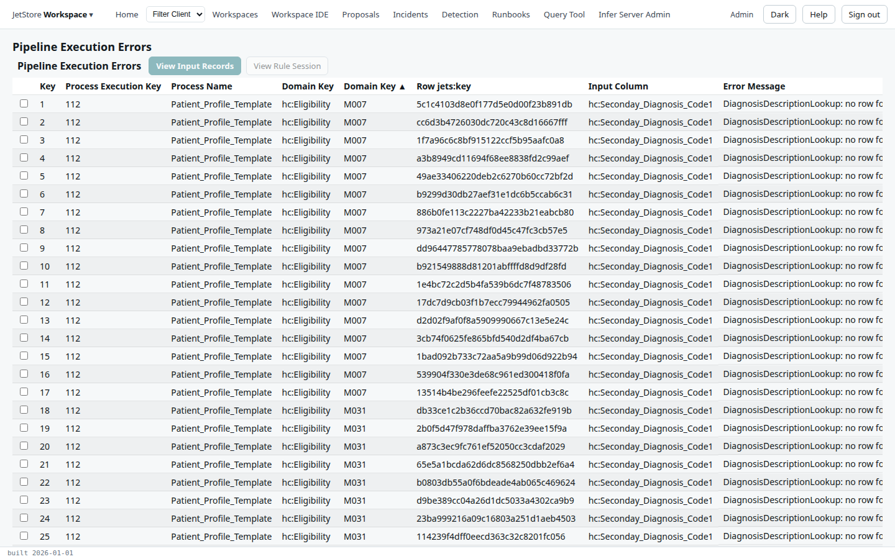

**Before you start**: your account has `jetstore_read`. A run that finished but whose rules raised
errors for some members ends with the status `errors`; its output is registered all the same.

1. On **Home**'s **Pipelines Status** tab, tick the run with status `errors`.

   

2. Press **View Process Errors**. Each row is one error: the member it concerns (the domain key),
   the input column, and the message.

   

3. Read the messages for a pattern. Here every error is the same: two diagnosis codes, `M5450` and
   `M5451`, are not in the workspace's diagnosis lookup, so the rules could not describe them. The fix
   is in the workspace, not in the run.
4. To see the data behind one error, tick it and press **View Input Records**. The dialog lists the
   member's records in each table the run read.

**What to do next**: fix the cause, here the lookup, in the workspace (see
[Work on a workspace](/docs/user/how-to/work-on-a-workspace/)), compile, and run the pipeline again
(see [Run a pipeline](/docs/user/how-to/run-a-pipeline/)). A run that `failed` has no process errors
but a failure; **View Failure Details** shows it. The [Process Errors](/docs/user/screens/process-errors/)
page describes every column.
