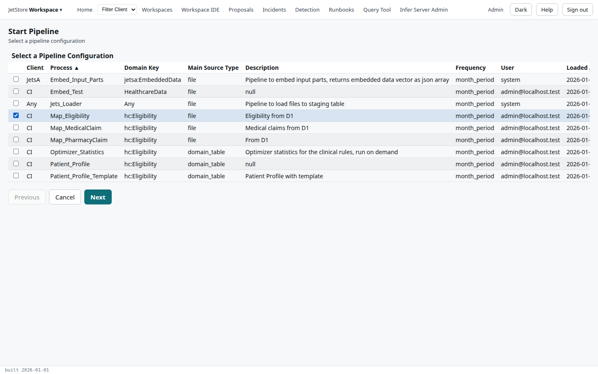
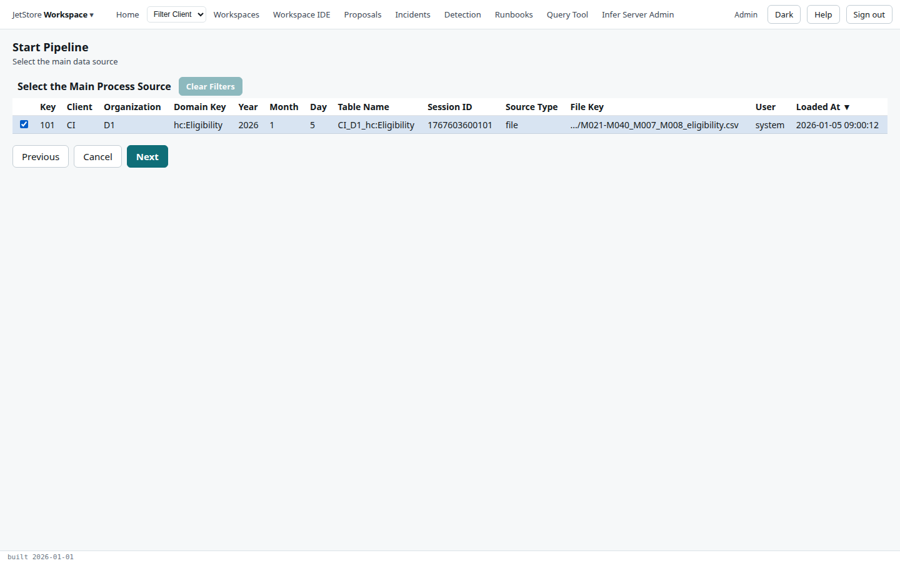
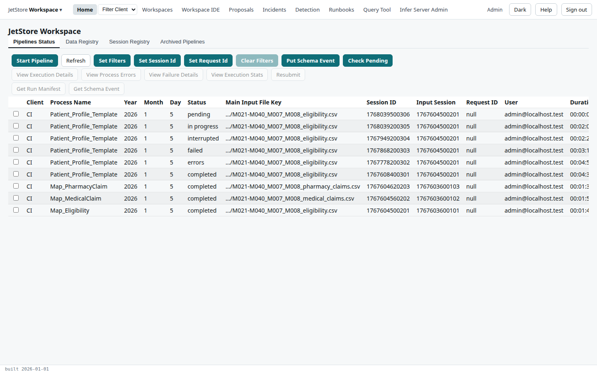
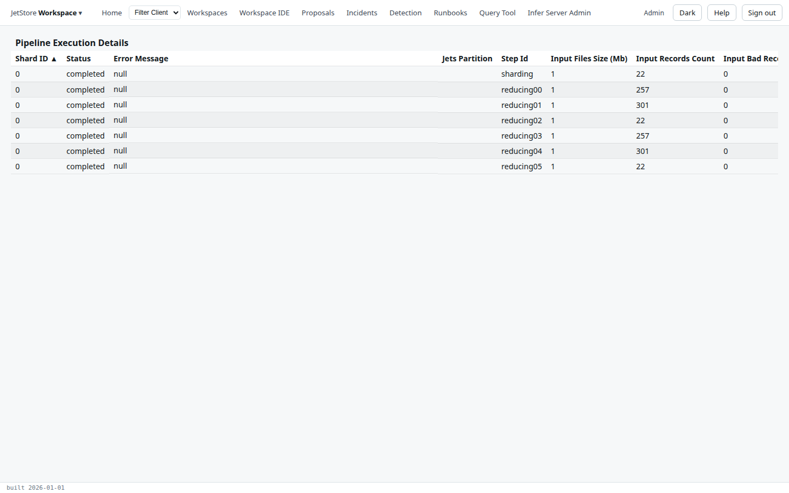
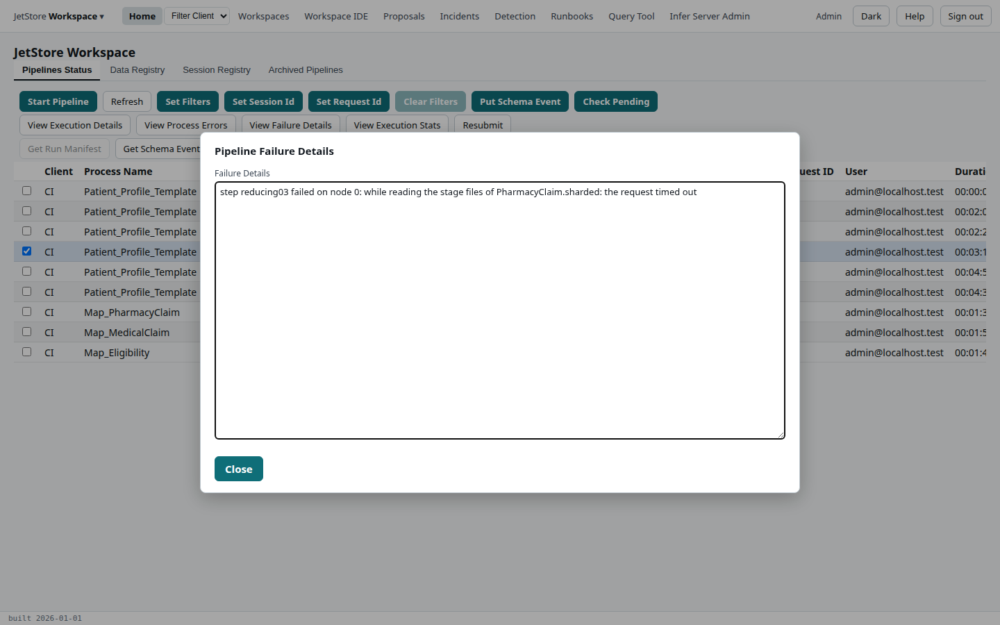
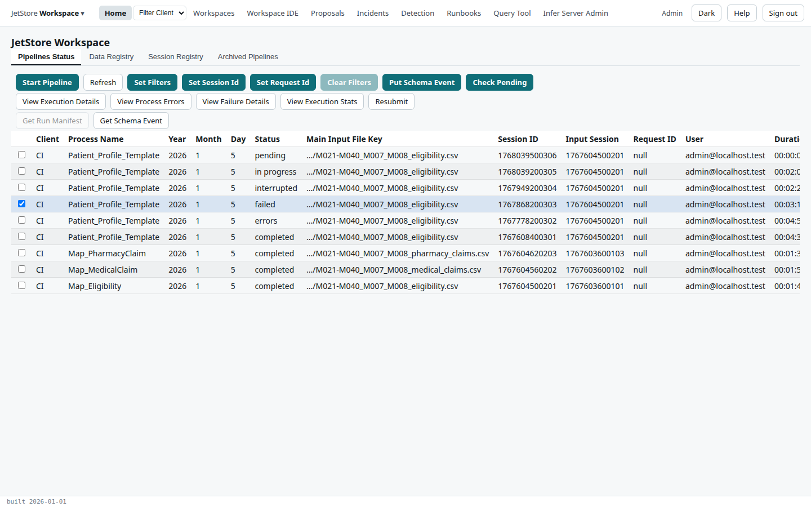

**Before you start**: the pipeline's input is registered (Home's **Data Registry** tab) and your
account has `run_pipelines`. The example starts `CI`'s `Map_Eligibility` on the January eligibility
file. [Pipelines and sessions](/docs/user/concepts/pipelines-and-sessions/) explains what a run is
and what its statuses mean.

## Start a run

1. On **Home**'s **Pipelines Status** tab, press **Start Pipeline**.
2. Tick the pipeline configuration, here `Map_Eligibility` for client `CI`, and press **Next**.

   

3. Tick the main input, the registered data the run reads, and press **Next**. Each row is one
   session; pick it by its period and file key.

   

4. Check the summary, and press **Start Pipeline & Done**.

The flow returns to Home, where the run is the newest row. The [Start Pipeline](/docs/user/screens/flows/start-pipeline/)
page describes each step's columns.

## Watch it

1. On **Pipelines Status**, press **Refresh** to follow the run's status: `pending` while it waits
   for a place, `submitted` while it runs, then `completed`, `errors` or `failed`. A run takes from a
   few minutes upward, depending on its data.

   

2. To see its steps, tick the run and press **View Execution Details**. Each row is a step on a
   node, with the records it read and wrote.

   

**How to tell it worked**: the status is `completed`, or `errors` (see
[Read a run's process errors](/docs/user/how-to/read-process-errors/)), and the tables it wrote are on
the **Data Registry** tab under its session id.

## Run it again

A run that ended `failed`, `interrupted` or `timed_out` registered nothing, and can be run again.

1. On **Pipelines Status**, tick the run, and press **View Failure Details** to read why it stopped.

   

2. Close the dialog. If the cause has passed, a timeout for example, press **Resubmit**. The run
   starts again on the same inputs, under a new session, as a new row.

   

If the cause is in the data or the rules, fix that first; a resubmitted run uses the workspace as it
is compiled now. Every button and column of the tab is on the [Home](/docs/user/screens/home/) page.
