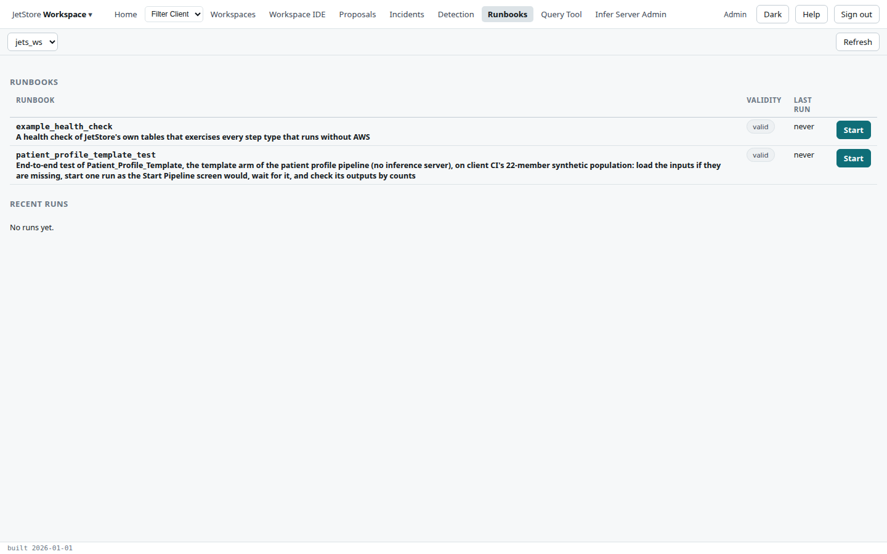
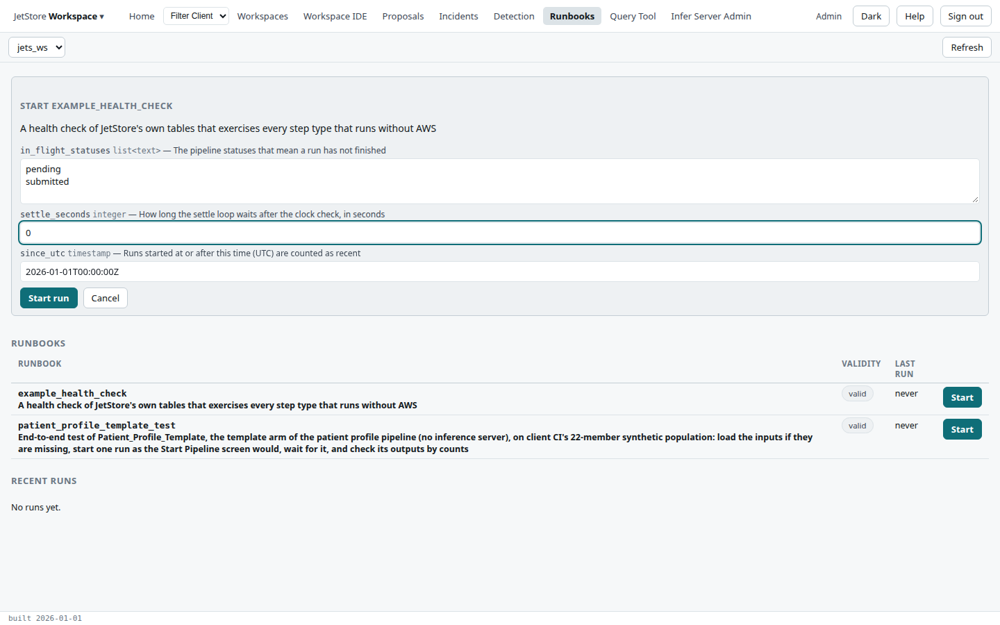
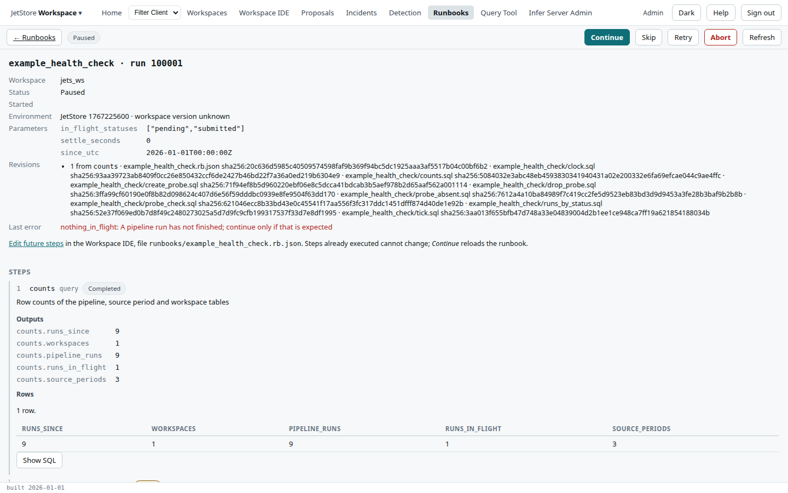
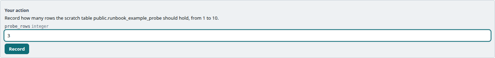
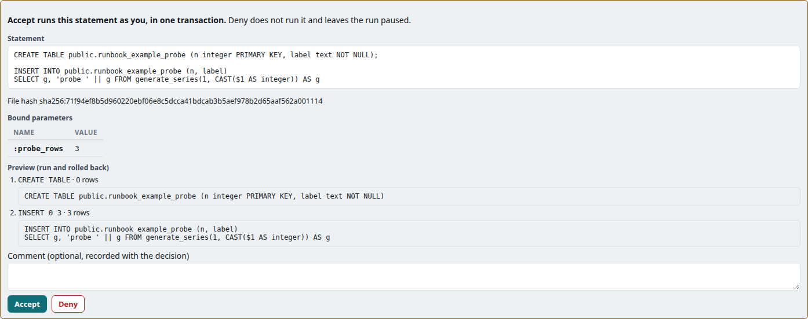
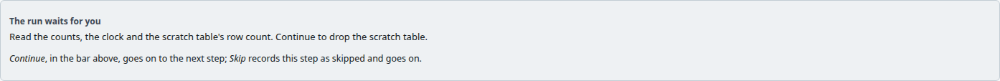
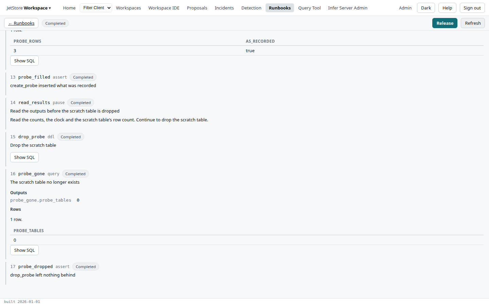

**Before you start**: your account has `runbook_execute`, and the capability each step needs: a query
needs `jetstore_read`, a pipeline start `run_pipelines`. A runbook is a list of steps in the active
workspace's `runbooks/` folder, which the installation runs for you one at a time; the Developer's
Guide describes [the runbook format](/docs/developer/engine/runbook-format/). The example is
`jets_ws`'s `example_health_check`.

1. Open **Runbooks** from the top bar. Each runbook shows whether it is **valid** and its last run.
   Only a valid runbook can be started, and only one run of a runbook at a time.

   

2. Press **Start** on the runbook. Check its parameters, each with its type and meaning; change any
   that should differ, here `settle_seconds` to `0`. Press **Start run**.

   

3. The run screen opens and the installation works through the steps, each listed with its status and
   outputs. When it stops, the run is **Paused**; read why under **Last error** and in the step
   itself. Here the assert `nothing_in_flight` found a pipeline run still pending.

   

   Press **Continue** if the condition is expected, **Skip** to pass over the step, **Retry** to run a
   failed step again, or **Abort** to end the run. The bar offers only what the step can take.

4. A **manual** step waits for you to record values. Fill them in and press **Record**.

   

5. A **ddl** step, which changes the database, always waits for you, and shows exactly what it will
   run: the statement, the values bound into it, its file's hash, and a preview run and rolled back.
   Read it, optionally add a comment, and press **Accept** to run it, or **Deny** to leave the run
   paused.

   

6. A **pause** step stops for you to read what the run has found so far. Its panel shows the
   runbook's message. Read the outputs, then press **Continue** in the bar.

   

7. When the run ends, press **Release** to release its result; **Download .rbr.json** then saves it
   as a file.

   

**How to tell it worked**: the run's status is **Completed**, and every step's status is completed or
skipped. On the **Runbooks** screen, the runbook's last run shows the same.

**Editing a runbook during a run**: the *Edit future steps* link opens the runbook's file in the
Workspace IDE. Steps already run cannot change; **Continue** reloads the runbook for the rest. The
[Runbooks](/docs/user/screens/runbooks/) page describes the list and the run screen.
