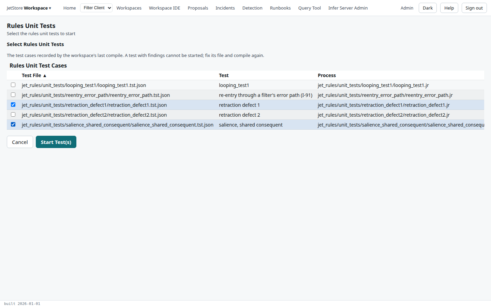
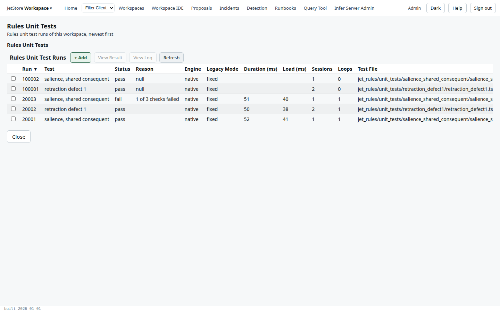
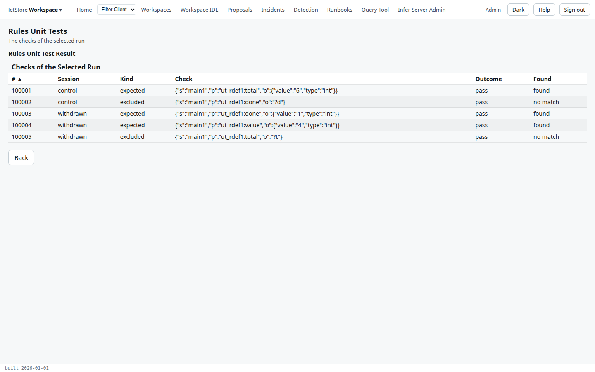

**Before you start**: your account has `workspace_ide`, and the workspace has been compiled since its
test files last changed: the tests run the compiled rules, and the list of tests is the one the last
compile recorded. A test is a `.tst.json` file beside the rules it tests; the Developer's Guide
explains [how to write one](/docs/developer/testing/rules-unit-tests/writing-tests/).

1. Open **Workspaces**, tick the workspace, and press **Rules Unit Tests**. The flow opens on the
   workspace's test runs, newest first.
2. Press **+ Add**, and tick the tests to run. A test with findings, in the **Findings** column,
   cannot be started: fix its file and compile again.

   

3. Press **Start Test(s)**. Each test becomes a run in the list. Press **Refresh** until each has a
   status: `pass`, `fail` or `error`. Small tests take seconds.

   

4. Tick a run and press **View Result**. Each row is one check of the test file, by session: a triple
   it expected or excluded, the outcome, and what was found. **Back** returns to the runs.

   

5. To see how the engine ran, tick a run and press **View Log**. The log ends with the test's
   verdict.

**How to tell it worked**: every run says `pass`. For a `fail`, **View Result** names the check that
failed; for an `error`, the **Reason** column and the log say why the test could not run. The
[Rules Unit Tests](/docs/user/screens/flows/rules-unit-tests/) page describes each step of the flow.
