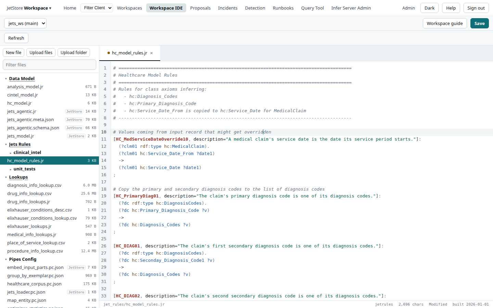
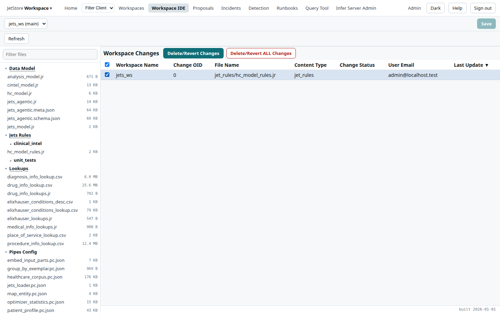
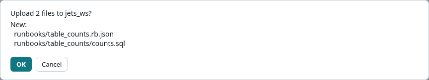
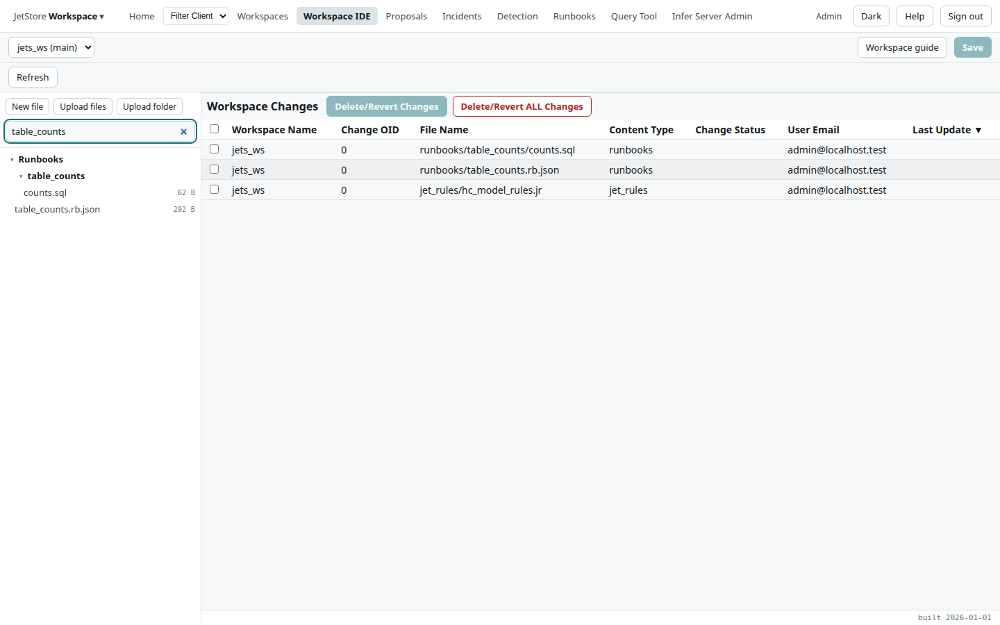
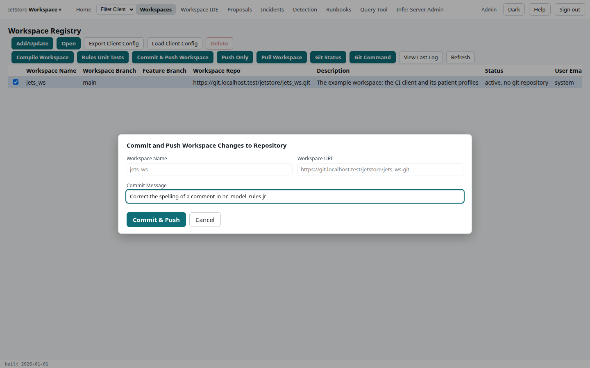

**Before you start**: your account has `workspace_ide`, and the workspace is the installation's
active one. [Workspaces](/docs/user/concepts/workspaces/) explains why a saved file is an override, why
it must be compiled, and why it must reach git.

## Edit and save a file

1. Open the **Workspace IDE**, and open the file from the tree on the left: here
   `jet_rules/hc_model_rules.jr`, under **Jets Rules**. **Filter files** finds a file by name.
2. Make the change. The file's tab shows a dot and the status bar says **Modified** until you save.

   

3. Press **Save**. Some kinds of file, such as user flows and SQL scripts, are checked as they are
   saved, and one that cannot be read is refused with the reason.
4. Close the file's tab. With no file open, the IDE lists the **Workspace Changes**: every file saved on
   this installation and not yet committed.

   

## Add a file or a folder

A file the installation needs and the workspace does not have, such as a new runbook and its SQL, is
added from the Workspace IDE: no deployment is needed.

- **One new file**: press **New file**, type its path in the workspace, such as
  `runbooks/table_counts/counts.sql` (a folder that is not there is made), write it, and press **Save**.
- **Files or a folder from your computer**: press **Upload files** or **Upload folder**, pick them,
  and type the workspace folder they go in. Here a folder `runbooks`, holding a runbook
  `table_counts.rb.json` and its folder of SQL, is uploaded to the workspace's root, so its files
  keep their paths under `runbooks/`.

1. The IDE checks the files and shows what the upload will do: the files that are new, the ones that
   replace a file of the same name, and the ones it leaves out. Press **OK** to add them.

   

2. Each file is checked as a save checks it. If any is refused, nothing is added and the banner lists
   every refused file with the reason; correct them and upload again.
3. The files are in the tree, and, with no file open, in **Workspace Changes**, like a saved file.

   

Only a file the tree would list can be added, so a runbook goes under `runbooks/`, a rule file under
`jet_rules/`, and so on; [Workspace IDE](/docs/user/screens/workspace-ide/#adding-files) has the rules.
An added file is kept, compiled and committed like a saved one, as below, and its revert deletes it,
with the folders it was added in once they are empty.

## Compile

1. Open **Workspaces**, tick the workspace, and press **Compile Workspace**.
2. Press **Refresh** until its status shows the compile has finished. If it failed, **View Last Log**
   says why.

A change to rules, lookups, the data model or a pipeline definition takes effect only once the
workspace is compiled. To check a rule change before relying on it, run its tests:
[Run rules unit tests](/docs/user/how-to/run-rules-unit-tests/).

## Commit and push

1. On **Workspaces**, tick the workspace and press **Commit & Push Workspace**.
2. Write a commit message that says what changed and why, and press **Commit & Push**.

   

The changes go to the workspace's git repository, on its branch, and leave the list of workspace
changes; the next images of the installation carry them. Committing uses your git profile (**Admin**
in the top bar, then the *Git Profile* screen), so set it first. **Push Only** pushes commits already
made.

## Pull changes made elsewhere

1. On **Workspaces**, tick the workspace and press **Pull Workspace**.
2. Follow the *Pull Workspace Changes* flow: choose whether to also load client configurations, and
   confirm.

A pull brings in commits made in the repository since the installation's copy was taken, then
compile as above.

## Revert a change

1. In the **Workspace IDE**, with no file open, tick the change in **Workspace Changes**.
2. Press **Delete/Revert Changes** and confirm with **OK**. The file returns to the version the
   installation was deployed with, or last pulled. **Delete/Revert ALL Changes** reverts every file.
   A file added since the installation was deployed has no earlier version, so its revert **deletes
   the file**; the confirmation says so, and it cannot be undone. **Delete/Revert ALL Changes** keeps the
   compiled files from the last compile.
3. Compile, if the file was one the compile reads; after **Delete/Revert ALL Changes**, always.

**How to tell it worked**: after a commit or a revert, **Workspace Changes** no longer lists the file;
after a compile or a pull, the workspace's status on **Workspaces** no longer shows an error.

The screens are described on [Workspace IDE](/docs/user/screens/workspace-ide/),
[Workspaces](/docs/user/screens/workspaces/) and
[Pull Workspace Changes](/docs/user/screens/flows/pull-workspace-changes/).
