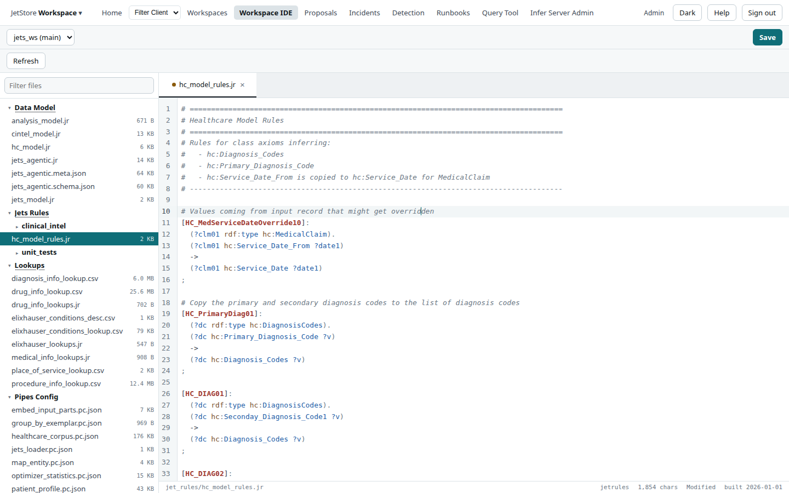
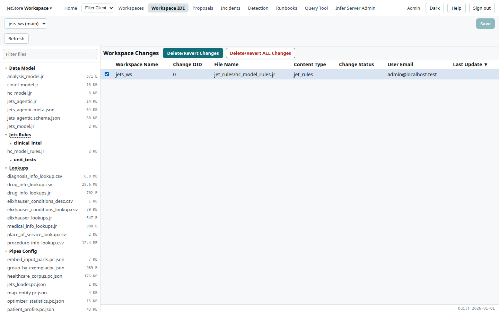
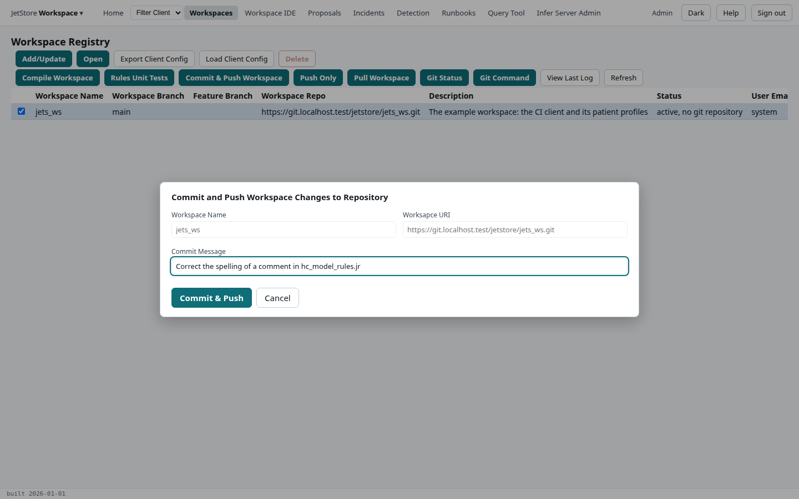

**Before you start**: your account has `workspace_ide`, and the workspace is the installation's
active one. [Workspaces](/docs/user/concepts/workspaces/) explains why a saved file is an override, why
it must be compiled, and why it must reach git.

## Edit and save a file

1. Open the **Workspace IDE**, and open the file from the tree on the left: here
   `jet_rules/hc_model_rules.jr`, under **Jets Rules**. **Filter files** finds a file by name.
2. Make the change. The file's tab shows a dot and the status bar says **Modified** until you save.

   

3. Press **Save**. Some kinds of file, such as user flows and SQL scripts, are checked as they are
   saved, and one that cannot be read is refused with the reason.
4. Close the file's tab. With no file open, the IDE lists the **Workspace Changes**: every file saved on
   this installation and not yet committed.

   

## Compile

1. Open **Workspaces**, tick the workspace, and press **Compile Workspace**.
2. Press **Refresh** until its status shows the compile has finished. If it failed, **View Last Log**
   says why.

A change to rules, lookups, the data model or a pipeline definition takes effect only once the
workspace is compiled. To check a rule change before relying on it, run its tests:
[Run rules unit tests](/docs/user/how-to/run-rules-unit-tests/).

## Commit and push

1. On **Workspaces**, tick the workspace and press **Commit & Push Workspace**.
2. Write a commit message that says what changed and why, and press **Commit & Push**.

   

The changes go to the workspace's git repository, on its branch, and leave the list of workspace
changes; the next images of the installation carry them. Committing uses your git profile (**Admin**
in the top bar, then the *Git Profile* screen), so set it first. **Push Only** pushes commits already
made.

## Pull changes made elsewhere

1. On **Workspaces**, tick the workspace and press **Pull Workspace**.
2. Follow the *Pull Workspace Changes* flow: choose whether to also load client configurations, and
   confirm.

A pull brings in commits made in the repository since the installation's copy was taken, then
compile as above.

## Revert a change

1. In the **Workspace IDE**, with no file open, tick the change in **Workspace Changes**.
2. Press **Delete/Revert Changes** and confirm with **OK**. The file returns to the version the
   installation was deployed with, or last pulled. **Delete/Revert ALL Changes** reverts every file.
   If the installation has no original copy of the file (a file added since it started), the revert
   is refused with a message and the change stays listed.
3. Compile, if the file was one the compile reads.

**How to tell it worked**: after a commit or a revert, **Workspace Changes** no longer lists the file;
after a compile or a pull, the workspace's status on **Workspaces** no longer shows an error.

The screens are described on [Workspace IDE](/docs/user/screens/workspace-ide/),
[Workspaces](/docs/user/screens/workspaces/) and
[Pull Workspace Changes](/docs/user/screens/flows/pull-workspace-changes/).
