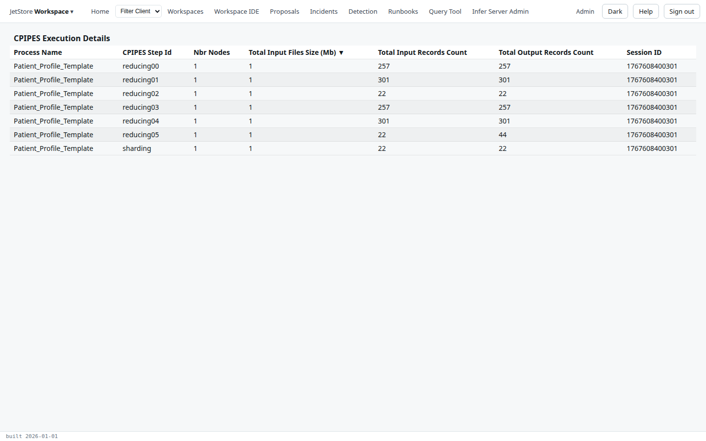

*CPIPES Execution Details* shows the size of one run, step by step: how many nodes each step ran on,
and how many records went in and came out, added up over the nodes. Compute pipes, *CPIPES*, is the
part of JetStore that runs pipelines. Open it to see where a run's records grow or shrink, or
which step is the large one.

**Capability:** `jetstore_read`.

**Reached from** Home's *Pipelines Status* tab: select a run, then *View Execution Stats*. The
screen's address carries the run's session id, `executionStatsDetails/<session id>`. Your browser's
*Back* returns to Home.

The rows are sorted by input size, the largest first. The table has no buttons.

| Column | What it holds |
|---|---|
| Process Name | the process run |
| CPIPES Step Id | the step: `sharding`, `reducing00`, `reducing01`… |
| Nbr Nodes | how many nodes ran the step |
| Total Input Files Size (Mb) | the size of the files the step read, in megabytes, over all nodes |
| Total Input Records Count | the records it read |
| Total Output Records Count | the records it wrote |
| Session ID | the run's session |

In the image, the last step reads each of the 22 members once and writes two records for each, a
patient profile and a briefing, so its output is twice its input.

The totals are written when the run ends, so a run that is still going shows no rows yet; for
it, and for each shard of each step, with errors, see
[Pipeline Execution Details](/docs/user/screens/pipeline-execution-details/).
