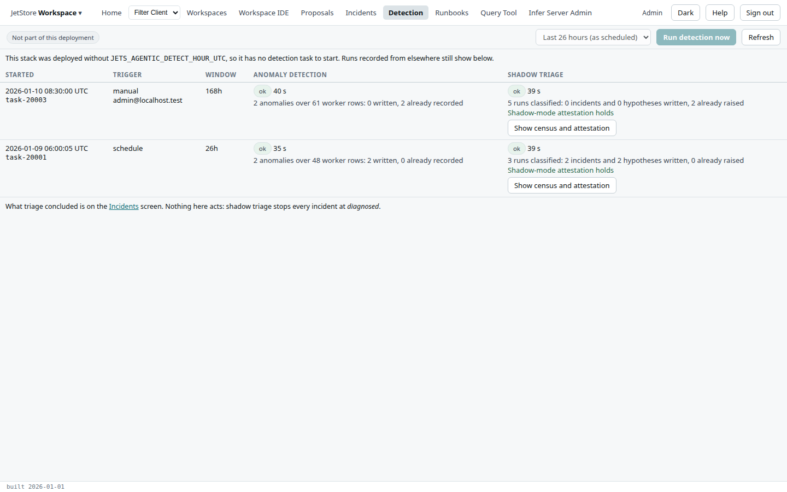
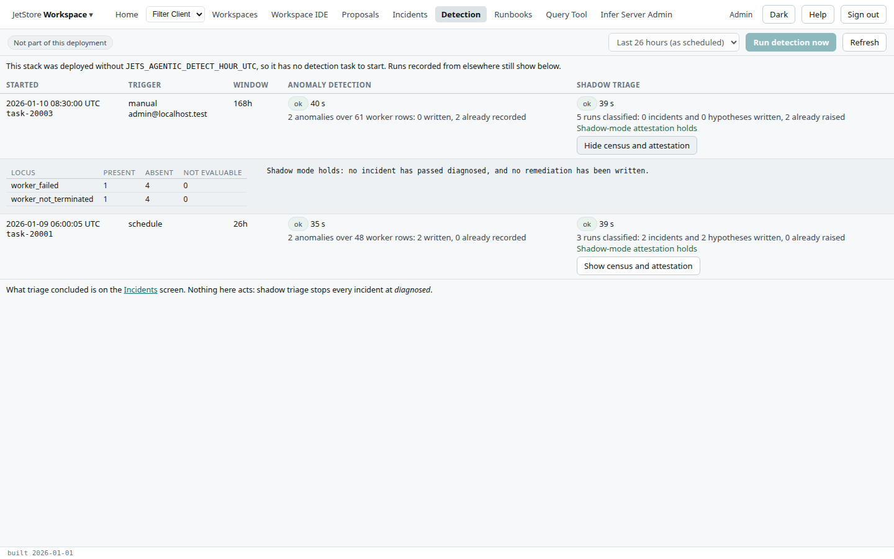

JetStore's **detection task** runs two commands over recent pipeline runs: **anomaly detection**,
which compares each run with its history and records what deviates, then **shadow triage**, which
classifies the runs and raises [incidents](/docs/user/screens/incidents/) with ranked hypotheses.
An installation runs it daily at a scheduled hour. The *Detection* screen shows whether it ran, when,
on whose request and with what result, and can start it now.

**Reach it** from *Detection* in the top bar. It needs the `agent_supervision` capability.

## The bar

| Control | What it does |
|---|---|
| **Schedule** | *Scheduled daily at HH:00 UTC*, or *Not part of this deployment* when the installation has no detection task. |
| **Window** | How far back a manual run looks: the last 26 hours (as scheduled), 7, 30 or 90 days. |
| **Run detection now** | Starts the deployed detection task, the same one the daily schedule runs, so a manual run also shows the scheduled one works. Disabled when the installation has no task, or while a run is in flight. |
| **Refresh** | Reads the list again. While a run is in flight, the list is read again on its own. |

The task takes a minute or two to start. A task that stopped before it could record anything, an image
that would not pull or a container stopped for memory, is shown with what AWS reports about it.

## The table

One row per task, newest first.

| Column | What it shows |
|---|---|
| **Started** | When the task was requested or started, and its reference. |
| **Trigger** | *schedule*, *manual* with who asked, or *command* for a run started outside JetStore. |
| **Window** | How far back it looked. |
| **Anomaly detection** | Its status (*requested*, *running*, *ok*, *failed*), how long it took, and how many anomalies it found over how many worker rows, how many it wrote and how many were already recorded. |
| **Shadow triage** | Its status and duration, how many runs it classified, the incidents and hypotheses it wrote, and how many incidents were already raised; and whether the shadow-mode attestation holds. |

**Show census and attestation** opens, under the row, the census of each locus over the runs
classified (*present*, *absent*, *not evaluable*) and the text of the attestation:

**Nothing on this screen acts on an incident.** Shadow triage stops every incident at *diagnosed*;
what it concluded is on the [Incidents](/docs/user/screens/incidents/) screen.
