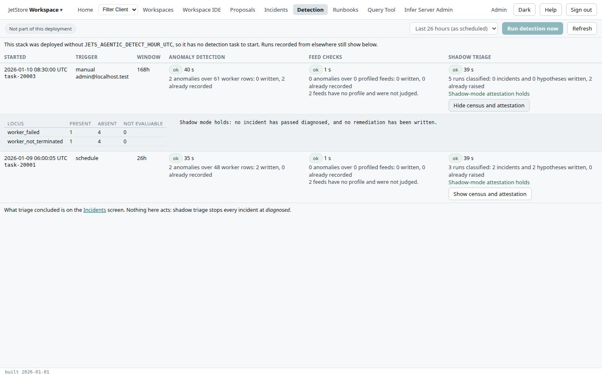

JetStore's **detection task** runs three commands: **anomaly detection**, which compares each
recent pipeline run with its history and records what deviates, then the **feed checks**, which
judge each feed's recent deliveries against its [feed profile](/docs/user/how-to/declare-a-feed-profile/),
then **shadow triage**, which classifies the runs and the deliveries with a finding and raises
[incidents](/docs/user/screens/incidents/) with ranked hypotheses.
An installation runs it daily at a scheduled hour. The *Detection* screen shows whether it ran, when,
on whose request and with what result, and can start it now.

**Reach it** from *Detection* in the top bar. It needs the `agent_supervision` capability.

## The bar

| Control | What it does |
|---|---|
| **Schedule** | *Scheduled daily at HH:00 UTC*, or *Not part of this deployment* when the installation has no detection task. |
| **Window** | How far back a manual run looks: the last 26 hours (as scheduled), 7, 30 or 90 days. |
| **Run detection now** | Starts the deployed detection task, the same one the daily schedule runs, so a manual run also shows the scheduled one works. Disabled when the installation has no task, or while a run is in flight. |
| **Refresh** | Reads the list again. While a run is in flight, the list is read again on its own. |

The task takes a minute or two to start. A task that stopped before it could record anything, an image
that would not pull or a container stopped for memory, is shown with what AWS reports about it.

## The table

One row per task, newest first.

| Column | What it shows |
|---|---|
| **Started** | When the task was requested or started, and its reference. |
| **Trigger** | *schedule*, *manual* with who asked, or *command* for a run started outside JetStore. |
| **Window** | How far back it looked. |
| **Anomaly detection** | Its status (*requested*, *running*, *ok*, *failed*), how long it took, and how many anomalies it found over how many worker rows, how many it wrote and how many were already recorded. |
| **Feed checks** | Its status and duration, how many anomalies the feed checks found over how many profiled feeds, how many they wrote and how many were already recorded; how many feeds have no profile and were not judged; and any feed that could not be checked, with the database's error code. A task that ran before the feed checks were part of it shows *not recorded*. |
| **Shadow triage** | Its status and duration, how many runs it classified, the incidents and hypotheses it wrote, and how many incidents were already raised; and whether the shadow-mode attestation holds. |

**Show census and attestation** opens, under the row, the census of each locus over the runs
classified (*present*, *absent*, *not evaluable*) and the text of the attestation:

## What anomaly detection looks for

Anomaly detection runs two detectors over the workers of the runs in its window.

- **Volume collapse**: a worker that completed but wrote materially fewer rows than its step usually
  writes for what it reads. Shadow triage applies the same rule for the locus *Rows lost silently*.
- **Step regression**: a step that failed after succeeding on earlier runs of the same source.

**Volume collapse judges each step against its own history.** A worker's ratio is its output count
divided by its input count. The detector compares that ratio with the median ratio of the same step,
for the same client and process, over the step's last 10 runs before this one. It records an anomaly
when the ratio is less than half of that median. A step that reduces its input, for example to the
claims that qualify for a review, writes a small share of what it reads on every run. That share is
normal for the step, so it raises nothing. The same step writing a much smaller share than usual
does raise an anomaly, and so does a step that usually writes more than it reads but suddenly writes
less.

**A step with too little history is judged against a fixed floor.** A step needs 3 earlier runs before
its own history is used. With fewer, the detector records an anomaly when the worker wrote less than
half of what it read. These earlier runs count only if every worker of the step completed and the run
read at least 1,000 rows. Workers that read fewer than 1,000 rows are not judged at all.

**Each anomaly says which comparison it made.** Its basis begins *against the step's own history*,
with the median and the runs it came from, or *against the absolute floor*, with the reason.
The reason says either that the step's history is short or that earlier runs of the process were
archived when their sessions were deleted. A deleted session keeps its run in the pipeline history but
loses its worker counts, so a step whose history was deleted looks new. Such an anomaly carries the
confounder *history truncated*.

**The numbers are starting points, not measured values.** The 10 runs, the 3 runs, the halving and the
floor are the detection command's defaults: `-volume-history-runs`, `-volume-min-prior-runs`,
`-volume-drop`, `-min-ratio` and `-min-input`. Nothing has yet measured how much a step's ratio varies
from run to run. The detector that judges by history is *volume_collapse@2*. Earlier anomalies, judged
against the floor alone, are *volume_collapse@1*. The first run of the new detector judges every worker
in its window again, even those the earlier one already judged.

**Nothing on this screen acts on an incident.** Shadow triage stops every incident at *diagnosed*;
what it concluded is on the [Incidents](/docs/user/screens/incidents/) screen.
