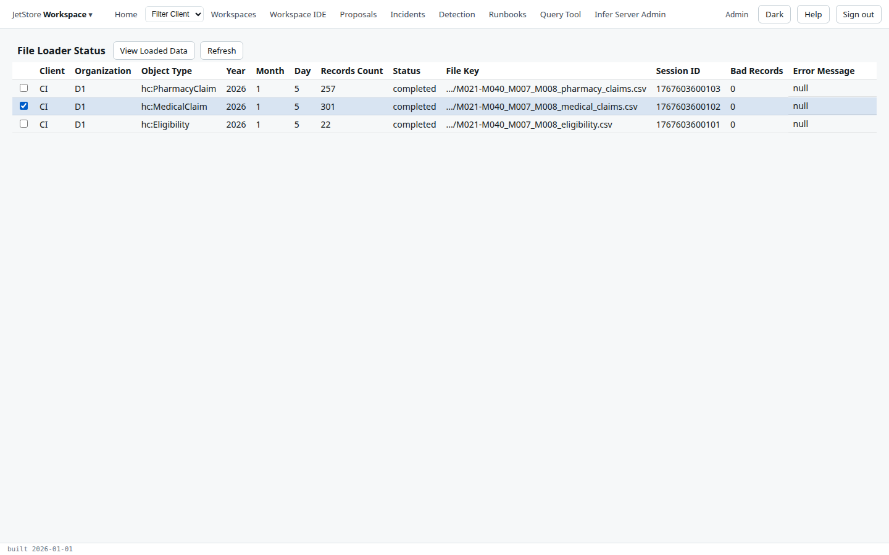

*File Loader Status* lists every file that was loaded into a staging table, the latest first: how
many records loaded, how many were bad, and the error if the load failed. A file is loaded with the
[Load Files](/docs/user/screens/flows/load-files/) flow, to look at what a vendor sent before or
apart from mapping it; see
[Loading a file to look at it](/docs/user/concepts/files-and-the-input-registry/#loading-a-file-to-look-at-it).
Loading is not what a pipeline does with a file: a mapping pipeline reads the file itself, and its
progress is on Home.

**Capability:** `jetstore_read`.

**Reached from** the *Source Mapping* flow (*JetStore Workspace* menu, *Source Mapping*), with its
*Loader Status* button. Your browser's *Back* returns to the flow.

| Column | What it holds |
|---|---|
| Client, Organization | whose file it is, and who sent it |
| Object Type | the file's object type, such as `hc:MedicalClaim` |
| Year, Month, Day | the file's source period |
| Records Count | the records loaded into the staging table |
| Status | `submitted` while the load runs, then the status it ended with, such as `completed` or `failed` |
| File Key | the file key, shortened to its file name; click to copy it whole |
| Session ID | the session the load wrote its rows under |
| Bad Records | the records that could not be read |
| Error Message | why the load failed, if it did |
| User | who loaded the file |
| Loaded At | when; the table sorts on it |

| Button | What it does |
|---|---|
| **View Loaded Data** | Opens the selected load's rows in [Staging Table or Domain Table View](/docs/user/screens/table-view/): the staging table, at the load's session. |
| **Refresh** | Reads the table again. Press it to see a load you just started move from `submitted` to `completed`. |

When the counts are not what you expected, look at the file itself with
[Input File Preview](/docs/user/screens/input-file-preview/), and at its source configuration in the
*Source Configuration* flow.
