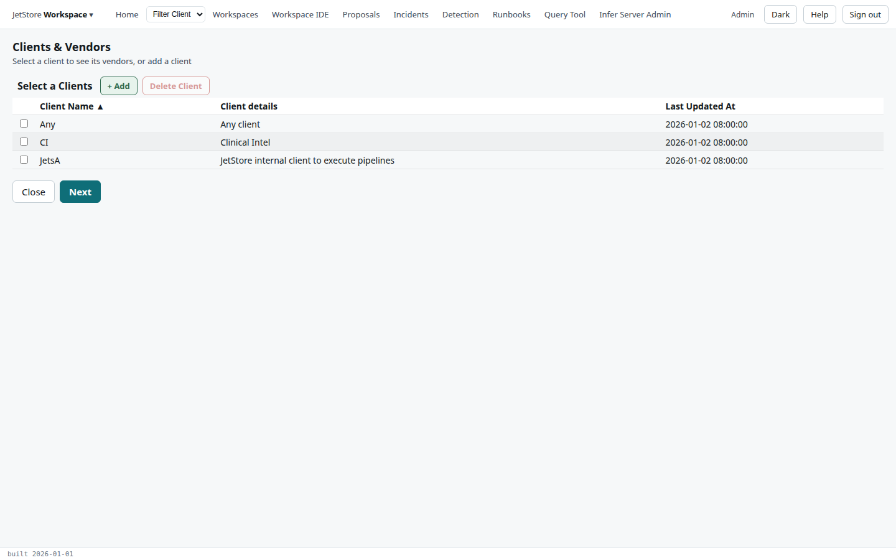
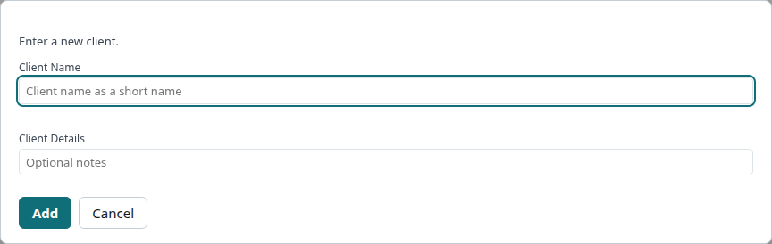
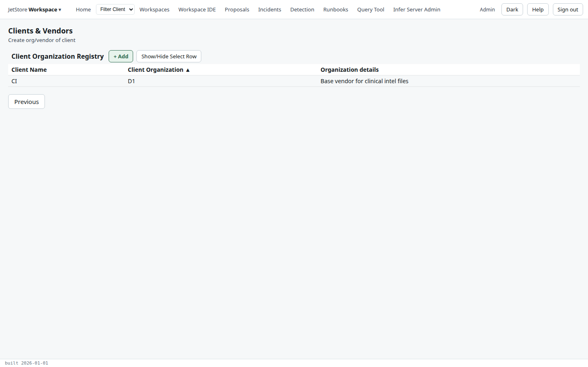
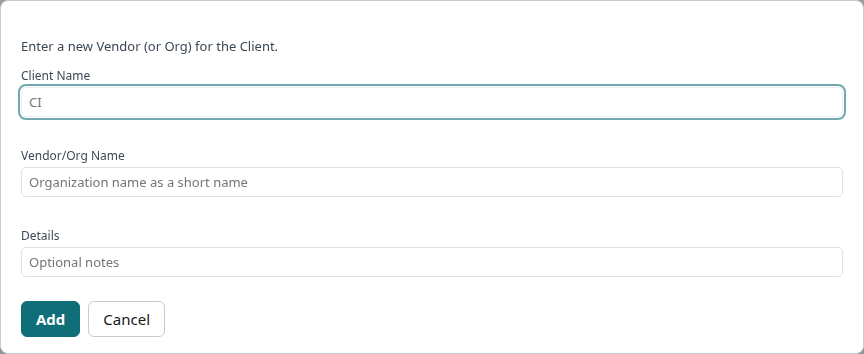

The *Clients & Vendors* flow maintains the **clients**, whose data an installation holds, and for each
client its **vendors**, also called organisations, which send the client's files. Why the two are kept
apart is explained in [Clients, organisations and object types](/docs/user/concepts/clients-and-object-types/).

**Reach it** from the *JetStore Workspace* menu at the left of the top bar, *Clients & Vendors*.
Reading needs `jetstore_read`; adding and deleting need `client_config`.

## Step 1: select a client

| Column | What it shows |
|---|---|
| **Client Name** | The client's short name, such as `CI`. |
| **Client details** | A description. |
| **Last Updated At** | When the client was added or last changed. |

`Any` and `JetsA` are JetStore's own: they are the clients of its built-in pipeline configurations,
`Jets_Loader` and `Embed_Input_Parts`.

| Button | What it does |
|---|---|
| **+ Add** | Opens the *Add Client* dialog. |
| **Delete Client** | Deletes the selected client, after a confirmation. |
| **Close** | Leaves the flow. |
| **Next** | Goes to the selected client's vendors. A client must be selected. |

| Field | Rule |
|---|---|
| **Client Name** | Required. A short name, up to 20 characters; it becomes part of the file keys and staging table names. |
| **Client Details** | Optional notes, up to 80 characters. |

**Add** creates the client, which then appears in the list.

## Step 2: the client's vendors

| Column | What it shows |
|---|---|
| **Client Name** | The client. |
| **Client Organization** | The vendor's short name, such as `D1`. |
| **Organization details** | A description. |

| Button | What it does |
|---|---|
| **+ Add** | Opens the dialog that adds a vendor to the client. |
| **Show/Hide Select Row** | Shows or hides the column of tick boxes. |
| **Delete Organization** | Deletes the selected vendor, after a confirmation. |
| **Previous** | Back to the client list. |

| Field | Rule |
|---|---|
| **Client Name** | The client, read-only. |
| **Vendor/Org Name** | Required. A short name, up to 20 characters. |
| **Details** | Optional notes, up to 80 characters. |
