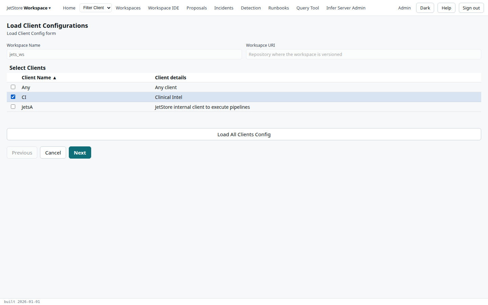

*Load Client Configurations* loads the configuration a workspace holds for its clients, their
vendors, source configurations, mappings and pipeline configurations, into the installation's
database, where the screens and the pipelines read it. Use it after a client's configuration has
changed in the workspace, for example after pulling a colleague's changes. See
[The workspace and a client's configuration](/docs/user/concepts/workspaces/#the-workspace-and-a-clients-configuration).

**Loading replaces what the database holds for the chosen clients with what the workspace holds.** A
change made since in the configuration flows, and not exported to the workspace, is lost.

**Capability:** `workspace_ide`.

**Opened from** the *Workspaces* screen: select a workspace, then *Load Client Config*. The button
is disabled while the workspace is being compiled. The flow returns to *Workspaces* when it ends.
Its key is `loadConfigUF`.

## Steps

### 1. Load Client Config form

| Field | What it shows |
|---|---|
| **Workspace Name** | the workspace chosen on *Workspaces*, read-only |
| **Workspace URI** | the repository it is versioned in, read-only |
| **Select Clients** | the clients the installation knows, *Client Name* and *Client details*. Tick the clients to load, as many as you like; at least one is required |

**Load All Clients Config**, below the table, loads the workspace's whole configuration, its base
configuration and every client's, at once, without going to step 2.

### 2. Confirm Load Config

The workspace again, and the table *Clients Selected*. **Confirm** loads the configuration of the
clients ticked in step 1 and returns to *Workspaces*.

In this version the *Clients Selected* table lists every client, with none ticked, rather than the
clients you chose; what is loaded is still the clients ticked in step 1. Use *Previous* to check
them.

## The result

The load runs on the installation. Its output is added to the workspace's last log: on *Workspaces*,
select the workspace and press *View Last Log*. The workspace's status shows `error` if the load
failed.
