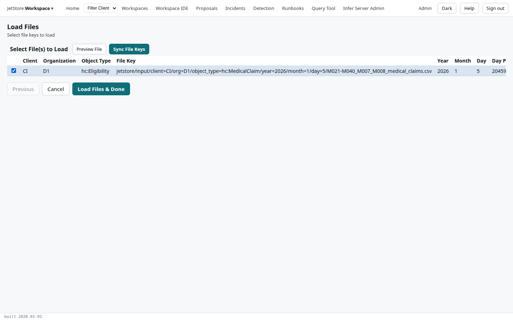

*Load Files* loads one or more files of a source into the source's **staging table**, a table with a
column for each column of the file, so their rows can be looked at and queried. It is the first
thing to do with a new vendor's file: it shows whether the columns are the ones the mapping
expects. Loading does not run a pipeline, and a pipeline does not need it: see
[Loading a file to look at it](/docs/user/concepts/files-and-the-input-registry/#loading-a-file-to-look-at-it).

**Capability:** `run_pipelines`, to load, to sync the file keys and to drop a staging table;
`jetstore_read` to read the lists.

**Opened from** the *Source Mapping* flow (*JetStore Workspace* menu): select a data source, then
*Load Data*. The flow opens at its second step, for that source, and returns to *Source Mapping* when
it ends. Its key is `loadFilesUF`.

## Steps

### 1. Select a file data source configuration

The installation's source configurations, one per client, organisation and object type, with the
*Staging Table Name* each loads into, its *File Format* and when it last changed. Tick one; it is
required.

| Button | What it does | Capability |
|---|---|---|
| **Drop Staging Table** | Drops the selected source's staging table, and every row loaded into it. The next load creates it again from the file's header. Without a drop, a load adds a column for any header the table lacks, and keeps the others. | `run_pipelines` |

**Opened from *Source Mapping*, the flow starts at step 2 with this choice made**, and *Previous* is
disabled there, so this step and *Drop Staging Table* are not reached in this version.

### 2. Select file keys to load

The files registered for the source, the latest first. Tick the files to load, as many as you like;
at least one is required.

| Column | What it holds |
|---|---|
| Client, Organization | the source's client and organisation |
| Object Type | the domain key the file is registered under: `hc:Eligibility` for each of `CI`'s files, claims included |
| File Key | the file's full key in the bucket |
| Year, Month, Day | its source period |
| Day Period | the source period as a number of days |
| Table Name | the staging table it loads into |
| Session ID | the session of the file's delivery |
| Last Update | when the file was registered |

| Button | What it does | Capability |
|---|---|---|
| **Preview File** | Opens the selected file in [Input File Preview](/docs/user/screens/input-file-preview/), to see its first lines as they arrived. | `jetstore_read` |
| **Sync File Keys** | Reads the installation's bucket, registers the files that are there and not yet registered, and lists them here. It starts no pipeline. Use it when files reached the bucket without being registered. | `run_pipelines` |
| **Load Files & Done** | Starts a load for each ticked file, and returns to *Source Mapping*. | `run_pipelines` |

Each load runs on the installation, apart from the screen. Follow it on
[File Loader Status](/docs/user/screens/file-loader-status/), from *Source Mapping*'s *Loader
Status*: it shows `submitted`, then `completed` with its record counts, or `failed` with its error.
*View Loaded Data* there opens the loaded rows.
