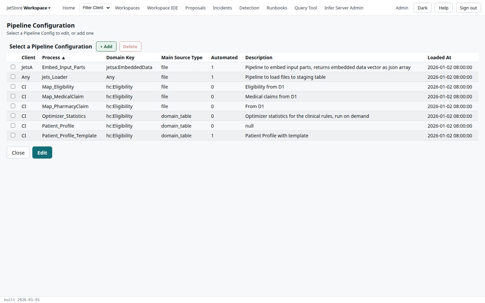
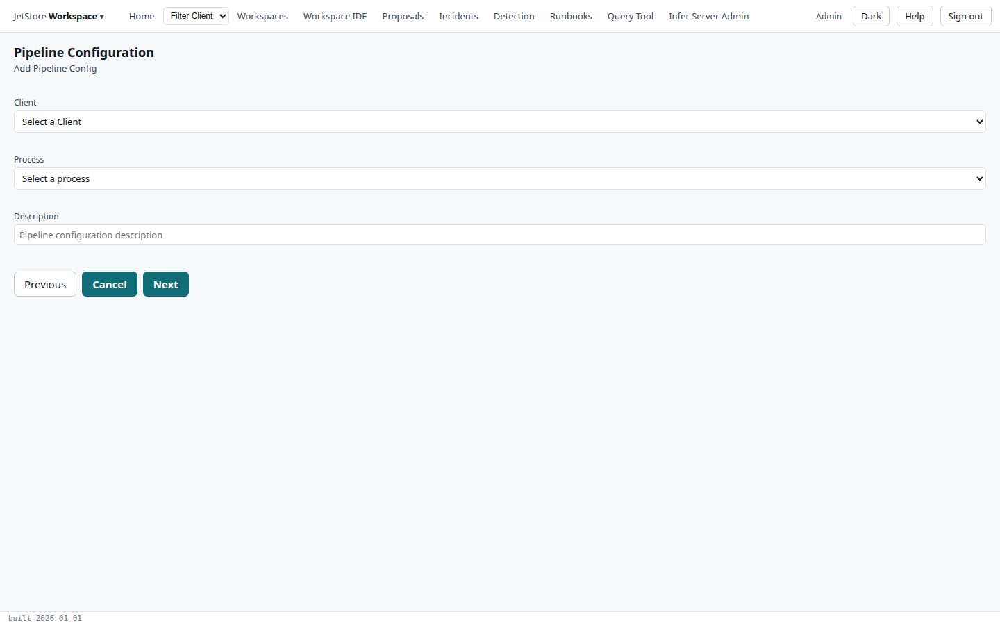
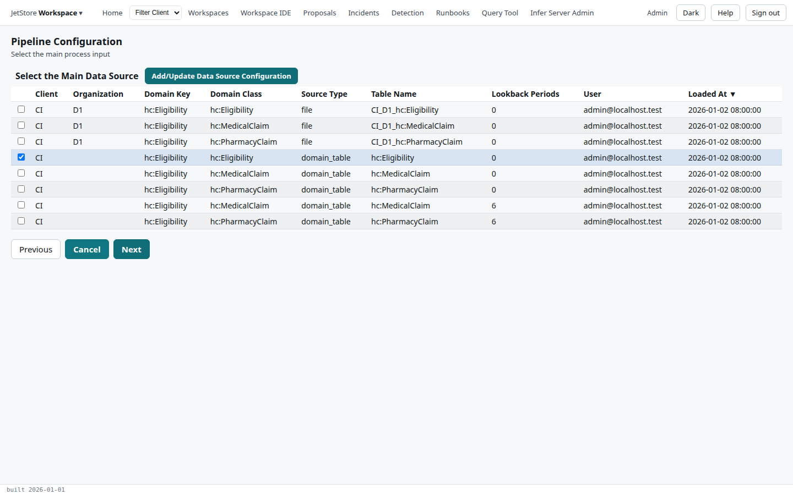
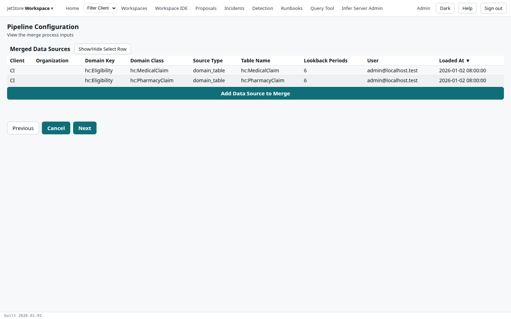
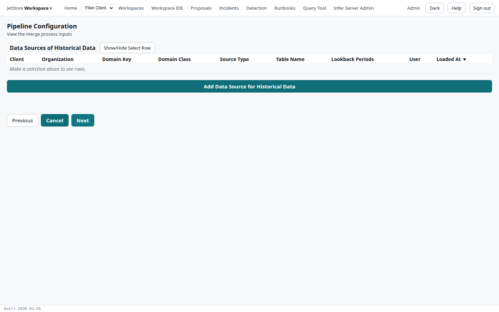
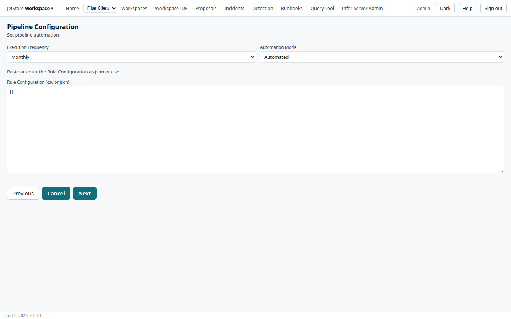
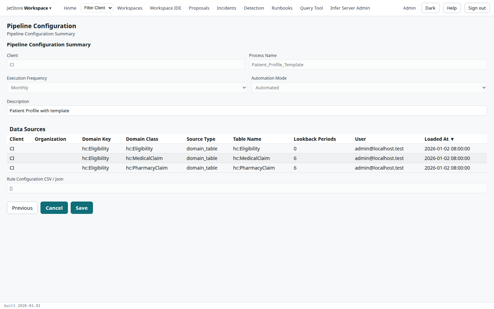

A **pipeline configuration** says, for one client and one process, which data sources a run reads,
how often it runs, whether it starts on its own when its files arrive, and the rule configuration it
adds. The *Pipeline Configuration* flow lists them and walks through adding or editing one, page by
page, to a summary that saves it. How a pipeline configuration and a run relate is explained in
[Pipelines and sessions](/docs/user/concepts/pipelines-and-sessions/).

**Reach it** from the *JetStore Workspace* menu at the left of the top bar, *Pipeline Configuration*.
Reading needs `jetstore_read`; saving and deleting, a data source included, need `client_config`.

## The list

| Column | What it shows |
|---|---|
| **Client** | The client, or `Any` for JetStore's own. |
| **Process** | The process the pipeline runs. |
| **Domain Key** | The domain key its rule sessions are grouped by. |
| **Main Source Type** | The type of its main data source. |
| **Automated** | `1` if it starts on its own when its files arrive. |
| **Description** | Free text. |
| **Loaded At** | When it was last saved. |

| Button | What it does |
|---|---|
| **+ Add** | Starts a new pipeline configuration, on the add page. |
| **Delete** | Deletes the selected pipeline configuration, after a confirmation. |
| **Close** | Leaves the flow. |
| **Edit** | Edits the selected pipeline configuration, from the main data source. |

Every page after this one has **Previous**, **Cancel**, which abandons the add or the edit and returns
to this list, and **Next**.

## Adding: client and process

**Client** and **Process** are required; **Description** is optional.

## The main data source

Tick the **main data source**: the input a run is started on, and whose records each rule session is
built around. The table lists the client's data sources:

| Column | What it shows |
|---|---|
| **Client**, **Organization** | Whose data it is. |
| **Domain Key** | The key its records are grouped by. |
| **Domain Class** | The class its records belong to. |
| **Source Type** | `file` for a staging table loaded from files, `domain_table` for a table a pipeline wrote. |
| **Table Name** | The table it is read from. |
| **Lookback Periods** | How many earlier periods are read with the current one. |
| **User**, **Loaded At** | Who saved it, and when. |

**Add/Update Data Source Configuration** opens the *New Process Input* dialog, which adds a data
source, or updates the selected one: choose a table from those registered for the client, and give
its **Lookback Periods**, the number of periods to include in the rule session. **Save** saves it.

## Merged data sources and historical data

Two pages of the same shape:

- **Merged Data Sources**: other sources whose records join the main source's in each rule session,
  matched on the domain key.
- **Data sources for historical data**: sources whose records are read as history.

On each, **Add Data Source to Merge** (or **Add Data Source for Historical Data**) opens a page that
lists the client's data sources; tick one and press **Next** to add it. **Show/Hide Select Row**
shows the tick boxes, and **Remove** takes the selected source out of the set.

## Automation and rule configuration

| Field | Rule |
|---|---|
| **Execution Frequency** | Required: *Monthly*, *Weekly* or *Daily*, the period a run's source period covers. |
| **Automation Mode** | Required: *Automated* starts a run when the pipeline's files have arrived; *Manual* leaves it to a person. |
| **Rule Configuration (csv or json)** | Required: the objects added to every rule session of this pipeline, as on the [Rules Configuration](/docs/user/screens/rules-configuration/) screen. `[]` when there are none. |

## The summary

The summary shows the **Client**, the **Process Name**, the frequency and the mode, the
**Description**, which can still be changed, the **Data Sources** (the main, merged and historical
ones), and the rule configuration. **Save** saves the pipeline configuration and returns to the list.
