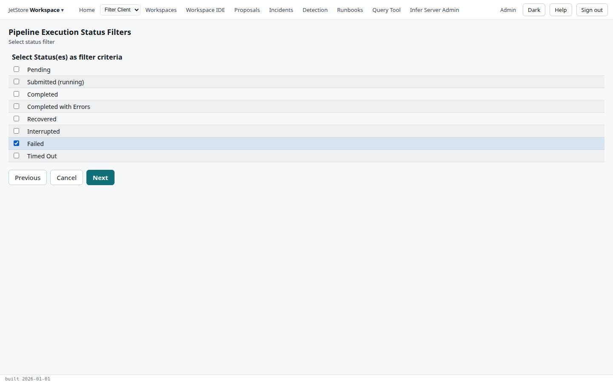
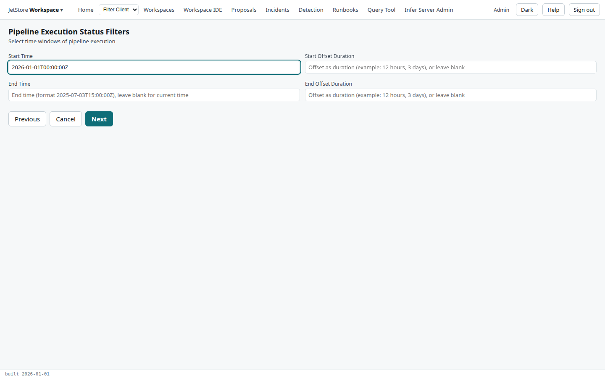
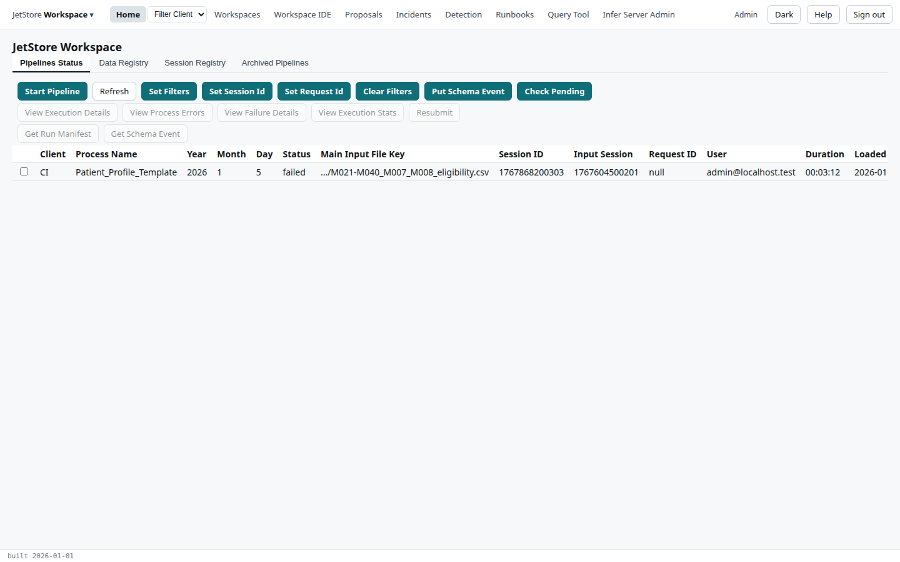

*Pipeline Execution Status Filters* narrows Home's list of runs: to some processes, some statuses,
the runs whose input file key matches, or the runs that started in a time window. Each step sets one
filter, and a step left empty sets none. The last step shows the runs the filters select, before you
keep them.

**Capability:** none beyond `jetstore_read`, to read the tables. Filters change no data.

**Opened from** Home: *Set Filters* on the *Pipelines Status* or *Archived Pipelines* tab. It
returns there when it ends. Its key is `homeFiltersUF`.

The filters are kept in the browser tab, for as long as you are signed in: they are not saved for
your account. Opening the flow again shows the values you last saved, so you can change one filter
and keep the others. *Clear Filters* on Home removes them all.

## Steps

### 1. Select process filter

A table of the installation's processes, *Process Name* and *Description*. Tick the processes whose
runs to show, as many as you like. Tick none to show every process.

### 2. Select status filter

The statuses to show, as many as you like; tick none to show every status. The list is every status
a run can have, as described in
[What a run's status means](/docs/user/concepts/pipelines-and-sessions/#what-a-runs-status-means):

| Label | Status |
|---|---|
| **Pending** | `pending` |
| **Submitted (running)** | `submitted` |
| **Completed** | `completed` |
| **Completed with Errors** | `errors` |
| **Recovered** | `recovered` |
| **Interrupted** | `interrupted` |
| **Failed** | `failed` |
| **Timed Out** | `timed_out` |

### 3. Select file key filter

| Field | What it does |
|---|---|
| **Select the File Key filter type** | How the file key is matched: **None**, for no file key filter, **Equals Value**, **Starts With**, **Ends With** or **Contains**. One must be chosen. |
| **File Key Extract** | The text to match against the run's main input file key, such as `pharmacy_claims` with *Contains*. Required for every type but *None*. |

### 4. Select time window

The window in which the runs started. Leave all four blank for no window.

| Field | What it does |
|---|---|
| **Start Time** | The window's start, as a date and time in UTC: `2025-07-03T15:00:00Z`. Blank means now, when an offset is given. |
| **Start Offset Duration** | Moves the start back by a duration: `12 hours`, `3 days`. With *Start Time* blank, `3 days` means the last three days. |
| **End Time** | The window's end, in the same form. |
| **End Offset Duration** | Moves the end back by a duration. |

### 5. Pipeline Execution Status

The table of runs, as on Home's *Pipelines Status* tab and with its buttons, showing only the runs
the filters select. **Save & Done** keeps the filters and returns to Home; *Previous* goes back to
change one.

## What each filter reaches

| Filter | *Pipelines Status* and *Archived Pipelines* | *Data Registry* |
|---|---|---|
| Process | the run's process | |
| Status | the run's status | |
| File key | the run's main input file key | the entry's file key |
| Time window | when the run started | when the entry was registered |

*Set Session Id* and *Set Request Id* on Home replace these filters with their own.
