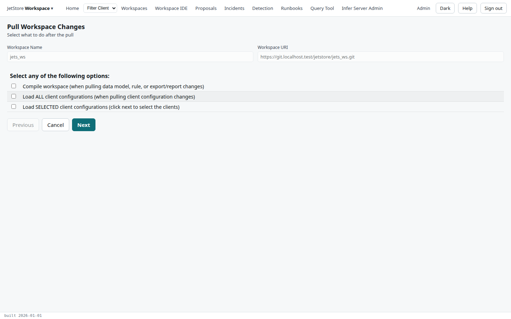
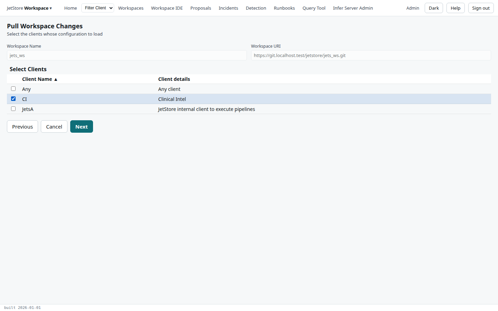
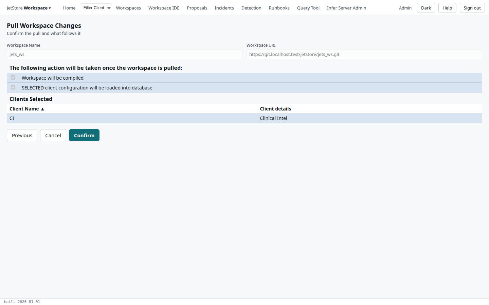

The *Pull Workspace Changes* flow brings the commits made elsewhere on the workspace's branch into the
installation's copy of the workspace, re-applies the overrides saved on the installation, and then,
if you ask, compiles the workspace and loads client configuration from it. Why a workspace is changed
in two places is explained in [Workspaces](/docs/user/concepts/workspaces/).

**Reach it** with **Pull Workspace** on the [Workspaces](/docs/user/screens/workspaces/) screen, with a
workspace selected. It needs `workspace_ide`. The pull uses the identity and token of your
[Git Profile](/docs/user/screens/git-profile/).

## Step 1: what to do after the pull

| Option | When to tick it |
|---|---|
| **Compile workspace** | The pull brings changes to the data model, the rules, the lookups or the reports. |
| **Load ALL client configurations** | The pull brings changes to clients' configuration files, and every client's should be loaded. |
| **Load SELECTED client configurations** | Only some clients' should be loaded; **Next** then asks which. |

Tick none to pull only. **Cancel** leaves the flow; **Next** goes on.

## Step 2: the clients

Shown only when *Load SELECTED client configurations* is ticked. Tick the clients whose configuration
files, `process_config/<client>_workspace_init_db.sql`, are loaded after the pull.

## Step 3: confirm

The page lists the actions that will follow the pull, and the clients. **Confirm** pulls: it merges the
workspace's branch into the installation's copy, re-applies the overrides held in the database, then
compiles and loads as chosen. Follow the compile's status on the Workspaces screen, and the result of
the pull with *View Last Log* there.

An installation without access to a git repository skips the pull itself and does the rest, which is
how an override saved there reaches the workspace's files.

## See also

- [Work on a workspace](/docs/user/how-to/work-on-a-workspace/)
