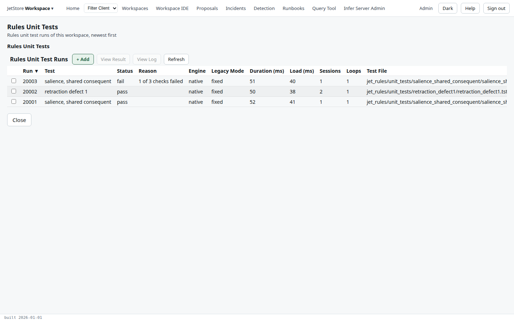
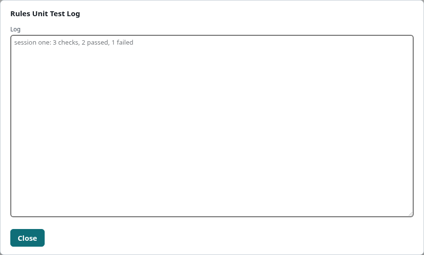
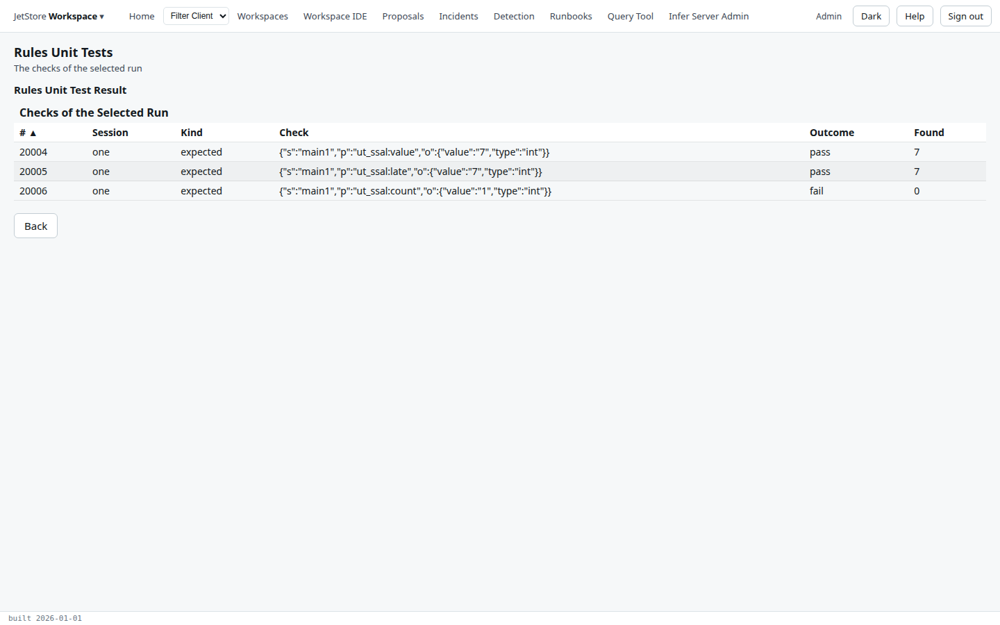
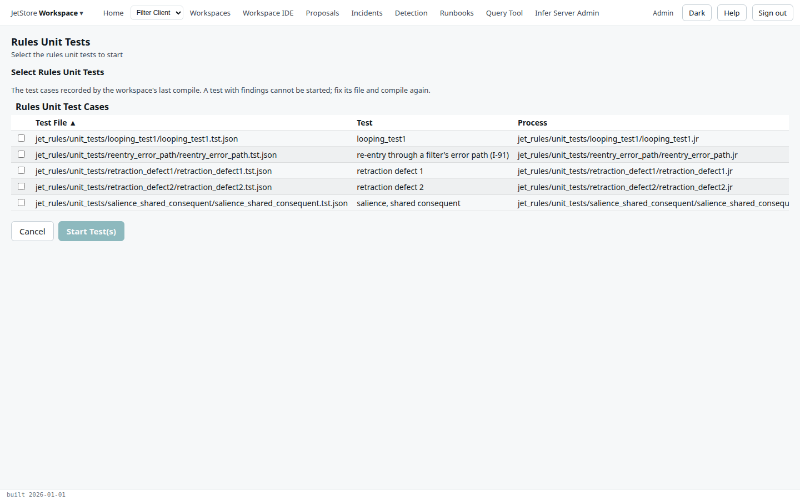

A **rules unit test** runs a rule file on a few small input sessions and checks the facts the rules
infer: that some are there, that some are not, that some are counted right. A workspace keeps its tests
under `jet_rules/unit_tests/`, as `.tst.json` files. The *Rules Unit Tests* flow lists the runs of a
workspace's tests, shows what one found, and starts tests. How a test is written is in
[Writing rules unit tests](/docs/developer/testing/rules-unit-tests/writing-tests/).

**Reach it** with **Rules Unit Tests** on the [Workspaces](/docs/user/screens/workspaces/) screen,
with a workspace selected. Reading needs `jetstore_read`; starting tests needs `workspace_ide`.

## The runs

| Column | What it shows |
|---|---|
| **Run** | The run's number. |
| **Test** | The test's name. |
| **Status** | `pass`, `fail` when a check failed, or `error` when the rules did not run to completion. |
| **Reason** | Why, when it is not `pass`. |
| **Engine**, **Legacy Mode** | The rule engine and the retraction behaviour the test ran with. |
| **Duration (ms)**, **Load (ms)** | How long the run took from start to result, and how much of it was building the rule engine. |
| **Sessions**, **Loops** | The input sessions run, and the rule loops, summed over the sessions. |
| **Test File** | The `.tst.json` file. |
| **User**, **Last Update** | Who started it, and when it was last updated. |

| Button | What it does |
|---|---|
| **+ Add** | Opens the page that selects the tests to start. |
| **View Result** | Shows the checks of the selected run. |
| **View Log** | Shows the selected run's log in a dialog. |
| **Refresh** | Reads the table again: a run started a moment ago appears, and its status changes, as it runs. |
| **Close** | Leaves the flow. |

## The checks of a run

| Column | What it shows |
|---|---|
| **#** | The check's number. |
| **Session** | The input session it belongs to. |
| **Kind** | `expected` (a fact must be there), `excluded` (it must not), or `count` (a count must hold). |
| **Check** | The check, as written in the test file. |
| **Outcome** | `pass` or `fail`. |
| **Found** | What the check saw: the value that matched, or the count. |

**Back** returns to the runs.

## Starting tests

The page lists the test cases the workspace's **last compile** recorded, with their **Test File**,
**Test** name, **Process** (the rule file they run), **Legacy Mode**, **Comment** and **Findings**. A
test with findings cannot be started: fix its file and compile again. A test added or changed since
the last compile is not here until the workspace is compiled.

Tick the tests and press **Start Test(s)**: one run is queued per test, and the flow returns to the
runs. **Cancel** returns without starting any.
