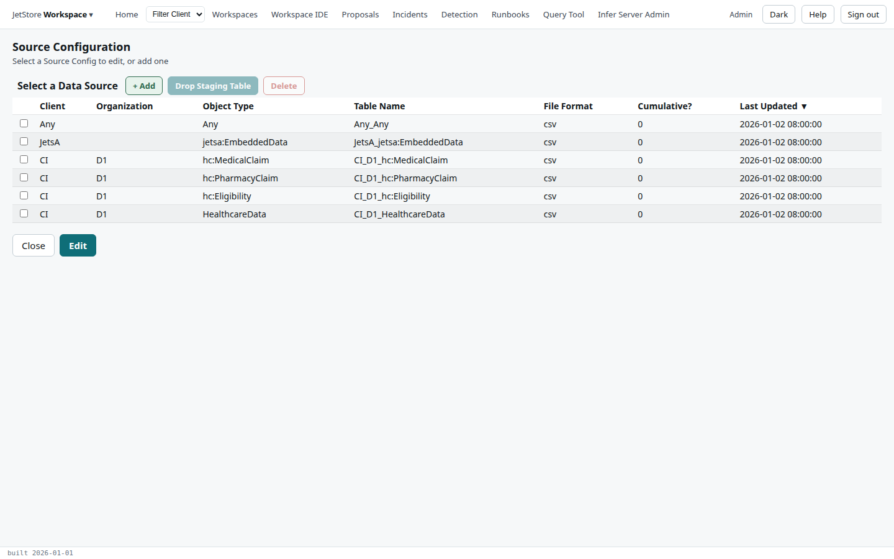
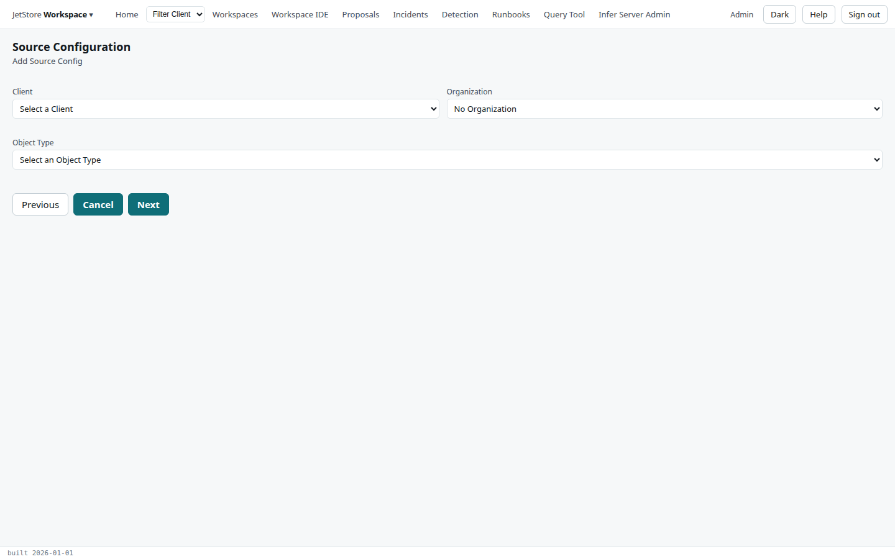
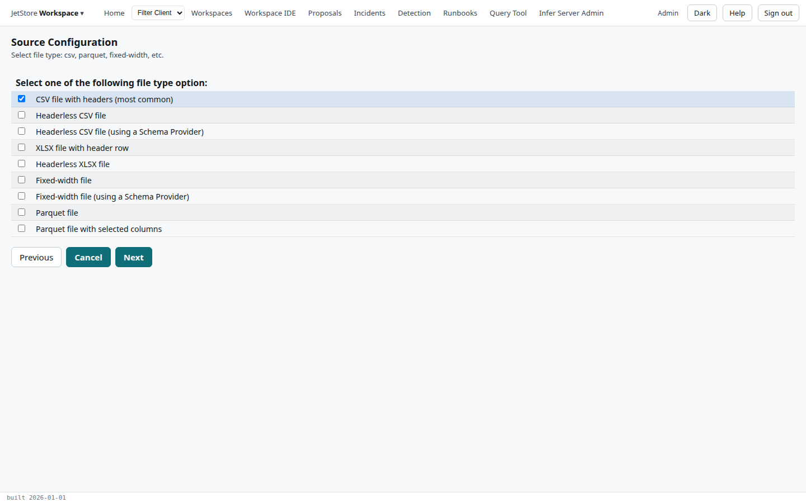
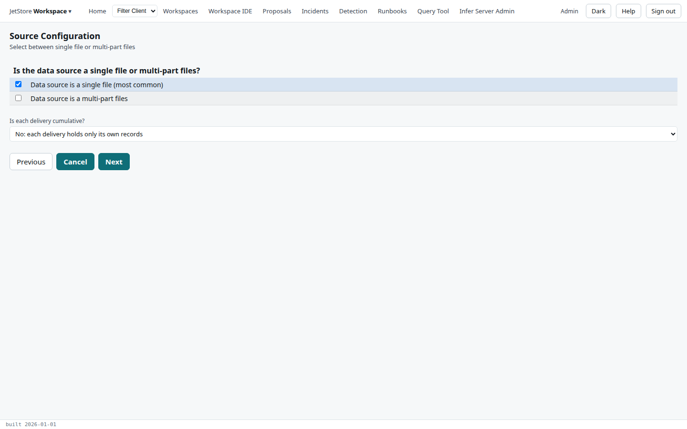
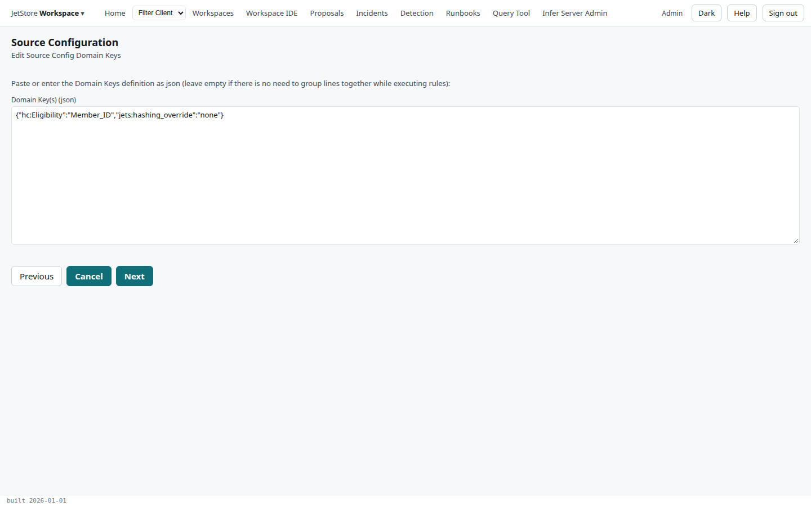
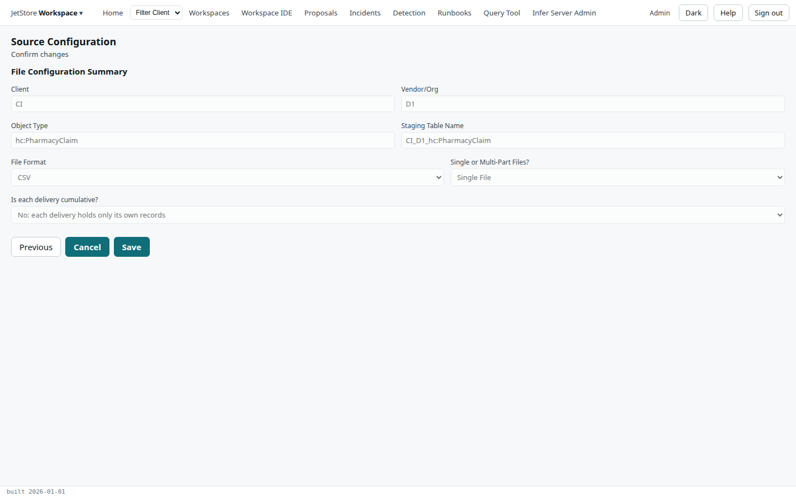

A **source configuration** tells JetStore how to read one kind of file from one client and vendor:
its object type, its format, whether it arrives in parts, its domain keys and its code value mapping.
The *Source Configuration* flow lists them and walks through adding or editing one, page by page,
to a summary that saves it. What each setting means is explained in
[Source configurations and domain keys](/docs/user/concepts/source-configurations/).

**Reach it** from the *JetStore Workspace* menu at the left of the top bar, *Source Configuration*.
Reading needs `jetstore_read`; saving and deleting need `client_config`, and dropping a staging table
needs `run_pipelines`.

## The list

| Column | What it shows |
|---|---|
| **Client**, **Organization** | Who sends the file. |
| **Object Type** | What the file holds, such as `hc:PharmacyClaim`. |
| **Table Name** | The staging table the file is loaded into: `<client>_<org>_<object type>`. |
| **File Format** | CSV, Parquet, fixed-width and the others below. |
| **Cumulative?** | Whether each delivery holds the whole feed. |
| **Last Updated** | When it was last saved. |

| Button | What it does |
|---|---|
| **+ Add** | Starts a new source configuration, on the add page. |
| **Drop Staging Table** | Drops the staging table of the selected source configuration. |
| **Delete** | Deletes the selected source configuration, after a confirmation. |
| **Close** | Leaves the flow. |
| **Edit** | Edits the selected source configuration, from the file format page. |

Every page after this one has **Previous**, **Cancel**, which abandons the add or the edit and returns
to this list, and **Next**.

## Adding: client, vendor and object type

| Field | Rule |
|---|---|
| **Client** | The client. |
| **Organization** | The vendor, or *No Organization*. |
| **Object Type** | Required. What the file holds. |

The staging table's name is made from the three. **Next** goes to the file format.

## The file format

Tick one format. It decides which page comes next:

| Format | Next page |
|---|---|
| **CSV file with headers (most common)** | single or multi-part |
| **Headerless CSV file** | the column names |
| **Headerless CSV file (using a Schema Provider)** | single or multi-part |
| **XLSX file with header row** | the sheet |
| **Headerless XLSX file** | the sheet, then the column names |
| **Fixed-width file** | the column layout |
| **Fixed-width file (using a Schema Provider)** | single or multi-part |
| **Parquet file** | single or multi-part |
| **Parquet file with selected columns** | the column names |

The pages a format needs:

| Page | Field |
|---|---|
| The sheet | **Sheet name or position containing the data**, required; the first sheet is at position 0. |
| The column names | **Input file column names (json)**: a JSON array of the columns, for a file with no header row, or the columns to read from a Parquet file. |
| The column layout | **Column names and positions (csv)**: each column's name and position, for a fixed-width file. |

## Single or multi-part

| Field | What it decides |
|---|---|
| **Data source is a single file (most common)** or **Data source is a multi-part files** | Whether one delivery is one file, or several parts read together. |
| **Is each delivery cumulative?** | *No*: each delivery holds only its own records. *Yes*: each holds the whole feed, so a lookback reads only the latest. |

## Domain keys, code values and schema provider

Three pages of text, each optional:

| Page | Field |
|---|---|
| Domain keys | **Domain Key(s) (json)**: the columns that make the key of a record, so the lines of one member are grouped in one rule session. Leave it empty when the lines need no grouping. |
| Code value mapping | **Code Values Mapping (csv or json)**: the client's own codes, mapped to canonical codes. |
| Schema provider | **Schema Provider JSON**: the schema of a file that carries none, for the formats that use one. |

## The summary

The summary shows the **Client**, **Vendor/Org**, **Object Type**, **Staging Table Name**, **File
Format**, single or multi-part, and whether deliveries are cumulative. **Save** saves the source
configuration, clearing the settings its format does not use, and returns to the list.
