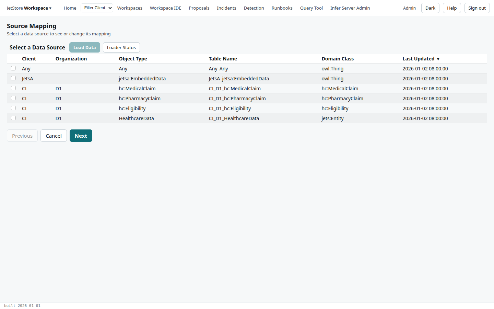
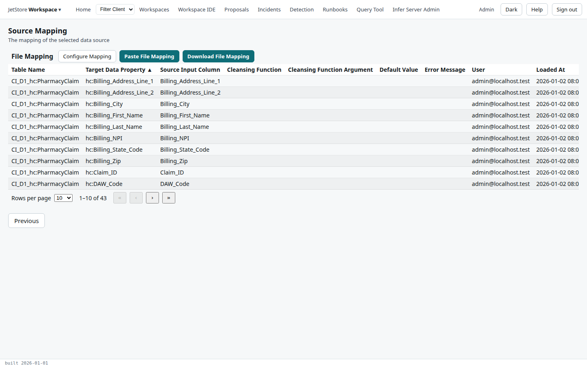
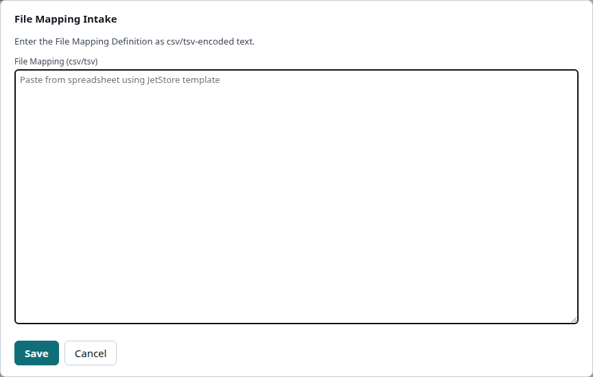

A source configuration's **mapping** says, for each data property of its object type, which column of
the file fills it, the cleansing function applied, its default value and the message when it fails.
The *Source Mapping* flow shows the mapping of one source configuration, and loads or downloads it as a
spreadsheet. How a mapping works is explained in
[Source configurations and domain keys](/docs/user/concepts/source-configurations/).

**Reach it** from the *JetStore Workspace* menu at the left of the top bar, *Source Mapping*.
Reading needs `jetstore_read`; pasting a mapping needs `client_config`.

## Step 1: select a source configuration

| Column | What it shows |
|---|---|
| **Client**, **Organization** | Who sends the file. |
| **Object Type** | What the file holds. |
| **Table Name** | Its staging table. |
| **Domain Class** | The class of the data model its rows map onto. |
| **Last Updated** | When the source configuration was last saved. |

| Button | What it does |
|---|---|
| **Load Data** | Opens the [Load Files](/docs/user/screens/flows/load-files/) flow, to load files of the selected source configuration. |
| **Loader Status** | Opens the [File Loader Status](/docs/user/screens/file-loader-status/) screen. |
| **Cancel** | Leaves the flow. |
| **Next** | Shows the mapping of the selected source configuration. |

## Step 2: the mapping

One row per mapped data property:

| Column | What it shows |
|---|---|
| **Table Name** | The staging table. |
| **Target Data Property** | The data property filled, such as `hc:NDC`. |
| **Source Input Column** | The file's column that fills it. |
| **Cleansing Function** | The function applied to the value, if any, such as `scrub_characters`. |
| **Cleansing Function Argument** | The function's argument. |
| **Default Value** | The value used when the column is empty. |
| **Error Message** | The message recorded when the value cannot be mapped. |
| **User**, **Loaded At** | Who saved the row, and when. |

| Button | What it does |
|---|---|
| **Configure Mapping** | Opens the [File Mapping Configuration](/docs/user/screens/flows/file-mapping-configuration/) flow, which edits the mapping one data property at a time. |
| **Paste File Mapping** | Opens a dialog that loads the whole mapping from spreadsheet rows. |
| **Download File Mapping** | Downloads the mapping as a file, in the same layout. |
| **Previous** | Back to the list. |

The dialog takes the mapping as CSV or tab-separated text, pasted from a spreadsheet made from
JetStore's template; a downloaded mapping is in the same layout. **Save** loads it.

## See also

- [Load and map a file](/docs/user/how-to/load-and-map-a-file/)
- [Your first pipeline](/docs/user/tutorials/first-pipeline/)
