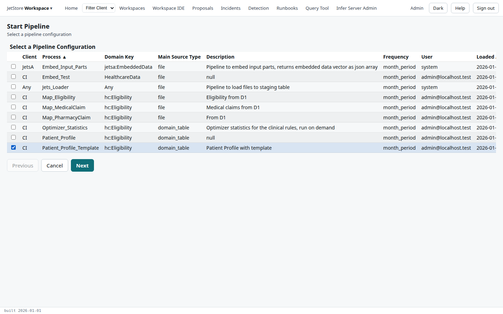
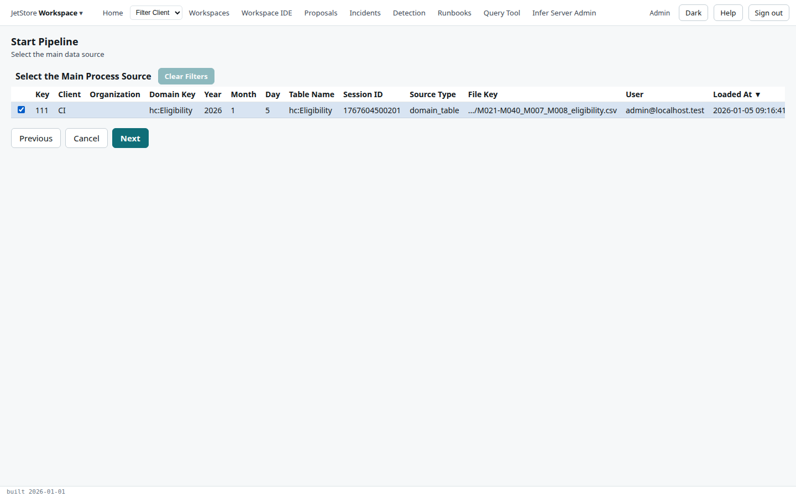
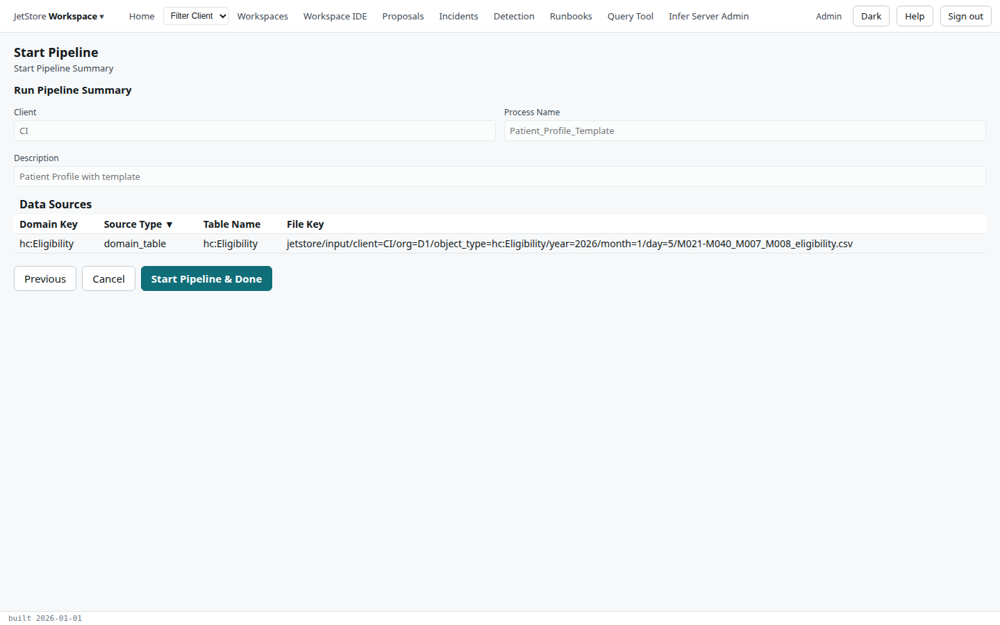

*Start Pipeline* starts one run of a pipeline by hand: you choose a pipeline configuration, then the
data it reads as its main input, then confirm. How runs start, by hand or by themselves, is in
[How a run starts](/docs/user/concepts/pipelines-and-sessions/#how-a-run-starts).

**Capability:** `run_pipelines`, for the *Start Pipeline* button that opens the flow and for the
start itself.

**Opened from** Home's *Pipelines Status* tab, *Start Pipeline*. It returns to Home when it ends.
Its key is `startPipelineUF`.

## Steps

### 1. Select a pipeline configuration

Every pipeline configuration of the installation, sorted by process. Tick one; it is required.

| Column | What it holds |
|---|---|
| Client | the client the configuration is for |
| Process | the process it runs |
| Domain Key | the domain key of its main input |
| Main Source Type | what its main input is: `file`, a client's file, or `domain_table`, a table another pipeline wrote |
| Description | the configuration's description |
| Frequency | the source period it runs on, such as `month_period` |
| User, Loaded At | who last changed the configuration, and when |

*Filter Client* in the top bar narrows the list to one client.

### 2. Select the main data source

The entries of the input registry the chosen configuration can read as its main input: those of its
client, its domain key, its main source type and its main input's table, the latest first. Tick one;
it is required. The columns are those of Home's
[Data Registry](/docs/user/screens/home/#data-registry) tab, and the choice fixes the run's source
period and its input session.

The file key and time filters set on Home narrow this list too. **Clear Filters** removes them, when
there are any.

### 3. Start Pipeline Summary

What will run, read-only:

| Field | What it shows |
|---|---|
| Client | the configuration's client |
| Process Name | its process |
| Description | its description |
| Data Sources | the main input chosen in step 2: its domain key, source type, table and file key |

The summary lists the main input only. A configuration's merged inputs, such as the claims tables
`Patient_Profile_Template` reads beside its eligibility table, are read across their lookback
periods by the run itself, and are not chosen here.

**Start Pipeline & Done** submits the run and returns to Home, where it appears at the top of
*Pipelines Status* under a new session id: `submitted` once it starts, or `pending` when the
installation already has as many runs going as it allows. Refresh the tab to follow it.

## See also

- [Run a pipeline](/docs/user/how-to/run-a-pipeline/)
