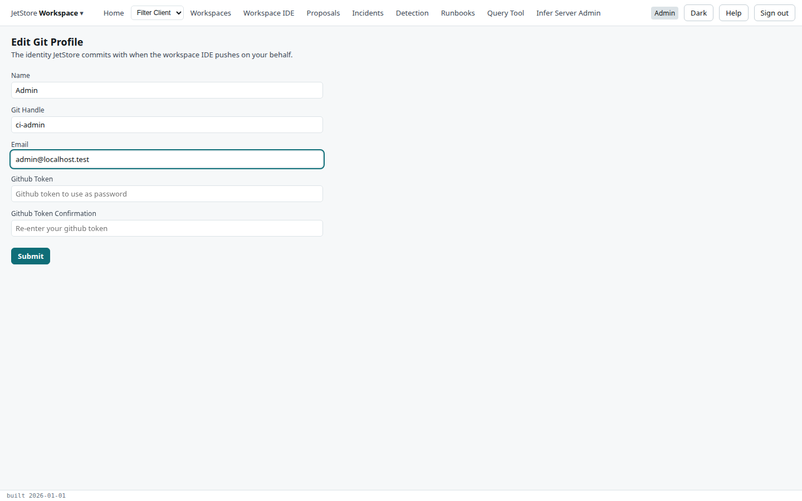

The *Git Profile* screen (*Edit Git Profile*) holds the identity JetStore uses when it commits, pushes
or pulls a workspace for you, from the [Workspaces](/docs/user/screens/workspaces/) screen: the name
and address on the commit, and the handle and token that authenticate you to the repository.

**Reach it** by pressing your name at the right of the top bar. Saving needs the `user_profile`
capability, which every role JetStore ships includes.

| Field | Rule |
|---|---|
| **Name** | The name on your commits. At least two characters. |
| **Git Handle** | Your user name on the git host, in lower case. At least four characters. |
| **Email** | The address on your commits, in lower case. |
| **Github Token** | A token the git host accepts in place of your password, with the rights to push to the workspace's repository. |
| **Github Token Confirmation** | The same token again. |

The name, handle and address are filled with what is already saved. The token never is: it is
stored, but never sent back to the screen, so **Submit** always needs it entered twice.

**Submit** checks every field, marks those that are wrong, and saves the profile for your account
only. It then returns to *Home* and says *Git profile updated*.
