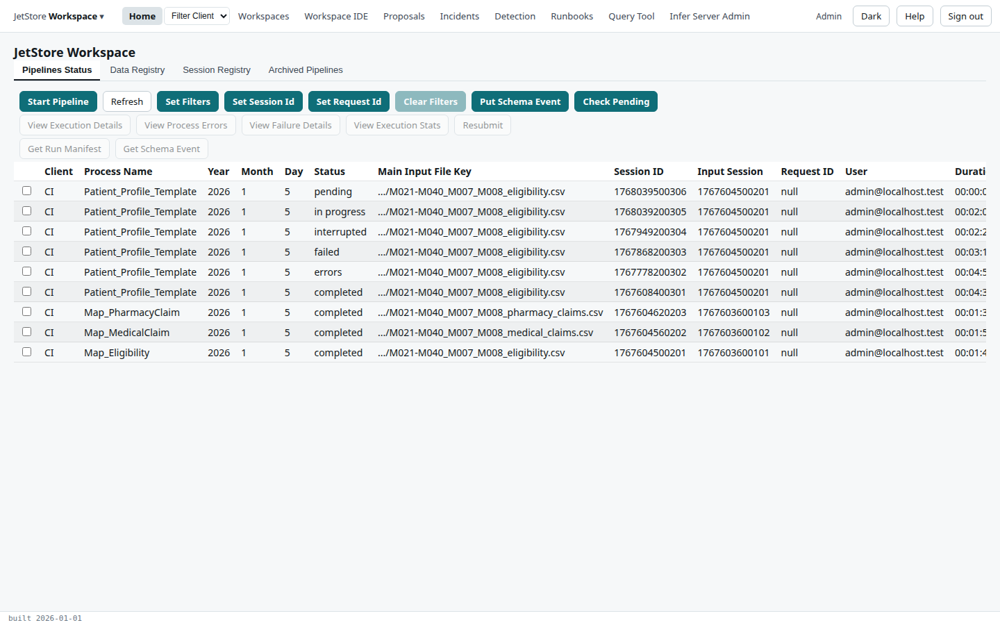
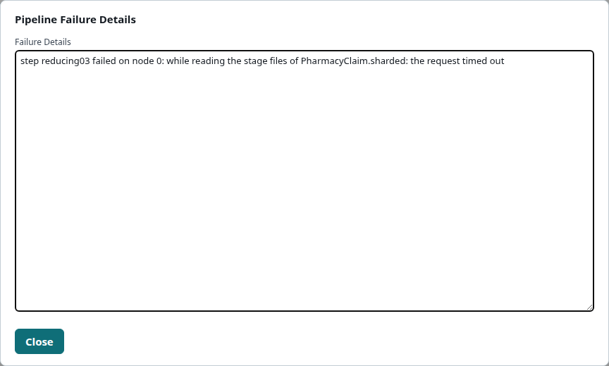
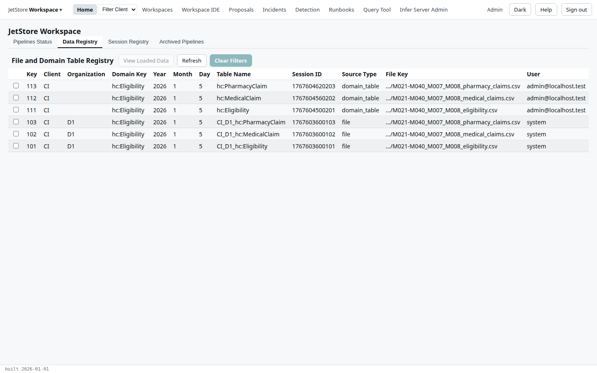
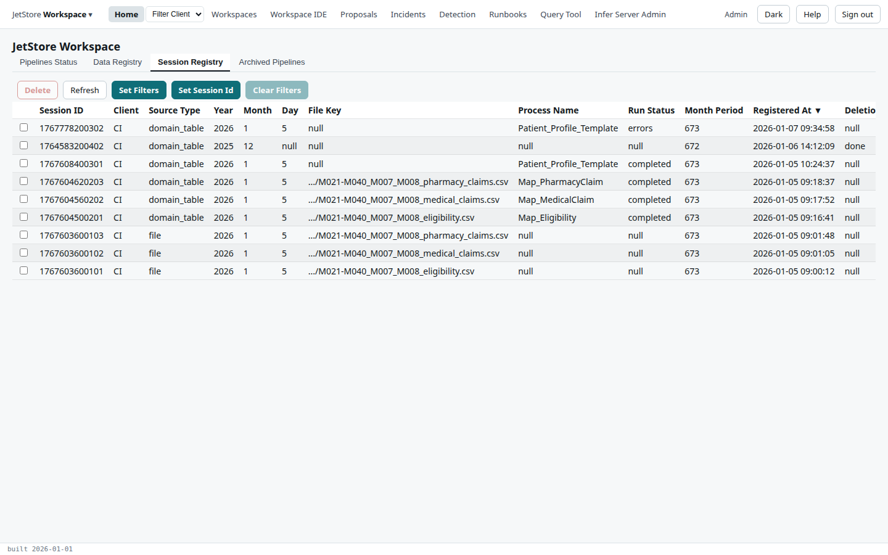
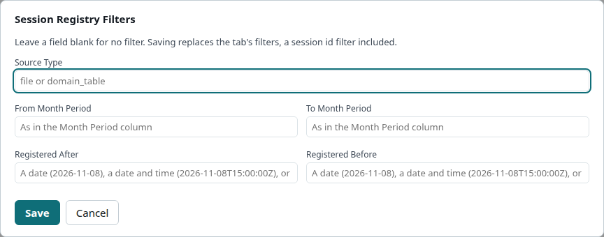
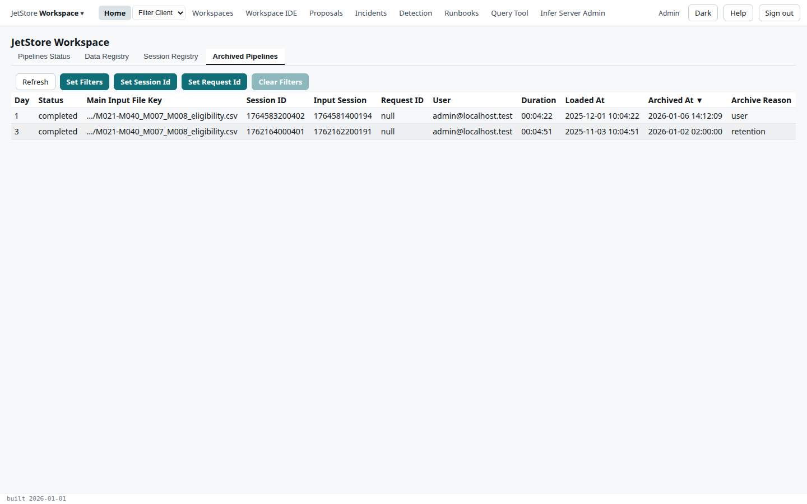

Home is the screen JetStore opens on, and the one to come back to. It answers the day-to-day
questions about a client's data: which pipelines ran and how they ended, what data is registered for
pipelines to read, which sessions exist, and which runs were archived when their session was
deleted. It has four tabs, and the tab you are on is kept in the address, so a flow started from a
tab brings you back to it.

**Capability.** Reaching Home needs no capability, but reading its tables needs `jetstore_read`.
Some buttons need more, and each says which below. See
[Users, roles and capabilities](/docs/user/concepts/users-and-capabilities/).

**Reached from** *Home* in the top bar. It is also where JetStore lands after you sign in.

The tables follow the rules on the [Screens](/docs/user/screens/#tables) page: select a row, then
press a button; hover over a disabled button to see why. *Filter Client* in the top bar narrows all
four tabs to one client.

## Pipelines Status

Every run of a pipeline, the latest first: one row per run, with its status, its main input and its
session. What each status means is in
[Pipelines and sessions](/docs/user/concepts/pipelines-and-sessions/#what-a-runs-status-means).

| Column | What it holds |
|---|---|
| Client | the client the run is for |
| Process Name | the process run, such as `Patient_Profile_Template` |
| Year, Month, Day | the source period of the run's main input: the date its data is for, not the date the run took place |
| Status | `pending`, `submitted`, `completed`, `errors`, `failed`, `interrupted`, and the others the concept page lists |
| Main Input File Key | the file key of the run's main input, shortened to its file name; click to copy it whole |
| Session ID | the run's own session: every row it writes carries it |
| Input Session | the session of the main input the run read |
| Request ID | the request the input was registered under, when it came with one |
| User | who started the run |
| Duration | from the run's start to its last update; for a run still going, so far |
| Loaded At | when the run's row was last updated; the tab sorts on it |

The tab has three rows of buttons. The first row acts on the whole table and needs no selection:

| Button | What it does | Capability |
|---|---|---|
| **Start Pipeline** | Opens the [Start Pipeline](/docs/user/screens/flows/start-pipeline/) flow, to start a pipeline by hand. | `run_pipelines` |
| **Refresh** | Reads the table again. | |
| **Set Filters** | Opens the [Pipeline Execution Status Filters](/docs/user/screens/flows/pipeline-execution-status-filters/) flow, to show only some runs. | |
| **Set Session Id** | Asks for one or more session ids, separated by commas, and shows only the runs with those sessions. The *Data Registry* tab then shows the inputs those runs read. | |
| **Set Request Id** | The same, by request id. | |
| **Clear Filters** | Removes the filters the three buttons above set, here and on the *Data Registry* and *Archived Pipelines* tabs. Disabled when there are none. | |
| **Put Schema Event** | Opens a dialog to paste a schema event, as JSON. *Save* stores it in the installation's schema triggers folder, which registers the file it describes, as if the file had just arrived. | `run_pipelines` |
| **Check Pending** | Starts the runs waiting as `pending` that the installation's limit now has room for, such as runs inserted by SQL. | `run_pipelines` |

The second and third rows act on the selected run:

| Button | What it does | Capability |
|---|---|---|
| **View Execution Details** | Opens [Pipeline Execution Details](/docs/user/screens/pipeline-execution-details/) for the run: each step and shard. | |
| **View Process Errors** | Opens [Process Errors](/docs/user/screens/process-errors/) for the run: the errors its rules raised. | |
| **View Failure Details** | Opens the run's failure details, the error that stopped it, in a dialog. Empty for a run that did not fail. | |
| **View Execution Stats** | Opens [CPIPES Execution Details](/docs/user/screens/cpipes-execution-details/) for the run: each step, totalled over its nodes. | |
| **Resubmit** | Runs the selected run again, on the same inputs, under a new session, with the workspace as it is compiled now. Refused when an input the run read has since been deleted. | `run_pipelines` |
| **Get Run Manifest** | Copies the run's manifest to the clipboard: the document a completed run writes, describing what it delivered (see [The run manifest](/docs/developer/compute-pipes/run-manifest/)). Enabled for a completed run only. | `jetstore_read` |
| **Get Schema Event** | Copies to the clipboard the schema event of the input the run was started from. | `jetstore_read` |

When the browser refuses the clipboard, the text is shown in a dialog instead, to copy by hand.

An installation can add its own buttons to the last row, each copying a file of the selected run's
to the clipboard. They are set when JetStore is deployed, and are not in this list.

## Data Registry

The input registry: every data set a pipeline can read, the files that arrived and the tables that
pipelines wrote, the latest first. Its caption is *File and Domain Table Registry*. See
[Files, file keys and the input registry](/docs/user/concepts/files-and-the-input-registry/#the-input-registry).

| Column | What it holds |
|---|---|
| Key | the entry's key in the input registry; a pipeline's main input is chosen by it |
| Client, Organization | whose data it is, and who sent it; empty for a table a pipeline wrote |
| Domain Key | the object type the entry is registered under |
| Year, Month, Day | its source period |
| Table Name | the table the data is in: a staging table such as `CI_D1_hc:Eligibility`, or a domain table such as `hc:Eligibility` |
| Session ID | the session of the file's delivery, or of the run that wrote the table |
| Source Type | `file` or `domain_table` |
| File Key | the file key, shortened to its file name; for a domain table, the key of the file it came from |
| User | who registered it: `system` for a file, the user who ran the pipeline for a table |
| Loaded At | when it was registered |

| Button | What it does |
|---|---|
| **View Loaded Data** | Opens the selected entry's rows in [Staging Table or Domain Table View](/docs/user/screens/table-view/): the rows of its table that carry its session. |
| **Refresh** | Reads the table again. |
| **Clear Filters** | Removes the filters set on the *Pipelines Status* tab. Its file key and time filters, and its session and request ids, narrow this tab too. |

A file's entry has rows to view only once the file has been loaded into its staging table, with the
[Load Files](/docs/user/screens/flows/load-files/) flow.

## Session Registry

Every session JetStore knows of, the latest first, with the run or file it belongs to and whether
it has been deleted. It is where sessions are deleted. See
[Sessions](/docs/user/concepts/pipelines-and-sessions/#sessions).

| Column | What it holds |
|---|---|
| Session ID | the session |
| Client | its client; `(unknown)` when it could not be read |
| Source Type | `file` for a file's delivery, `domain_table` for a pipeline's output |
| Year, Month, Day | its source period; the day is empty for a deleted session |
| File Key | the file key of the session's input registry entries |
| Process Name | the pipeline whose run is this session, for a `domain_table` session |
| Run Status | that run's status |
| Month Period | the source period as a number of months, the one the filters take |
| Registered At | when the session was registered, or deleted for a deleted one |
| Deletion | `pending`, `failed` or `done` once a deletion is requested; empty otherwise |
| Deletion Reason | `user`, `retention` or `orphan` |
| Deletion Requested By | who deleted it, or `purge` for the retention purge |
| Deletion Requested At | when |

| Button | What it does | Capability |
|---|---|---|
| **Delete** | Deletes the selected sessions and every session derived from them. It first lists all of them, and asks you to confirm; nothing is deleted before you do. Disabled for a session whose deletion is already requested or done. | `delete_session` |
| **Refresh** | Reads the table again. | |
| **Set Filters** | Opens the *Session Registry Filters* dialog, below. | |
| **Set Session Id** | Asks for session ids, separated by commas, or a range, `from..to`, either end of which may be left empty (`1000..` or `..2000`). | |
| **Clear Filters** | Removes this tab's filters. Disabled when there are none. | |

A deletion cannot be undone. What it removes, and why sessions derived from the one you select go
with it, is in [Deleting a session](/docs/user/concepts/pipelines-and-sessions/#deleting-a-session).

**Session Registry Filters.** Leave a field blank for no filter. Saving replaces the tab's filters,
a session id filter included, and the dialog opens again with the values you last saved.

| Field | Filters to |
|---|---|
| Source Type | one source type: `file` or `domain_table` |
| From Month Period, To Month Period | sessions whose month period is in the range, as the *Month Period* column shows it; digits only |
| Registered After, Registered Before | sessions registered in the window. Each takes a date (`2026-11-08`), a date and time (`2026-11-08T15:00:00Z`) or a duration ago (`3 days`) |

## Archived Pipelines

The runs whose session was deleted, by a user or by the installation's retention purge. Deleting a
session removes its run from *Pipelines Status* and keeps its row here, so the record of what ran
survives the data.

Its columns are those of *Pipelines Status*, and two more:

| Column | What it holds |
|---|---|
| Archived At | when the run's session was deleted and the run moved here; the tab sorts on it |
| Archive Reason | `user`, `retention` or `orphan`: a user's deletion, the retention purge, or the purge's sweep of a session whose rows remained after its registration was gone |

Its buttons, *Refresh*, *Set Filters*, *Set Session Id*, *Set Request Id* and *Clear Filters*, work
as on *Pipelines Status*, and the filters are the same ones: a filter set on either tab applies to
both. No run here can be acted on, so it has no check boxes.
