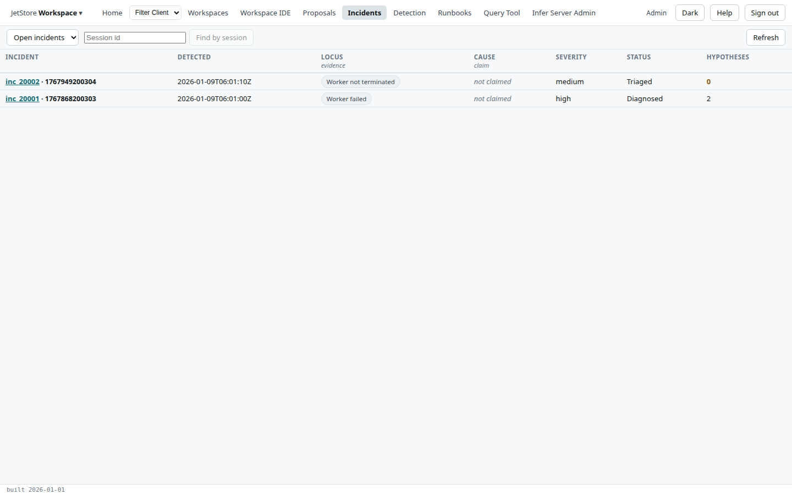
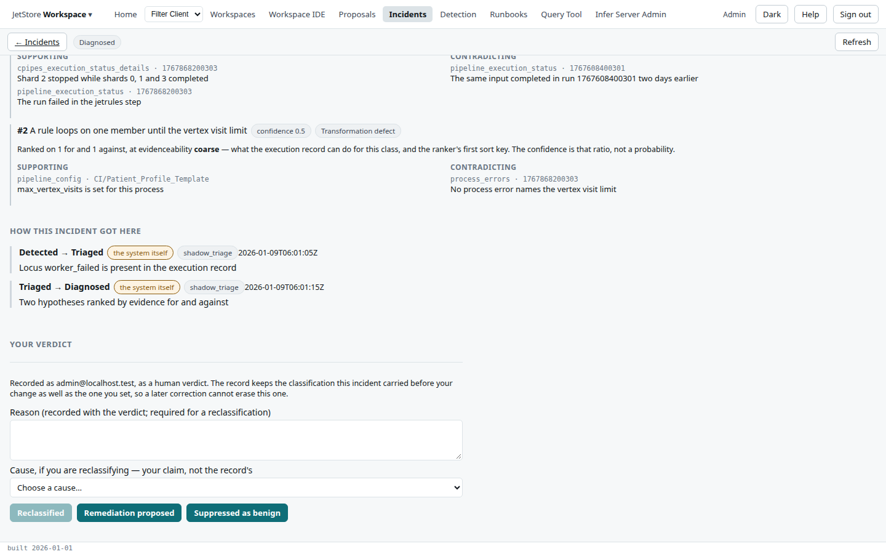

An **incident** is a problem that JetStore's detection found, or that a person raised: in a pipeline
run, a worker that failed, one that never finished, records that failed or went missing; in a feed's
deliveries, a delivery that did not come or one that departs from what the feed declares. JetStore
separates two things about it. Its **locus** is *where the evidence sits* in the record, which the
record establishes. Its **cause** is *a claim* about what produced it, which the record
does not establish, and which a hypothesis or a person makes. The *Incidents* screen lists the
incidents; each has a page with the evidence, the ranked hypotheses, how it reached its status, and
the controls for a person's verdict.

**Reach it** from *Incidents* in the top bar, or from the link on the [Detection](/docs/user/screens/detection/)
screen. It needs the `agent_supervision` capability. Evidence marked as protected health information
is shown only with `agent_phi_access` as well; without it the server withholds it, and the page says
which properties were withheld.

## The list

The picker chooses **Open incidents** (the default), **Adjudicated**, or **All incidents**.
**Refresh** reads the list again.

| Column | What it shows |
|---|---|
| **Incident** | The incident's id, linked to its page, and the session it concerns: a run's, or, for a feed incident, the session in which a delivery was registered. |
| **Detected** | When it was raised. |
| **Locus** *evidence* | Where the evidence sits, such as *Worker failed*. Hover for what the locus means. |
| **Cause** *claim* | The cause claimed, or *not claimed*. |
| **Severity** | *info*, *low*, *medium*, *high* or *critical*. |
| **Status** | Where the incident is in its lifecycle. |
| **Hypotheses** | How many causes have been proposed for it. |

**Adjudicated** lists the incidents a person has given a verdict on that settles them: *verified*,
*reclassified* or *suppressed as benign*.

**An empty list is not evidence that nothing went wrong.** Incidents are written by shadow triage,
which runs where the detection task is deployed; the Detection screen says whether it has run.

### Incidents about a feed's deliveries

Two loci are about a feed rather than a run. They come from feed detection, which compares each
delivery with the feed's declared profile (see
[Declare a feed profile](/docs/user/how-to/declare-a-feed-profile/)) and records what departs from
it. Shadow triage turns those findings into incidents, the same way it does for runs, and takes them
no further than *diagnosed*.

| Locus | What it means |
|---|---|
| **Delivery overdue** | No delivery of the feed arrived for the period one was due in, past the declared grace. A delivery that never came has no session of its own, so the incident is on the session of the feed's **last delivery**, the one after which nothing came. |
| **Delivery departs from profile** | A delivery arrived and departs from what the profile declares: its size, how recent its service dates are, the span they cover, a required field's completeness, its overlap with earlier deliveries, a repeat of the last delivery, or a period older than one already delivered. The locus does not say which; the detection that raised it does, and the incident's evidence names it. |

**A feed incident is on a registration session, which may have no pipeline run.** Its page shows the
nine run loci as *not evaluable*, because there is no run to ask, and the feed locus with the
detection's own words as its evidence. The feed is named by its **source configuration**, with that
configuration's client. When the delivery was registered under another client, such as `Any`, the
evidence says so beside it; the incident does not take that client as the feed's.

**A burst of deliveries is one incident.** When the same check fires on several deliveries of one
feed registered on the same day (UTC), as a catch-up of many past files does, shadow triage raises
**one** incident, on the **last** of those deliveries. Its evidence says how many deliveries it
stands for and names their sessions. The other deliveries still show the locus as present on their
own sessions, but no incident of their own: their evidence names the session the incident is on. If
triage ran while the day's files were still arriving, the incident is on the last delivery that run
saw, and later deliveries of the same day join it rather than raising a second one.

**The hypotheses offered for a feed incident:**

| Locus | Causes proposed |
|---|---|
| **Delivery overdue** | *Source delivery failure*, *Benign variation* |
| **Delivery departs from profile** | *Source content change*, *Transformation defect*, *Benign variation* |

*Transformation defect* is offered because a departure can be the mapping's rather than the
supplier's: a column the pipeline leaves unmapped looks absent from every delivery. *Benign
variation* is offered because the declaration can be wrong.

**Both are observations against a declaration, not a verdict on the feed**, and every feed
hypothesis says so. Each carries, as evidence **against** it, who declared the profile, on what date,
and how old the declaration was when the finding was detected: a profile that is out of date makes a
sound delivery depart from it. *Source delivery failure* on an overdue feed carries the declared
cadence as evidence **for** it, because the cadence is the record of what was due. *Source content
change* carries a column as evidence for it when the check that fired compared a column the profile
names: a required field, the service date or the business key. Check the profile as well as the
delivery before claiming a cause.

## An incident

| Section | What it shows |
|---|---|
| **Summary** | On a feed incident only: a few paragraphs saying what was found, in words. See [The summary of a feed incident](#the-summary-of-a-feed-incident) below. |
| **What the record evidences** | The **locus**, what it means and what it **cannot see**; the **session**; the **source type** and **file key** of each input registered under that session, `file` or `domain_table`, which find its runs on Home's *Pipelines Status* (*Set Session Id* with the session, or *Set Filters* with the file key); what **raised** it, with whether corrections to it reach an audit chain; when it was **detected**; the **step** and **shard** it is localised to, when it is; and the **confounders**, what the detector could not rule out. |
| **What has been claimed** | The **cause**, if any, the **severity** and the **model version** that raised it. |
| **Ranked hypotheses** | The causes proposed, best first. Each shows its confidence and cause category, the counts it was ranked on, and its **supporting** and **contradicting** evidence, each item with its source. A hypothesis contradicted more than supported, or raised at another locus, is marked. |
| **How this incident got here** | Every transition of its status: from, to, by *a person* or *the system itself*, when, and why. A cause set by a transition is shown too. |
| **Your verdict** | The controls below, when the status allows a transition. |

**The confidence is a ratio of evidence for and against, not a probability.** The text beside each
hypothesis says what it was ranked on.

### The summary of a feed incident

A feed incident's page opens with a **summary**: the incident in a few paragraphs, written for the
person who receives the feed rather than for the person who wrote the detectors. It says:

- **which feed**, as its source configuration names it, with its client, its object type and
  whether it is cumulative or incremental, and when the finding was made. When the delivery was
  registered under another client, such as `Any`, it says so;
- **what departed from what**: one sentence per check that fired, with what was measured beside
  what the profile declares. For example, *the required field paid_amount carries a value in 12.3%
  of the delivery's rows; the declaration requires at least 95.0%*, or, for an overdue feed, the
  last period delivered, the day the next became overdue, and the declared cadence;
- **the readings, best first**: each proposed cause in plain words and by its name, with its
  confidence, how many items of evidence are for and against it, and how evidenceable that cause is
  at this locus. These are the hypotheses listed further down the page, in the same order;
- **the case against every reading**: who declared the feed's profile, on what date, and how old the
  declaration was when the finding was made. A delivery is judged against what somebody wrote down,
  so a stale declaration is the first thing to doubt;
- **a burst**, when there is one: if the same check fired on other deliveries of the same feed
  registered the same day, as a catch-up of many files does, the summary says how many deliveries
  this incident stands for and how many have no incident of their own. **A burst is raised as one
  incident, so give it one verdict.** If another delivery of the burst has an incident of its own, for a
  finding outside the burst, it is named.

**The summary is rendered by a fixed template, not written by a model**, and the page says so. It is
built when the page is read, from the incident's findings, the feed's profile and the ranked
readings, and it is not stored. Two consequences follow:

- It describes the profile **as it is now**. If the profile was declared again after the incident
  was found, the summary says the declaration it names came later, and is not the one the delivery
  was judged against. The hypotheses' evidence keeps the declaration as it was at detection.
- It carries only counts, shares, sizes, dates and names from the feed's configuration. **No
  member, claim or key value appears in it**, because nothing it is built from carries one.

When a summary cannot be built, for instance because the anomaly table is not installed, the page
says so and gives the reason; the rest of the incident is shown as usual. A run incident has no
summary.

### Recording a verdict

Write a **reason**, then press the button of the status you move the incident to: there is one per
transition its current status allows. To **reclassify**, choose the cause you claim as well; both
the cause and the reason are then required. The verdict is recorded as yours, as a person's, and the
classification the incident carried before it is kept beside the new one. *Closed* and *suppressed as
benign* are terminal: nothing on the page writes to them.

The statuses run *detected*, *triaged*, *diagnosed*, *remediation proposed*, *awaiting approval*,
*remediating*, *resolved*, *verified* and *closed*; a triaged incident may instead be *reclassified*
or *suppressed as benign*. Shadow triage takes an incident no further than *diagnosed*; every later
step is a person's.

**A diagnosed incident takes a person's verdict too**: *suppressed as benign*, when the finding is a
false alarm, or *reclassified*, choosing the cause you hold, which may be the one ranked first. These
two are the verdicts a person gives on an incident shadow triage raised, and only a person can give
them; neither acts on anything, so shadow mode holds. A reclassified incident returns to *triaged*,
and *suppressed as benign* is terminal.
