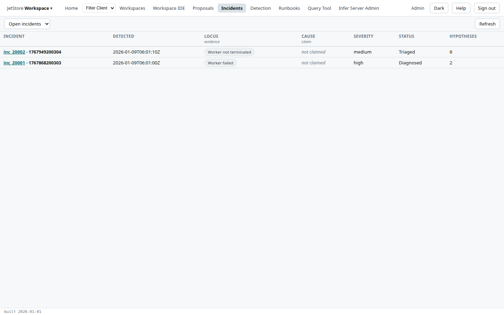
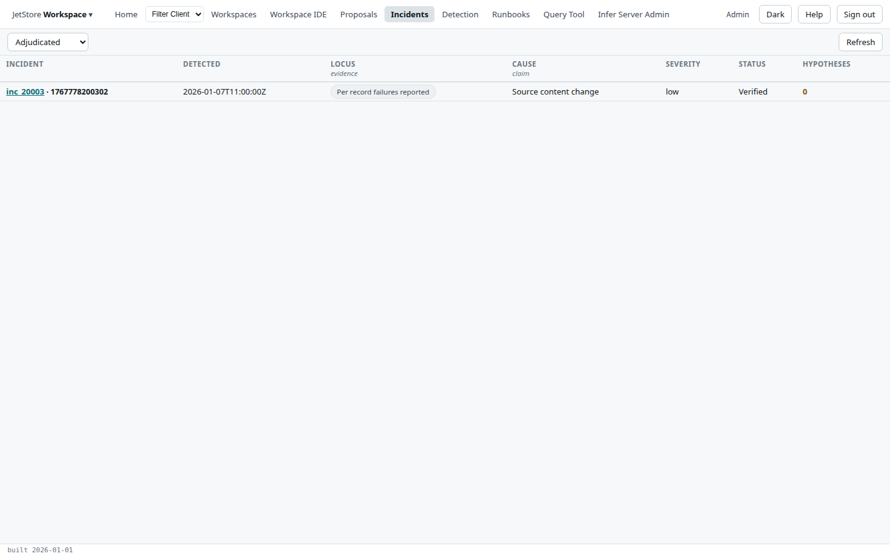
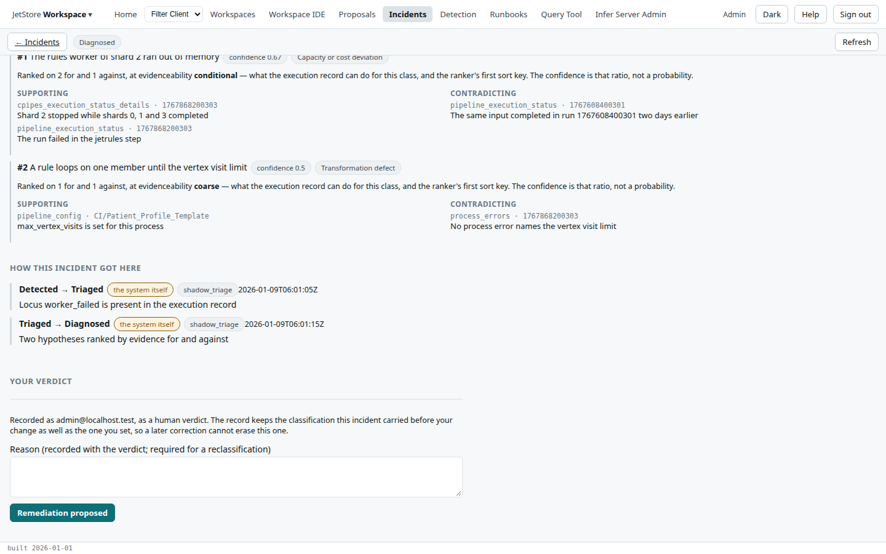

An **incident** is a problem in a pipeline run that JetStore's detection found, or that a person
raised: a worker that failed, one that never finished, records that failed or went missing. JetStore
separates two things about it. Its **locus** is *where the evidence sits* in the execution record,
which the record establishes. Its **cause** is *a claim* about what produced it, which the record
does not establish, and which a hypothesis or a person makes. The *Incidents* screen lists the
incidents; each has a page with the evidence, the ranked hypotheses, how it reached its status, and
the controls for a person's verdict.

**Reach it** from *Incidents* in the top bar, or from the link on the [Detection](/docs/user/screens/detection/)
screen. It needs the `agent_supervision` capability. Evidence marked as protected health information
is shown only with `agent_phi_access` as well; without it the server withholds it, and the page says
which properties were withheld.

## The list

The picker chooses **Open incidents** (the default), **Adjudicated**, or **All incidents**.
**Refresh** reads the list again.

| Column | What it shows |
|---|---|
| **Incident** | The incident's id, linked to its page, and the session of the run it concerns. |
| **Detected** | When it was raised. |
| **Locus** *evidence* | Where the evidence sits, such as *Worker failed*. Hover for what the locus means. |
| **Cause** *claim* | The cause claimed, or *not claimed*. |
| **Severity** | *info*, *low*, *medium*, *high* or *critical*. |
| **Status** | Where the incident is in its lifecycle. |
| **Hypotheses** | How many causes have been proposed for it. |

**Adjudicated** lists the incidents a person has given a verdict on that settles them: *verified*,
*reclassified* or *suppressed as benign*.

**An empty list is not evidence that nothing went wrong.** Incidents are written by shadow triage,
which runs where the detection task is deployed; the Detection screen says whether it has run.

## An incident

| Section | What it shows |
|---|---|
| **What the record evidences** | The **locus**, what it means and what it **cannot see**; the **session**; what **raised** it, with whether corrections to it reach an audit chain; when it was **detected**; the **step** and **shard** it is localised to, when it is; and the **confounders**, what the detector could not rule out. |
| **What has been claimed** | The **cause**, if any, the **severity** and the **model version** that raised it. |
| **Ranked hypotheses** | The causes proposed, best first. Each shows its confidence and cause category, the counts it was ranked on, and its **supporting** and **contradicting** evidence, each item with its source. A hypothesis contradicted more than supported, or raised at another locus, is marked. |
| **How this incident got here** | Every transition of its status: from, to, by *a person* or *the system itself*, when, and why. A cause set by a transition is shown too. |
| **Your verdict** | The controls below, when the status allows a transition. |

**The confidence is a ratio of evidence for and against, not a probability.** The text beside each
hypothesis says what it was ranked on.

### Recording a verdict

Write a **reason**, then press the button of the status you move the incident to: there is one per
transition its current status allows. To **reclassify**, choose the cause you claim as well; both
the cause and the reason are then required. The verdict is recorded as yours, as a person's, and the
classification the incident carried before it is kept beside the new one. *Closed* and *suppressed as
benign* are terminal: nothing on the page writes to them.

The statuses run *detected*, *triaged*, *diagnosed*, *remediation proposed*, *awaiting approval*,
*remediating*, *resolved*, *verified* and *closed*; a triaged incident may instead be *reclassified*
or *suppressed as benign*. Shadow triage takes an incident no further than *diagnosed*; every later
step is a person's.
