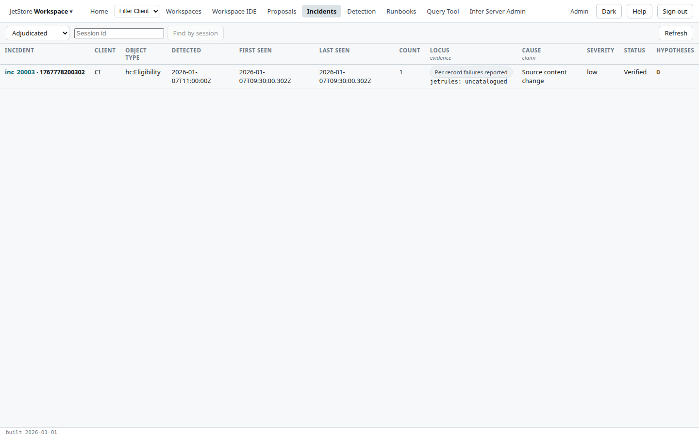

An **incident** is a problem that JetStore's detection found, or that a person raised: in a pipeline
run, a worker that failed, one that never finished, records that failed or went missing; in a feed's
deliveries, a delivery that did not come or one that departs from what the feed declares. JetStore
separates two things about it. Its **locus** is *where the evidence sits* in the record, which the
record establishes. Its **cause** is *a claim* about what produced it, which the record
does not establish, and which a hypothesis or a person makes. The *Incidents* screen lists the
incidents; each has a page with the evidence, the ranked hypotheses, how it reached its status, and
the controls for a person's verdict.

**Reach it** from *Incidents* in the top bar, or from the link on the [Detection](/docs/user/screens/detection/)
screen. It needs the `agent_supervision` capability. Evidence marked as protected health information
is shown only with `agent_phi_access` as well; without it the server withholds it, and the page says
which properties were withheld.

## The list

The picker chooses **Open incidents** (the default), **Adjudicated**, or **All incidents**.
**Refresh** reads the list again. **Find by session** takes a session id and opens the incidents
that session belongs to (see [Finding a session's incidents](#finding-a-sessions-incidents) below):
the list shows each incident once, on the session it is written on, so a delivery that joined
another delivery's incident has no row of its own here.

**The list is paged**, newest first: 20 incidents a page to start with, and **Rows per page** offers
20, 40, 100 or 200. The footer says which rows are shown out of how many, with buttons for the first,
previous, next and last page. Changing the picker or the client goes back to the first page.

**The client filter in the menu applies.** With a client selected, the list keeps the incidents whose
session is registered to that client. An incident whose session no longer has a registration (its
session was deleted or purged) has no client, so it is listed only when no client is selected.

| Column | What it shows |
|---|---|
| **Incident** | The incident's id, linked to its page, and the session it concerns: a run's, or, for a feed incident, the session in which a delivery was registered. |
| **Client** | The client the incident's session is registered to: the run's, or the delivery's. Blank when no registration remains. |
| **Object type** | The object type of that registration: the run's main object type, or the delivery's. Blank when no registration remains. |
| **Detected** | When it was raised. |
| **First seen**, **Last seen** | For a feed incident, the earliest and the latest of the deliveries it stands for, by when each was registered. For a run incident, first seen is the start of the run it was written on, kept after that run is deleted, and last seen is the start of the latest run of its [run condition](#the-run-condition-of-a-run-incident) still held, or *no run held* when none is. For any other incident, and a run incident written before run conditions, the time of its own session, in both. |
| **Count** | For a feed incident, how many deliveries of its condition it stands for: the deliveries placed in it, as its page's [Condition](#the-condition-of-a-feed-incident) section counts them, so a delivery that went to a later incident of the same condition is not counted. For a run incident, how many runs of its run condition **still held** are placed in it: the count falls as retention deletes runs. For any other incident, and a run incident written before run conditions, 1. Hover to see which. |
| **Locus** *evidence* | Where the evidence sits, such as *Worker failed*. Hover for what the locus means. A per-record failures incident shows its **error code** beneath the locus, because each code is an incident of its own. |
| **Cause** *claim* | The cause claimed, or *not claimed*. |
| **Severity** | *info*, *low*, *medium*, *high* or *critical*. |
| **Status** | Where the incident is in its lifecycle. |
| **Hypotheses** | How many causes have been proposed for it. |

**Adjudicated** lists the incidents a person has given a verdict on that settles them: *verified*,
*reclassified* or *suppressed as benign*.

**An empty list is not evidence that nothing went wrong.** Incidents are written by shadow triage,
which runs where the detection task is deployed; the Detection screen says whether it has run.

**A run whose session was deleted is not judged.** Deleting a session keeps its run's status on the
*Archived Pipelines* tab and deletes everything the run loci read: its worker rows, its process
errors and its stored configuration. Shadow triage selects only the runs of sessions that exist. A
run it is asked about by session, or whose session is deleted while it runs, is found in the pipeline
history and counted *not evaluable* at every run locus, with when and why the session was deleted,
so it raises no incident; the deleted records' absence is not read as a run that never started or
reported no failure. A later run of the same source carries *history truncated* when a deleted run
falls in the history it is compared with.

### Incidents about a feed's deliveries

Two loci are about a feed rather than a run. They come from feed detection, which compares each
delivery with the feed's declared profile (see
[Declare a feed profile](/docs/user/how-to/declare-a-feed-profile/)) and records what departs from
it. Shadow triage turns those findings into incidents, the same way it does for runs, and takes them
no further than *diagnosed*.

| Locus | What it means |
|---|---|
| **Delivery overdue** | No delivery of the feed arrived for the period one was due in, past the declared grace. A delivery that never came has no session of its own, so the incident is on the session of the feed's **last delivery**, the one after which nothing came. |
| **Delivery departs from profile** | A delivery arrived and departs from what the profile declares: its size, how recent its service dates are, the span they cover, a required field's completeness, its overlap with earlier deliveries, a repeat of the last delivery, or a period older than one already delivered. The locus does not say which; the detection that raised it does, and the incident's evidence names it. |

**A feed incident is on a registration session, which may have no pipeline run.** Its page shows the
nine run loci as *not evaluable*, because there is no run to ask, and the feed locus with the
detection's own words as its evidence. The feed is named by its **source configuration**, with that
configuration's client. When the delivery was registered under another client, such as `Any`, the
evidence says so beside it; the incident does not take that client as the feed's.

**A standing condition is one incident.** A feed that sends the same faulty file every week, or a
catch-up of many past files that all depart from the profile in the same way, is one fault that
persists, and you read it once. Consecutive deliveries of one feed whose findings fall at the same
locus form a **condition**, and shadow triage raises **one** incident for it, on its **first**
delivery. Each later delivery of the feed with a finding at that locus joins it: the locus still
shows as present on its own session, but it has no incident of its own. Which check fired does not
matter, only the locus; a delivery with findings at both loci belongs to two conditions, one at each.

- **A condition ends at the first delivery of the feed with no finding at its locus**, whether that
  delivery was checked and passed or could not be checked. A later finding starts a new condition
  and a new incident, whose evidence names the previous condition's incident. Re-processing a file
  the feed already delivered is not a delivery, so it neither ends a condition nor extends one.
- **Your verdict closes it for new evidence.** Once you reclassify an incident, suppress it as
  benign or verify it, a finding at the locus detected **after** your verdict raises a new incident
  naming the one you judged and your verdict; a finding detected before it was part of what you
  judged and joins it. Nothing is suppressed for you.
- **Where the incident is does not depend on which deliveries a triage run selected.** If a run
  reaches a later delivery of a condition first, it raises the condition's incident on the first
  delivery then. An incident already written is never moved or withdrawn: incidents raised one per
  delivery, or one per day, before conditions stay as they are, and later deliveries join the latest
  of them.
- **Old deliveries whose registrations have been purged** cannot be told apart from gaps, so before
  the feed's earliest remaining registration two findings belong to one condition only when they
  were registered on the same day (UTC).
- **A delivery deleted with its findings is not counted at all**: it neither ends a condition nor
  splits it, and the incident stays the condition's incident when its own first delivery is deleted,
  because the incident keeps which feed it is for and where its delivery stood in the feed's order.
  Its page still shows its condition, its later deliveries, and a summary read from the earliest of
  them.
  An incident raised before incidents kept these is found through its own delivery, and belongs to
  no condition once that delivery and its findings are deleted.

The incident's evidence says which deliveries the condition held when the incident was raised, from
when to when, whether it was still open, and the previous condition's incident with its verdict.
Which incident a later delivery joined is not stored: it is worked out again from the feed's
deliveries, findings and incidents each time it is read. The incident's page shows the condition
as it stands now, every delivery it holds included (see
[The condition of a feed incident](#the-condition-of-a-feed-incident) below), so read the page
rather than the evidence for what the condition holds today.

### A recurring run failure is one incident

A process that fails the same way run after run is one fault too. Consecutive runs of one process
for one client with a finding at the same run locus form a **run condition**, and shadow triage
raises one incident for it, on its first run; each later run with the finding joins it and has no
incident of its own.

- **Per-record failures are one incident per error code.** Every row of a run's process errors gets
  a short error code when it is read (see
  [the error code catalogue](/docs/developer/workspace/system-tables/#table-error_code_catalogue)),
  and each code is a condition of its own, so a code you judge benign does not cover another code
  that starts the next week. The incident names its code and the stored rows of every code in the
  run, as a lower bound, and **never quotes a message**, because a message's tail can carry a
  record's values; the session's Process Errors rows hold the text.
- **A code below its reporting threshold raises nothing**, and a debug code never does; both are
  still counted in the incident's evidence when another code of the run raises one. Such a run
  neither joins nor ends the code's condition.
- **A condition ends only at a run whose finding at its locus is absent.** A run that could not be
  judged there, or that triage did not reach, is skipped. A deleted run is not counted at all: it
  neither ends a condition nor splits it, and the incident stays the condition's incident when its
  own first run is deleted.
- **Your verdict closes it for new evidence**, as for a feed condition: a run whose finding is found
  after your verdict raises a new incident naming the one you judged.
- **Incidents written before run conditions stay as they are**, one per run, and a condition open
  across the change gets one new incident at its first run triaged afterwards. On the list they keep
  a count of 1 and their own session's time.

The incident's page shows its run condition as it stands now (see
[The run condition of a run incident](#the-run-condition-of-a-run-incident) below), and a later
run's session finds the condition's incident (see
[Finding a session's incidents](#finding-a-sessions-incidents)).

### Finding a session's incidents

A later delivery of a condition, or a later run of a run condition, has no incident of its own and
no row in the list, but it belongs to the condition's incident, and you can open it from the
delivery's or the run's session:

- **Find by session**, on the list, with the delivery's or the run's session id; or
- **View Incident**, on Home's [*Pipelines Status*](/docs/user/screens/home/#pipelines-status),
  with a run selected. It takes the run's session, and JetStore adds the input session of the run,
  the session the delivery it read was registered in.

Either opens a page listing, for each session, the incidents it belongs to and how:

| How | What it means |
|---|---|
| **its own incident** | The incident is written on this session: a run's incident on the run's session, or a feed incident on the delivery that raised it. |
| **a later delivery of the feed's condition** | The session is a delivery that joined the incident of its condition, which is written on another delivery, named beside it. JetStore says why it was placed there. |
| **a later run of the process's run condition** | The session is a run that joined the incident of its run condition, written on an earlier run of the same process for the same client, named beside it, with the error code for per-record failures. JetStore says why it was placed there. |
| **not raised yet** | The session carries a finding whose incident shadow triage has not written yet; the page says which session it will be written on. |

Which incident a delivery or a run belongs to is worked out by JetStore each time, by the same rule shadow
triage follows when it writes incidents, so the page and the incidents agree. A session nothing was
found on says so.

**The hypotheses offered for a feed incident:**

| Locus | Causes proposed |
|---|---|
| **Delivery overdue** | *Source delivery failure*, *Benign variation* |
| **Delivery departs from profile** | *Source content change*, *Transformation defect*, *Benign variation* |

*Transformation defect* is offered because a departure can be the mapping's rather than the
supplier's: a column the pipeline leaves unmapped looks absent from every delivery. *Benign
variation* is offered because the declaration can be wrong.

**Both are observations against a declaration, not a verdict on the feed**, and every feed
hypothesis says so. Each carries, as evidence **against** it, who declared the profile, on what date,
and how old the declaration was when the finding was detected: a profile that is out of date makes a
sound delivery depart from it. *Source delivery failure* on an overdue feed carries the declared
cadence as evidence **for** it, because the cadence is the record of what was due. *Source content
change* carries a column as evidence for it when the check that fired compared a column the profile
names: a required field, the service date or the business key. Check the profile as well as the
delivery before claiming a cause.

## An incident

| Section | What it shows |
|---|---|
| **Summary** | On a feed incident only: a few paragraphs saying what was found, in words. See [The summary of a feed incident](#the-summary-of-a-feed-incident) below. |
| **Condition** | On a feed incident only: the deliveries of the condition the incident stands for, how it ended or that it is still open, and the previous incident at the locus. See [The condition of a feed incident](#the-condition-of-a-feed-incident) below. |
| **What the record evidences** | The **locus**, what it means and what it **cannot see**; for per-record failures, the incident's **error code**, the **error codes in this run** with their rows, and a link to the session's process errors (see [The run condition of a run incident](#the-run-condition-of-a-run-incident)); the **session**; the **source type** and **file key** of each input registered under that session, `file` or `domain_table`, which find its runs on Home's *Pipelines Status* (*Set Session Id* with the session, or *Set Filters* with the file key); what **raised** it, with whether corrections to it reach an audit chain; when it was **detected**; the **step** and **shard** it is localised to, when it is; and the **confounders**, what the detector could not rule out. |
| **Run condition** | On a run incident whose condition holds more than its own run: the runs it stands for, still held, from when to when. On a run incident with no key to find its condition by, or whose runs have all been deleted, the heading with a note saying which. See [The run condition of a run incident](#the-run-condition-of-a-run-incident) below. |
| **What has been claimed** | The **cause**, if any, the **severity** and the **model version** that raised it. |
| **Ranked hypotheses** | The causes proposed, best first. Each shows its confidence and cause category, the counts it was ranked on, and its **supporting** and **contradicting** evidence, each item with its source. A hypothesis contradicted more than supported, or raised at another locus, is marked. |
| **How this incident got here** | Every transition of its status: from, to, by *a person* or *the system itself*, when, and why. A cause set by a transition is shown too. |
| **Your verdict** | The controls below, when the status allows a transition. |

**The confidence is a ratio of evidence for and against, not a probability.** The text beside each
hypothesis says what it was ranked on.

### The condition of a feed incident

A feed incident's page has a **Condition** section, after *What the record evidences*. It says, as
JetStore works it out when the page is read:

- **the feed**, how many consecutive deliveries carry a finding at the incident's locus, from which
  session to which, and **how many of them this incident stands for**;
- **whether the condition is open**, its feed's latest delivery still carrying a finding here, so the
  next may join it, or **what ended it**: the next delivery, with no finding at the locus (it was
  checked and passed, or could not be checked); a delivery carrying findings of another feed at the
  locus; or, before the feed's earliest remaining registration, a change of day;
- **each delivery**, in the feed's order: its session, which opens that session's incidents; the
  file key the feed delivered in it, or *no registration of the feed* for a session that carries a
  finding and no registration; when its finding was detected; which checks fired; and its
  incident: *this incident*, another incident linked by its id, or *not raised yet*. A delivery is
  in another incident when that incident was written for it before conditions (one per delivery or
  per day), or when its finding came after a person's verdict on this one;
- **the previous incident at the locus**: the latest incident on an earlier delivery of the same
  condition, which for an incident raised after a person's verdict is the one judged, or else the
  incident of the feed's previous condition, each with the verdict a person gave it, or *with no
  verdict*. When the previous
  condition's incident is not written yet, the section says so and names the session it will be
  written on.

**It can differ from the incident's evidence, and the page is the one that is current.** The
evidence is the condition as it was when the incident was raised, and is never changed. Deliveries
that joined since appear only here; and an incident raised while shadow triage was working through
older deliveries, newest first, may name in its evidence a previous condition whose incident was not
yet written, while this section links it.

A feed incident whose session carries findings of two feeds at the locus belongs to no single
feed's condition, and the section says so instead. A run incident has a run condition instead (see
the next section).

### The run condition of a run incident

A run incident's page reads its [run condition](#a-recurring-run-failure-is-one-incident) as
JetStore works it out when the page is read.

**A per-record failures incident names its code and counts, never a message.** *What the record
evidences* shows:

- **the error code** the incident is for, read from the rule or operator that raised the rows and
  never from their values;
- **the error codes in this run**: every code the run's process errors were given, most rows first,
  with the rows stored for each and whether it reports. **The counts are a lower bound**: each
  operator stops storing rows at its maximum error count, so the run may have failed more records
  than it stored. A run that has been deleted has no codes left to show;
- **a link to the session's process errors**, the *Process Errors* screen of the incident's session,
  where the rows and their messages are read under your own permissions. The incident shows no
  message because a message's tail can carry a record's values.

**The Run condition section** follows *What the record evidences*, when the condition holds more
than the incident's own run. It says:

- **the process and the client**, and the error code for per-record failures;
- **how many runs still held this incident stands for**, its **first seen**, the start of the run it
  was written on, and its **last seen**, the start of its latest run still held. **The count is of
  runs still held**: retention deletes runs, a deleted run is not counted, and the count falls as the
  condition ages. First seen stays at the run the incident was written on, and the section says when
  that run has been deleted;
- **whether it is open**, no later run of the process having the finding absent, or **the run that
  ended it**;
- **how many later runs of the condition are in a later incident**, raised because their finding
  came after a person's verdict on this one;
- **each run**, in start order: its session, which opens that session's incidents; when it started;
  for per-record failures, the code's rows stored in it and a link to its process errors.

An incident whose condition holds only its own run shows no section, as before run conditions; the
list counts it as 1. An incident written before run conditions, or on a run with no live run header,
carries no key to find its condition by, and one whose runs have all been deleted has none left; the
section says which.

### The summary of a feed incident

A feed incident's page opens with a **summary**: the incident in a few paragraphs, written for the
person who receives the feed rather than for the person who wrote the detectors. It says:

- **which feed**, as its source configuration names it, with its client, its object type and
  whether it is cumulative or incremental, and when the finding was made. When the delivery was
  registered under another client, such as `Any`, it says so;
- **what departed from what**: one sentence per check that fired, with what was measured beside
  what the profile declares. For example, *the required field paid_amount carries a value in 12.3%
  of the delivery's rows; the declaration requires at least 95.0%*, or, for an overdue feed, the
  last period delivered, the day the next became overdue, and the declared cadence;
- **the readings, best first**: each proposed cause in plain words and by its name, with its
  confidence, how many items of evidence are for and against it, and how evidenceable that cause is
  at this locus. These are the hypotheses listed further down the page, in the same order;
- **the case against every reading**: who declared the feed's profile, on what date, and how old the
  declaration was when the finding was made. A delivery is judged against what somebody wrote down,
  so a stale declaration is the first thing to doubt;
- **the condition**: how many deliveries of the feed the incident stands for, and when the first and
  the last of them were registered. Then whether the condition is **still open**, because the feed's
  latest delivery carries the finding, or how it **ended**: at a delivery with no finding at the
  locus, or by your verdict, after which a later delivery is new evidence. Such a delivery is named
  with the incident it belongs to, or counted as having none yet. **A condition is raised as one
  incident, so give it one verdict.** Incidents written one per delivery before conditions are named
  as other incidents of the same condition;
- **the incident before it** at the same locus: the incident you judged, with your verdict and its
  date, when this one was opened by a later finding; otherwise the feed's previous condition, its
  deliveries and its incident with any verdict, or *no incident yet* when it has not been raised.
  This is read when the page is read, so it names an incident raised after this one, which the
  evidence of this incident cannot.

**The summary is rendered by a fixed template, not written by a model**, and the page says so. It is
built when the page is read, from the incident's findings, the feed's profile and the ranked
readings, and it is not stored. Two consequences follow:

- It describes the profile **as it is now**. If the profile was declared again after the incident
  was found, the summary says the declaration it names came later, and is not the one the delivery
  was judged against. The hypotheses' evidence keeps the declaration as it was at detection.
- It carries only counts, shares, sizes, dates and names from the feed's configuration. **No
  member, claim or key value appears in it**, because nothing it is built from carries one.

When a summary cannot be built, for instance because the anomaly table is not installed, the page
says so and gives the reason; the rest of the incident is shown as usual. A run incident has no
summary.

### An incident that has been purged

**An incident goes once no session it stands for is held.** Deleting a session, by a person or by the
installation's retention, deletes its findings, and its incident stays as long as a later delivery or
run of its condition is held and placed in it. The scheduled purge deletes it once none is, with its
hypotheses, its history and its verdicts.

A link to it then opens a page saying **the incident is no longer held** and what became of it: it
was purged when the session it was written on was deleted, or, when JetStore has no record of that
session at all, it was purged or the link is mistyped. Such links are a proposal's trigger, on the
*Proposals* screens, and the history of a later incident that names it, such as one raised after a
person's verdict on it; that incident's page lists each incident its history names that has been
purged, under *How this incident got here*.

### Recording a verdict

Write a **reason**, then press the button of the status you move the incident to: there is one per
transition its current status allows. To **reclassify**, choose the cause you claim as well; both
the cause and the reason are then required. The verdict is recorded as yours, as a person's, and the
classification the incident carried before it is kept beside the new one. *Closed* and *suppressed as
benign* are terminal: nothing on the page writes to them.

The statuses run *detected*, *triaged*, *diagnosed*, *remediation proposed*, *awaiting approval*,
*remediating*, *resolved*, *verified* and *closed*; a triaged incident may instead be *reclassified*
or *suppressed as benign*. Shadow triage takes an incident no further than *diagnosed*; every later
step is a person's.

**A diagnosed incident takes a person's verdict too**: *suppressed as benign*, when the finding is a
false alarm, or *reclassified*, choosing the cause you hold, which may be the one ranked first. These
two are the verdicts a person gives on an incident shadow triage raised, and only a person can give
them; neither acts on anything, so shadow mode holds. A reclassified incident returns to *triaged*,
and *suppressed as benign* is terminal.
