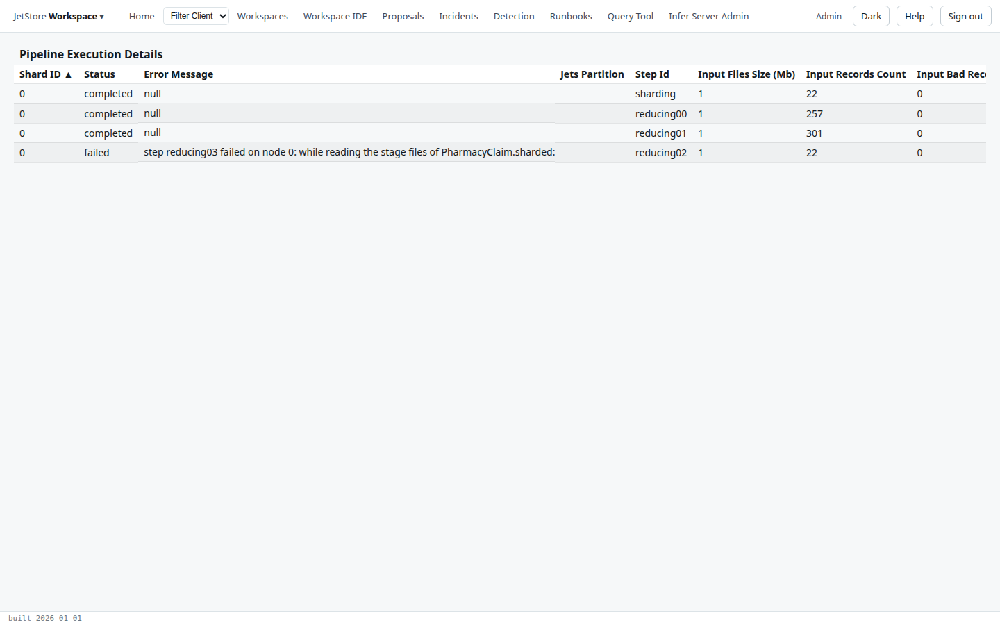

*Pipeline Execution Details* shows how one run went, step by step: a row for each shard of each
step the run reached, with its status, its error if it had one, and how many records it read and
wrote. Open it to find the step where a run stopped, or where records went missing.

A run is a sequence of steps, named by its pipeline definition: `sharding`, which splits the input
across workers, then `reducing00`, `reducing01` and so on. A step runs on one or more shards at once;
each shard is a row here. See [What happens in a run](/docs/user/concepts/pipelines-and-sessions/#what-happens-in-a-run).

**Capability:** `jetstore_read`.

**Reached from** Home's *Pipelines Status* tab: select a run, then *View Execution Details*. The
screen's address carries the run's session id, `executionStatusDetails/<session id>`. Your browser's
*Back* returns to Home.

The rows are sorted by shard. The table has no buttons.

| Column | What it holds |
|---|---|
| Shard ID | the shard, from 0 |
| Status | the shard's status: `completed`, `in progress`, `failed`… |
| Error Message | the error the shard stopped on, if it failed |
| Jets Partition | the partition of the input the shard read, when the step reads one partition per shard |
| Step Id | the step |
| Input Files Size (Mb) | the size of the files the shard read, in megabytes |
| Input Records Count | the records it read |
| Input Bad Records Count | the records it could not read |
| Rete Sessions Count | the rule sessions it ran: one for each member whose records went to the rule engine, on the step that runs the rules |
| Output Records Count | the records it wrote |
| Duration | how long the shard ran |

For the same run totalled per step, over all its shards, see
[CPIPES Execution Details](/docs/user/screens/cpipes-execution-details/). The error that stopped a
failed run as a whole is also in *View Failure Details* on [Home](/docs/user/screens/home/#pipelines-status).
