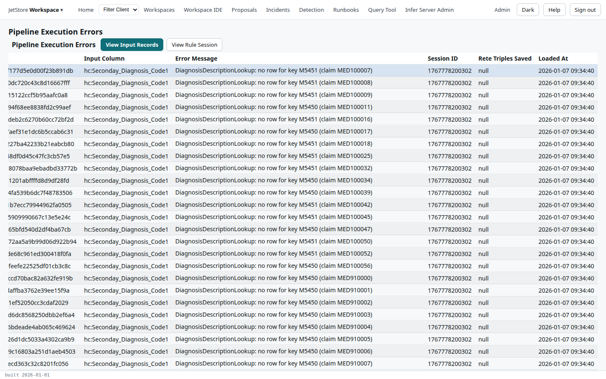
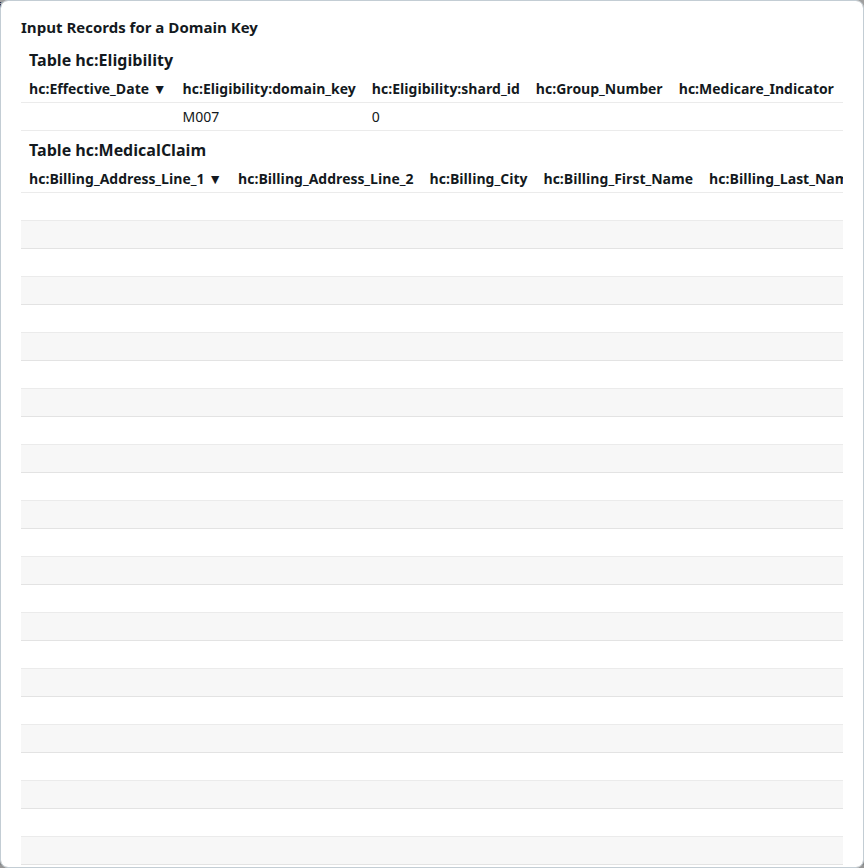

*Process Errors* lists the errors one run raised: a row for each, with the member it concerns, the
column involved and the message. A run that finishes with errors has status `errors`: it completed,
its output is registered, and the rules could not do what they should for some members. Open this
screen to see which members, and why; its two dialogs show the records behind an error.

The errors come from the rules, and from the mapping when a required value is missing. See
[When something goes wrong](/docs/user/concepts/rule-engine/#when-something-goes-wrong) for how the rules raise them.

**Capability:** `jetstore_read`.

**Reached from** Home's *Pipelines Status* tab: select a run, then *View Process Errors*. The
screen's address carries the run's session id, `processErrors/<session id>`. Your browser's *Back*
returns to Home. A run with no errors shows an empty table.

The rows are sorted by member, 50 to a page. Select one error to use the buttons.

| Column | What it holds |
|---|---|
| Key | the error's key |
| Process Execution Key | the key of the run on *Pipelines Status* |
| Process Name | the process run |
| Domain Key (the first) | the run's domain key, `hc:Eligibility` for `CI`'s pipelines |
| Domain Key (the second) | the member the error concerns: the value of the domain key, such as `M007`. The table sorts on it |
| Row jets:key | the key of the record the error was raised on |
| Input Column | the column or property involved |
| Error Message | what went wrong |
| Session ID | the run's session |
| Rete Triples Saved | whether the rule session was saved with the error, for *View Rule Session* |
| Loaded At | when the error was written |

| Button | What it does |
|---|---|
| **View Input Records** | Opens the selected error's member in every input of the run, below. |
| **View Rule Session** | Opens the rule session saved with the selected error, below. |

## Input records

*View Input Records* opens a dialog, *Input Records for a Domain Key*, with a table for each input
of the run: its main input first, then its merged inputs, then any injected inputs. Each table holds
the member's records in that input, from the session the run read, so you see exactly what the rules
were given. Each table is headed with its table name, and its columns are the table's own, in
alphabetical order. *Close* returns to the errors.

The dialog scrolls, and each table scrolls sideways: the columns that matter are often further
along than the first ones.

## Rule session

*View Rule Session* opens the *Rete Session Explorer*: the facts the rule engine held for the
member when the error was raised, so you can see what the rules saw. It has three tables, read from
left to right:

| Table | What it lists |
|---|---|
| Class Name | the classes of the entities in the session. Select one to list its entities |
| Entity Key | the entities of the selected class. Select one to see its properties |
| Entity Details | the selected entity's properties: *Property*, *Value* and its *Type* |

**Visit Object Entity**, above *Entity Details*, follows the selected property when its value is
another entity, and shows that entity's properties instead.

A rule session is saved with the first errors of a run only, as many as the pipeline
configuration allows; the *Rete Triples Saved* column says which. For an error without one, the
explorer opens with its tables empty.

## See also

- [Read a run's process errors](/docs/user/how-to/read-process-errors/)
