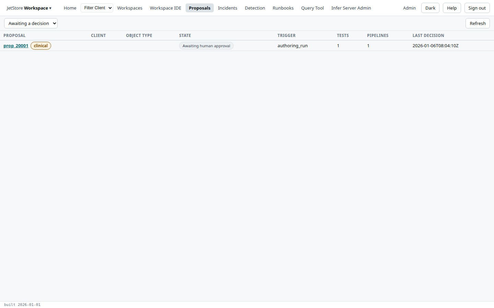
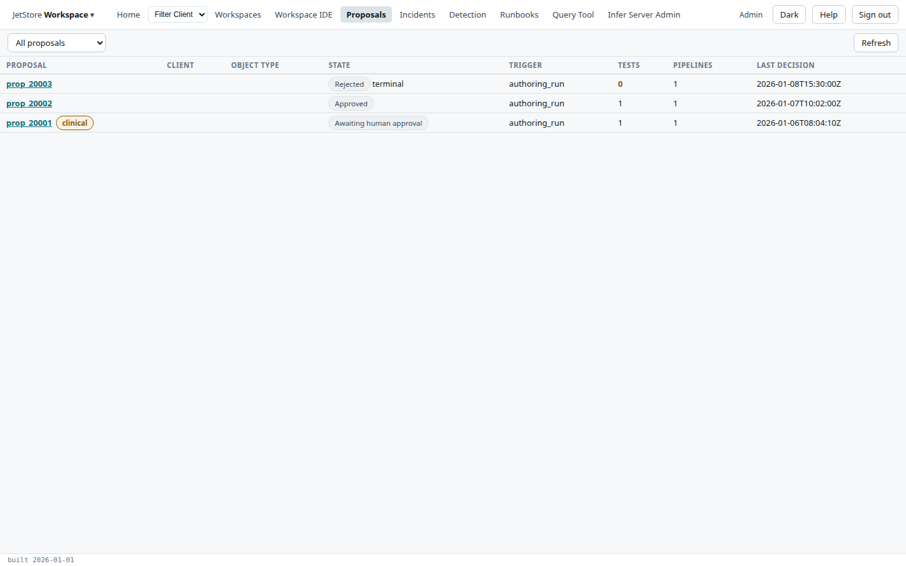
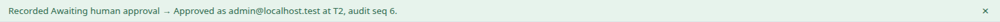
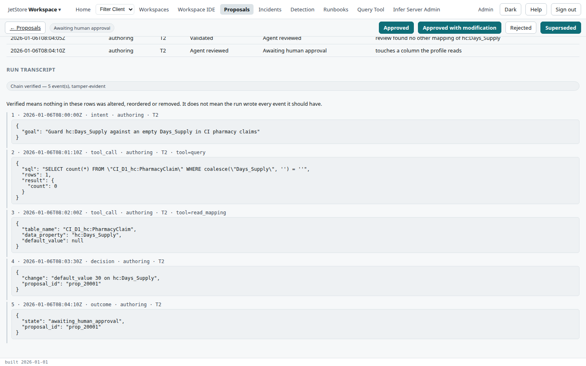

When one of JetStore's AI agents produces a change, such as a mapping, a pipeline setting or a
lookup, it does not apply it: it writes a **change proposal** for a person to decide on. The
*Proposals* screen lists them; each has a page with what the agent produced, the decisions taken on it
so far, the transcript of the agent's run, and the buttons that record the next decision.

**Reach it** from *Proposals* in the top bar. It needs the `agent_supervision` capability; without
it the screen says so and shows nothing, because proposals and transcripts are governance records.

## The list

The picker chooses what is listed: **Awaiting a decision** (the default: draft, validated,
agent-reviewed and awaiting human approval), **Open proposals** (those, and the approved and deployed
ones), or **All proposals**. **Refresh** reads the list again. The most recently decided come first.

| Column | What it shows |
|---|---|
| **Proposal** | The proposal's id, linked to its page. **clinical** marks a proposal whose impact touches clinical relevance. |
| **State** | Where the proposal is in its lifecycle; *terminal* when no further decision is possible. |
| **Trigger** | What prompted it, such as an authoring run. |
| **Tests** | How many tests the agent generated with it. A proposal with none is shown in a warning colour. |
| **Pipelines** | How many pipelines it affects. |
| **Last decision** | When it was last decided on, or *never*. |

## The lifecycle

A proposal starts as a **draft**. The agent's own checks take it to **validated** and **agent
reviewed**, then to **awaiting human approval**. A person then records **approved**, **approved with
modification** or **rejected**; an approved proposal is later **deployed**. At any point before it
ends, a proposal can be **superseded** by a newer one. **Rejected** and **superseded** are terminal.

## A proposal

| Section | What it shows |
|---|---|
| **The bar** | **← Proposals**, the current state, and one button per decision the state allows. A terminal proposal shows *No further decision* instead. |
| **Facts** | The **trigger** and the run that produced the proposal, the **model version**, the **generated tests**, the **affected pipelines** and the **affected assets**. |
| **What the run produced** | The agent's output: the change and its reasons, line by line as written. A run whose output is a JSON document shows it indented, one member per line. |
| **Decision** | A **rationale**, optional, recorded with the decision you take. The decision is recorded under your account, and the autonomy tier is read from the agent's run rather than chosen here. |
| **Decisions so far** | Every decision on the proposal: when, who, the tier, from which state to which, and why. The agent's own steps are listed as well as people's. |
| **Run transcript** | The audit record of the agent's run, below. |

**Recording a decision**: write the rationale if you have one, then press the decision's button. The
screen confirms it, with the new state, your account, the tier and the decision's number in the run's
audit chain:

If someone else decided on the proposal in the meantime, the decision is refused, the proposal is
read again, and the screen says so.

### The run transcript

The transcript lists every event the agent's run wrote, in order: its number, time, kind (*intent*,
*tool_call*, *decision*, *outcome*, *approval*, *error*), the actor, the tier, the tool called, and
its payload. Each event carries a hash of the one before, so the screen can check the chain:

- **Chain verified** means nothing in these events was altered, reordered or removed. It does not
  mean the run wrote every event it should have.
- **CHAIN NOT VERIFIED** lists the defects found, beside the events they concern.

A decision you record is appended to the same chain.

## A proposal drafted from a feed incident

Not every proposal comes from an agent's run. When shadow triage writes the incidents for a feed's
deliveries (see [Incidents](/docs/user/screens/incidents/)), it also looks for one case that has a known correction:
a feed whose deliveries **look cumulative** while its source configuration declares it
**incremental**. For such a feed it drafts one proposal: declare the feed cumulative, by setting
**is_cumulative** on its source configuration.

**When it is drafted.** A delivery of an incremental feed looks cumulative when most of it was in the
delivery before: its *delivery_overlap* finding records that at least half of its distinct keys were
already in its predecessor, or its *delivery_unchanged* finding records the same key set with no
newer date of service. The proposal is drafted only when the feed's **latest three deliveries in a
row** look so. One restated delivery does not draft it, nor do restatements spread through the
feed's history, nor a stretch the feed has since left. A feed already declared cumulative is never
proposed.

**What it says.** In the list its trigger is **incident**. On its page, **What the run produced**
holds the proposal's text:

- the change proposed, naming the feed, its client, org and object type;
- the evidence, delivery by delivery: the overlap share or *unchanged*, the session, and the incident
  on it;
- what the change would do: the feed detectors would judge the feed as cumulative, and a pipeline
  that names its object type on a channel with a lookback would read **only the latest delivery
  across the lookback**, not every delivery of every period;
- a warning when other source configurations of the same client share the object type and are not
  declared cumulative, since a cumulative read of a mixed object type fails the run;
- what it does not do.

**What it does not do.** Nothing is applied. The source configuration is unchanged until somebody
edits it on the source configuration screen. The incident it names stays at **diagnosed**, and no
remediation is recorded. The proposal is drafted once per feed: a later triage run finds it and
drafts nothing, whatever state it is in, so a rejected proposal stays rejected.

**Deciding on it.** A person moves it, on its page, through the lifecycle above. Two limits apply
today, and both are being worked on:

- **The decision buttons record nothing yet.** The autonomy tier of a decision is read from the
  agent's run, and a proposal drafted from an incident has no run, so a decision is refused with
  *no run … so its tier cannot be resolved*. Its **Run transcript** is empty for the same reason, and
  the facts label the incident as a run.
- **A draft cannot be rejected directly.** From *draft* the lifecycle offers only *validated* and
  *superseded*; *rejected* is reached from *awaiting human approval*.

Until both are lifted, the proposal is a reading of the evidence, not something to act on. If the
feed is cumulative, change its source configuration yourself; the detectors then judge it as
cumulative. If it is not, leave the proposal in draft: it is not drafted again. Either
way, the incident on the [Incidents](/docs/user/screens/incidents/) screen moves only when a person
moves it.
