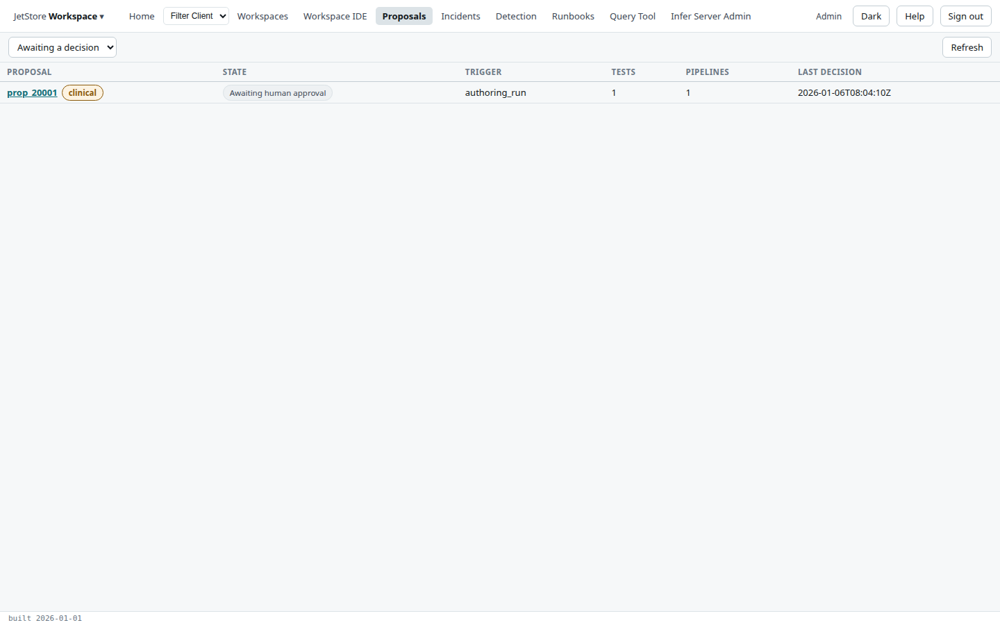
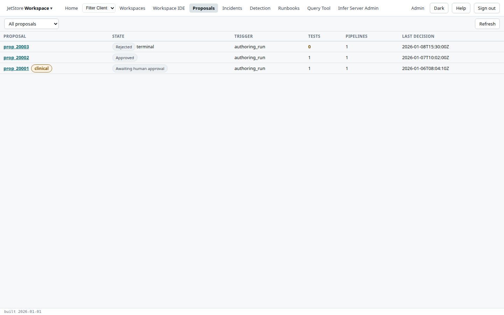
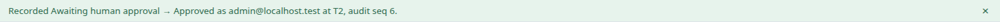
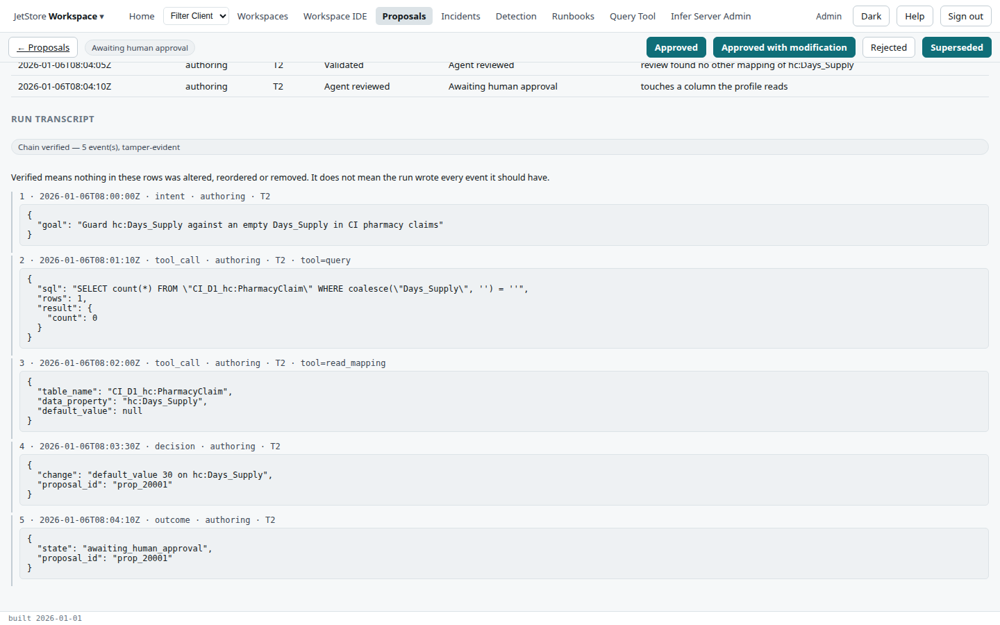

When one of JetStore's AI agents produces a change, such as a mapping, a pipeline setting or a
lookup, it does not apply it: it writes a **change proposal** for a person to decide on. The
*Proposals* screen lists them; each has a page with what the agent produced, the decisions taken on it
so far, the transcript of the agent's run, and the buttons that record the next decision.

**Reach it** from *Proposals* in the top bar. It needs the `agent_supervision` capability; without
it the screen says so and shows nothing, because proposals and transcripts are governance records.

## The list

The picker chooses what is listed: **Awaiting a decision** (the default: draft, validated,
agent-reviewed and awaiting human approval), **Open proposals** (those, and the approved and deployed
ones), or **All proposals**. **Refresh** reads the list again. The most recently decided come first.

| Column | What it shows |
|---|---|
| **Proposal** | The proposal's id, linked to its page. **clinical** marks a proposal whose impact touches clinical relevance. |
| **State** | Where the proposal is in its lifecycle; *terminal* when no further decision is possible. |
| **Trigger** | What prompted it, such as an authoring run. |
| **Tests** | How many tests the agent generated with it. A proposal with none is shown in a warning colour. |
| **Pipelines** | How many pipelines it affects. |
| **Last decision** | When it was last decided on, or *never*. |

## The lifecycle

A proposal starts as a **draft**. The agent's own checks take it to **validated** and **agent
reviewed**, then to **awaiting human approval**. A person then records **approved**, **approved with
modification** or **rejected**; an approved proposal is later **deployed**. At any point before it
ends, a proposal can be **superseded** by a newer one. **Rejected** and **superseded** are terminal.

## A proposal

| Section | What it shows |
|---|---|
| **The bar** | **← Proposals**, the current state, and one button per decision the state allows. A terminal proposal shows *No further decision* instead. |
| **Facts** | The **trigger** and the run that produced the proposal, the **model version**, the **generated tests**, the **affected pipelines** and the **affected assets**. |
| **What the run produced** | The agent's output: the change and its reasons. |
| **Decision** | A **rationale**, optional, recorded with the decision you take. The decision is recorded under your account, and the autonomy tier is read from the agent's run rather than chosen here. |
| **Decisions so far** | Every decision on the proposal: when, who, the tier, from which state to which, and why. The agent's own steps are listed as well as people's. |
| **Run transcript** | The audit record of the agent's run, below. |

**Recording a decision**: write the rationale if you have one, then press the decision's button. The
screen confirms it, with the new state, your account, the tier and the decision's number in the run's
audit chain:

If someone else decided on the proposal in the meantime, the decision is refused, the proposal is
read again, and the screen says so.

### The run transcript

The transcript lists every event the agent's run wrote, in order: its number, time, kind (*intent*,
*tool_call*, *decision*, *outcome*, *approval*, *error*), the actor, the tier, the tool called, and
its payload. Each event carries a hash of the one before, so the screen can check the chain:

- **Chain verified** means nothing in these events was altered, reordered or removed. It does not
  mean the run wrote every event it should have.
- **CHAIN NOT VERIFIED** lists the defects found, beside the events they concern.

A decision you record is appended to the same chain.
