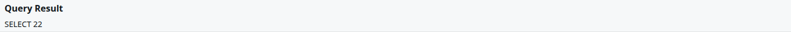

The *Query Tool* runs an SQL statement against JetStore's PostgreSQL database and shows the result.
It reads any table, a client's data tables and JetStore's own, and with *Submit DDL* it runs
statements that change them. Use it to answer a question no screen answers.

**Capability:** `workspace_ide`, for the entry in the top bar and for both buttons; the server
checks it again. **Statements run with your authority, and nothing stops a statement that changes
or deletes data.** There is no undo.

**Reached from** *Query Tool* in the top bar.

| Control | What it does |
|---|---|
| **Query** | The statement to run. It may span several lines. |
| **Submit Query** | Runs one statement and shows the rows it returns, with its own columns, under *Query Result*: every row, on one page, so put a `LIMIT` on a query that could return many. For a query: `SELECT`, or a statement with `RETURNING`. It is cancelled after 110 seconds. |
| **Submit DDL** | Runs the statement, or several separated by `;`, and shows only what the database replied, such as `CREATE TABLE` or `INSERT 0 5`: no rows. It has no time limit, so use it for a long statement, such as an export. |

A few things to know when writing a statement:

- **Quote names that contain a colon**, which is most of them: `"cintel:Patient_Profile"`,
  `"hc:Member_ID"`. A staging table's name has one too: `"CI_D1_hc:Eligibility"`. JetStore's own
  tables are in the `jetsapi` schema: `jetsapi.pipeline_execution_status`.
- **Filter by session.** Every row a pipeline or a load wrote carries `session_id`; the sessions are
  on Home's tabs.
- **The result shows one value per cell**, as text. A date is shown in UTC.
- **An error is shown in the banner** at the top, as the database reported it.

The result is sorted as your statement orders it. In this version, pressing a column heading of the
result sorts by its first column rather than by the one pressed, so put an `ORDER BY` in the
statement.

The tables that hold a client's data are described by the workspace's data model; JetStore's own
tables are listed in the Developer's Guide, under
[System tables](/docs/developer/workspace/system-tables/).
