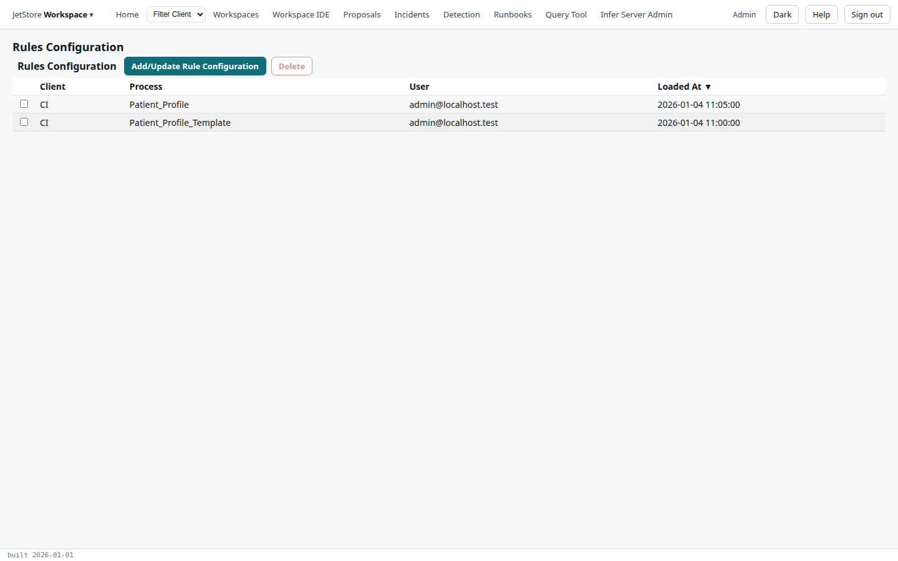
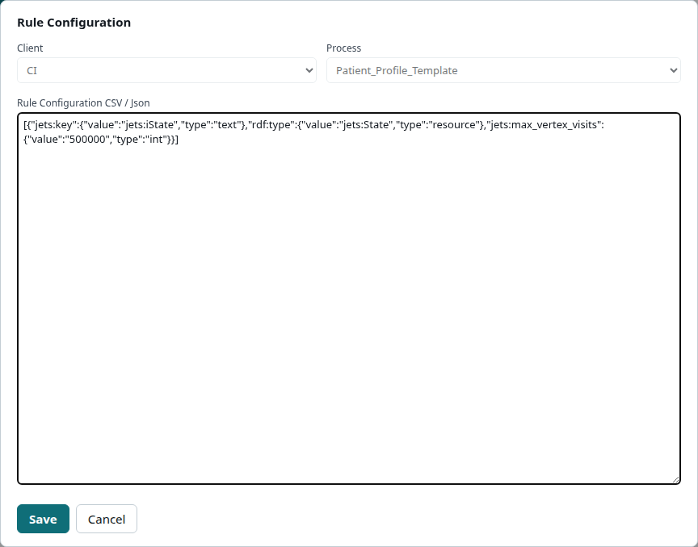

The *Rules Configuration* screen holds the **rule configurations**: for one client and one process,
a list of objects asserted into every rule session of that process's pipelines before the rules run.
The rules read their settings from them, such as the limit on how often the engine may revisit a
node (`jets:max_vertex_visits`), or a member to stop on when tracing (`cintel:breakOnMemberID` in
`jets_ws`). [The rule engine](/docs/user/concepts/rule-engine/) explains where they come in.

A rule session receives the objects from three places, appended in this order: the pipeline
definition's own (in its `.pc.json`, the same for every client), this screen's (for every pipeline of
the process, for one client), and the pipeline configuration's (for one pipeline of one client, set
in the [Pipeline Configuration](/docs/user/screens/flows/pipeline-configuration/) flow).

**Reach it** from the *JetStore Workspace* menu at the left of the top bar, *Rules Configuration*.
Any signed-in user can open it; reading the table needs `jetstore_read`, and saving or deleting needs
`client_config`.



## The table

| Column | What it shows |
|---|---|
| **Client** | The client the configuration applies to. |
| **Process** | The process whose pipelines read it. |
| **User** | Who saved it last. |
| **Loaded At** | When it was saved. |

| Button | What it does |
|---|---|
| **Add/Update Rule Configuration** | Opens the *Rule Configuration* dialog: empty to add one, filled from the selected row to update it. |
| **Delete** | Deletes the selected configuration, after a confirmation. Needs a selected row. |

## The dialog



| Field | What it holds |
|---|---|
| **Client** | The client. Fixed once the configuration exists. |
| **Process** | The process. Fixed once the configuration exists. |
| **Rule Configuration CSV / Json** | The objects, either as a JSON array or as CSV with a header row. |

In the JSON form each object is one element of the array; each of its properties names a data
property and gives its `value` and `type`. `jets:key` identifies the object and `rdf:type` its class:

```json
[
  {
    "jets:key": { "value": "jets:iState", "type": "text" },
    "rdf:type": { "value": "jets:State", "type": "resource" },
    "jets:max_vertex_visits": { "value": "500000", "type": "int" }
  }
]
```

**Save** adds the configuration, or updates the selected one; **Cancel** closes the dialog. A client
and process have one rule configuration: to change it, select its row first.
