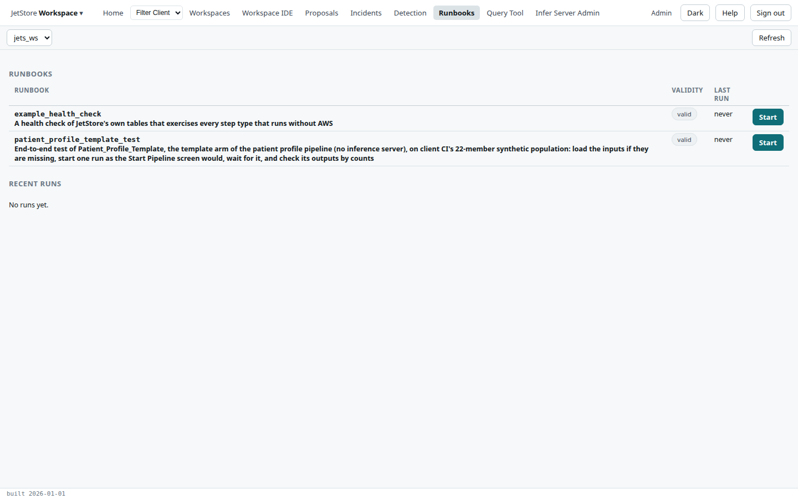
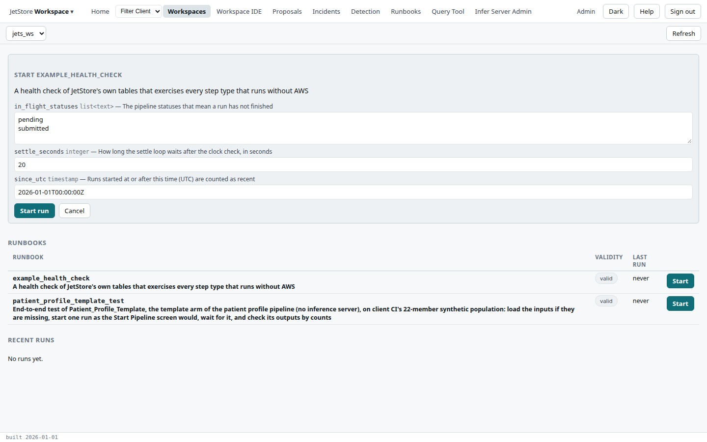
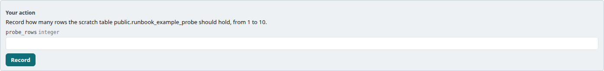
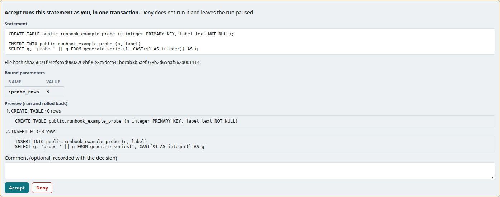

A **runbook** is a list of steps in a workspace's `runbooks/` folder that JetStore runs for you: SQL
queries and statements, waits and loops, pauses, values you record, pipeline starts and compiles. The
*Runbooks* screen lists the runbooks of a workspace and their recent runs, and starts one; each run has
a page of its own, where you follow it and act on the steps that wait for you. How a runbook is written
is in [The workspace runbook format](/docs/developer/engine/runbook-format/).

**Reach it** from *Runbooks* in the top bar, which stays marked on every runbook page, the list of a
workspace's runbooks at `/workspaces/<name>/runbooks` included. It needs the `runbook_execute` capability. Each step also
needs its own: a query needs `jetstore_read`, a pipeline start `run_pipelines`, a compile
`workspace_ide`. A step runs as the person who started the run, or who accepted it.

## The list

The **workspace picker** chooses the workspace whose runbooks are listed, and its address,
`/workspaces/<name>/runbooks`; **Refresh** reads the list again.

| Column | What it shows |
|---|---|
| **Runbook** | The runbook's name and description. |
| **Validity** | *valid*, or the findings the validator reports on the runbook, such as a missing `.sql` file. A runbook with an error cannot be started. |
| **Last run** | A link to the last run, its status and when it started, or *never*. |
| **Start** | Opens the start form. Disabled for a runbook that is not valid. |

**Recent runs** lists the workspace's last runs: the run's number, linked to its page, the runbook,
the status, who started it, and when it started and finished.

### Starting a run

The start form lists the runbook's **parameters**, each with its type and description, filled with
its default. A `list<text>` parameter takes one value per line. **Start run** starts the run and opens
its page; **Cancel** closes the form. A runbook has one run in progress at a time: a second start is
refused until the first is finished or aborted.

## A run

The run's page, `/runbooks/run/<number>`, opens when the run starts, and from the run links of the
list. While the run is working it is read again every few seconds, and the bar shows *Live*.

The bar offers only what the current step can take: the step the run is at, which is the last one
listed that is not finished.

| Button | Shown when | What it does |
|---|---|---|
| **← Runbooks** | always | Back to the list of the run's workspace. |
| **Continue** | the run is paused at a pause step, or after a step that failed or was denied | Goes on from the current step; after a failed or denied step, the next step runs and the failure or denial stays in the record. It reads the runbook again, so a step edited since the pause runs as edited. |
| **Skip** | the run is paused, unless a step is running; or the run is in a wait | Records the current step as skipped and goes on. It also ends a wait early. |
| **Retry** | the current step failed, was denied or was interrupted | Runs the current step again; a `ddl` step asks for confirmation again. |
| **Abort** | the run is not finished | Stops the run: the steps not yet run are marked skipped. |
| **Release** | the run is finished | Asks for confirmation, then releases the run's result: every step's statement, bound values, outputs and rows may then leave the database. |
| **Download .rbr.json** | the run is released | Downloads the result. |
| **Refresh** | always | Reads the run again. |

**Run statuses**: *Running*, *Paused* (waiting for you), *Completed*, *Failed* and *Aborted*.

Under the bar, the run's facts: its **workspace**, **status**, when and by whom it was **started**,
when it **finished**, the **environment** (the JetStore release and the workspace version it ran
on), its **parameters**, the **revisions** of the runbook files it ran under, each with its hash,
when and by whom it was **released**, and the **last error**. **Edit future steps** opens the runbook
file in the [Workspace IDE](/docs/user/screens/workspace-ide/): a step that has already run cannot
change, and *Continue* runs the edited version of the steps still to come.

### The steps

Each step that has run, or is waiting, is listed in order with its number, its id, its type and its
status, its description, when it started and finished and who ran it. A step's **Outputs** are the
values later steps and conditions can read, as `<step>.<name>`; a query's **Rows** are shown as a table;
**Show SQL** shows the statement it ran, its file's hash and its bound values.

Step statuses: *Pending*, *Running*, *Waiting* (a wait step between checks), *Awaiting confirmation*,
*Awaiting input*, *Completed*, *Failed*, *Skipped*, *Denied* and *Interrupted*. A failed `assert`
stops the run, or pauses it when the runbook says so; the step shows the runbook's message.

**A pause step** stops the run so that you can read what it has found so far. Its panel, *The run
waits for you*, shows the runbook's message; **Continue**, in the bar, goes on, and **Skip** records the
step as skipped and goes on.

**A manual step** waits for values you record. Its panel, *Your action*, shows the runbook's
instruction and one field per value; **Record** records them and the run goes on. **Skip**, in the
bar, goes on without them.

**A `ddl` step always waits for a person to accept it**, and shows exactly what *Accept* will run:
the statement as it will be sent, the hash of its file, every bound parameter and its value, and, when
the runbook asks for a preview, each statement's result from a trial run that was rolled back.
**Accept** runs it, as you, in one transaction; **Deny** does not run it and leaves the run paused.
A comment is recorded with either. **Skip**, in the bar, does not run it either and goes on.

A pipeline start, a schema event or a compile waits in the same way, saying what *Accept* will do:
the row it will insert into the pipeline status table, the event it will put, or the workspace it will
compile.

Once the run is finished and released, its result can be downloaded:

## See also

- [Run a runbook](/docs/user/how-to/run-a-runbook/)
