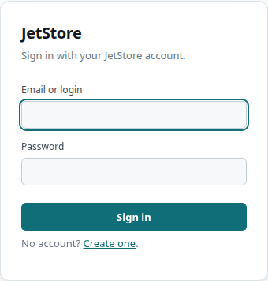
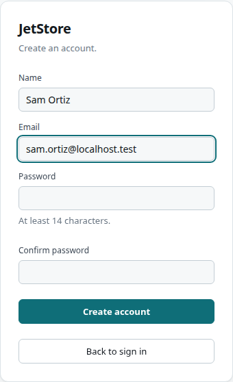

JetStore opens on the **sign-in form** for anyone without a session, whatever address they arrive
at. The **registration form**, at `/register`, is the only way an account is created.

## Sign in

| Control | What it does |
|---|---|
| **Email or login** | The account's email address. The installation's administrator account may instead be a login that is not an address, such as `admin`. |
| **Password** | The account's password. |
| **Sign in** | Signs in. An unknown login, a wrong password and an account not yet activated all get the same message under the fields, so the message does not say whether the account exists. |
| **No account? Create one** | Opens the registration form. |

Signing in needs no capability. Once signed in you land on [Home](/docs/user/screens/home/), and the
[top bar](/docs/user/screens/#the-top-bar) shows the screens your roles allow; see
[Users, roles and capabilities](/docs/user/concepts/users-and-capabilities/).

**The session is held by the browser tab.** Reloading the page, or typing an address into the
address bar, signs you out and shows this form again. Move between screens with the top bar and the
screens' own links.
**Sign out**, at the right of the top bar, ends the session and returns to this form.

## Register

| Field | Rule |
|---|---|
| **Name** | At least two characters, at most 80. |
| **Email** | The account's address, which is also its key. Up to 80 characters, written in lower case as you type. |
| **Password** | At least 14 characters. |
| **Confirm password** | The same password again. |

**Create account** creates the account and shows *Registration successful*, with a **Sign in** button
back to the sign-in form. **Back to sign in** leaves without creating anything.

**A new account is inactive and has no roles.** It cannot sign in until someone with the
`user_admin` capability activates it and gives it roles, on the
[User Administration](/docs/user/screens/user-administration/) screen. Until then, signing in shows
*Invalid user or password, or the user has not been activated by an administrator*.

## See also

- [Manage users](/docs/user/how-to/manage-users/)
