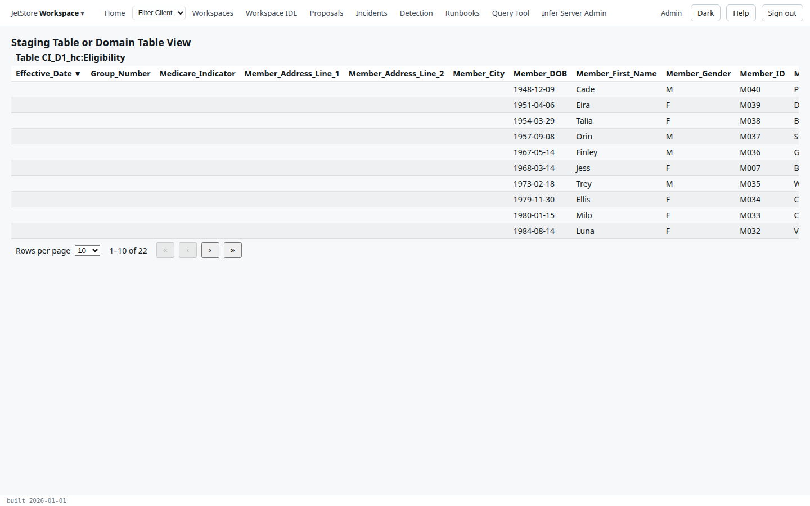
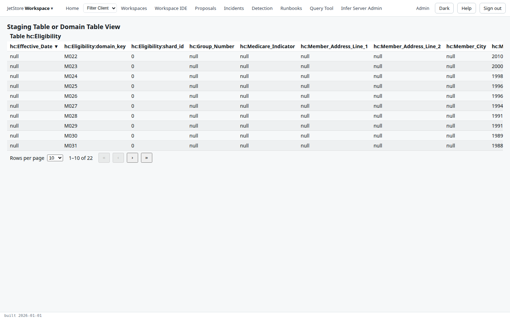

*Staging Table or Domain Table View* shows the rows of one table that carry one session: a file's
rows in its **staging table**, as they were loaded, or the rows a pipeline wrote to a **domain
table**. It is how you look at data in JetStore without writing SQL.

**Capability:** `jetstore_read`.

**Reached from**

- Home's *Data Registry* tab: select an entry, then *View Loaded Data*;
- *File Loader Status*: select a load, then *View Loaded Data*.

The screen's address names the table and the session, `domainTableViewer/<table>/<session id>`. Your
browser's *Back* returns to where you came from.

The table is headed with its name. Its columns are the table's own, every one of them, in
alphabetical order, and they come from the table rather than from a configuration, so the screen
shows any table. A staging table has one text column for each column of the file, with the file's
headers as names, and a `session_id`; a domain table has the data model's properties, such as
`hc:Member_ID`, and JetStore's own columns, such as `jets:key` and the domain key. The table has no
buttons, and shows 10 rows to a page.

The rows are sorted by the first column. In this version, pressing another column's heading sorts by
the first column again rather than by the one pressed; use the
[Query Tool](/docs/user/screens/query-tool/) to sort by any column.

A file's entry in the *Data Registry* has rows here only once the file has been loaded into its
staging table with the [Load Files](/docs/user/screens/flows/load-files/) flow. Otherwise the table is
empty.

## See also

- [Look at loaded data](/docs/user/how-to/look-at-loaded-data/)
