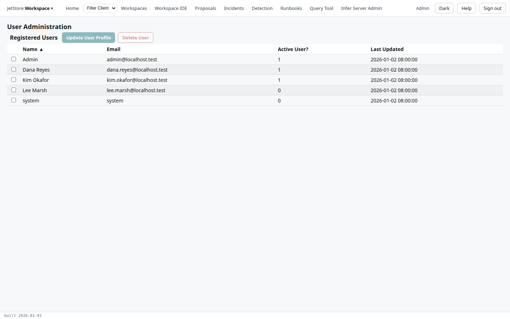
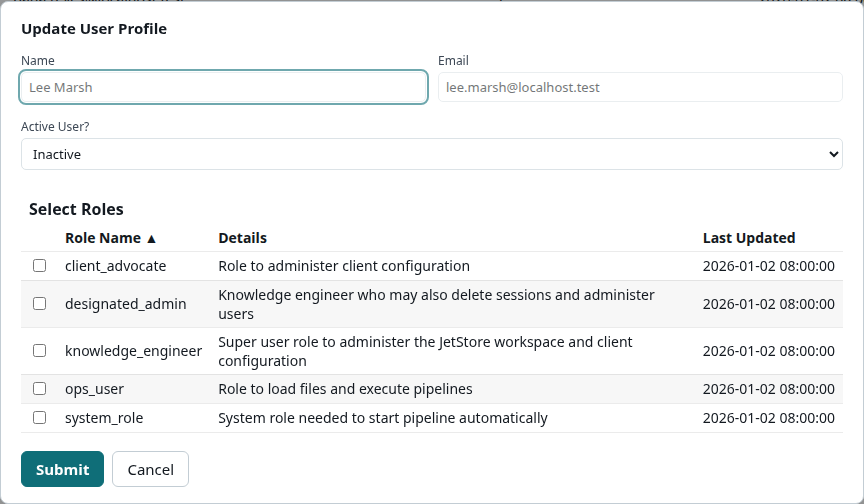

The *User Administration* screen lists every account on the installation, and is where a new account
is activated and given its roles, an account is deactivated, or deleted. What each role allows is in
[Users, roles and capabilities](/docs/user/concepts/users-and-capabilities/).

**Reach it** from the *JetStore Workspace* menu at the left of the top bar, *User Administration*.
It needs the `user_admin` capability, which the `designated_admin` role and the installation's
administrator account hold; without it the menu entry is disabled, and the server refuses every change.

## The table

| Column | What it shows |
|---|---|
| **Name** | The name the account was registered with. |
| **Email** | The account's address, which is also its key. |
| **Active User?** | `1` if the account can sign in, `0` if not. A newly registered account is `0`. |
| **Last Updated** | When the account last changed. |

The `system` account is the one JetStore uses to start pipelines automatically; it cannot sign in.

| Button | What it does |
|---|---|
| **Update User Profile** | Opens the *Update User Profile* dialog for the selected account. |
| **Delete User** | Deletes the selected accounts, after a confirmation. |

## The dialog

| Field | What it does |
|---|---|
| **Name**, **Email** | The account, as registered. |
| **Active User?** | *Active* lets the account sign in; *Inactive* stops it. |
| **Select Roles** | Tick the roles the account holds. Every role on the installation is listed, with what it is for. |

**Submit** saves the active flag and the roles.

**The administrator account cannot be changed here.** The server refuses to deactivate, change or
delete it, so the installation always keeps an account that can manage users.

## See also

- [Manage users](/docs/user/how-to/manage-users/)
