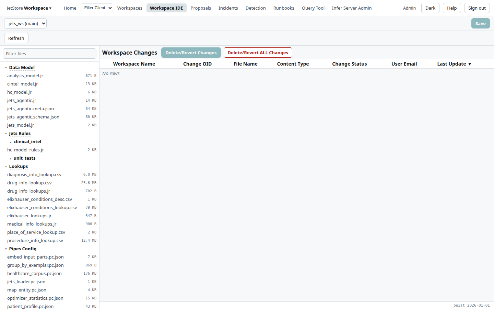
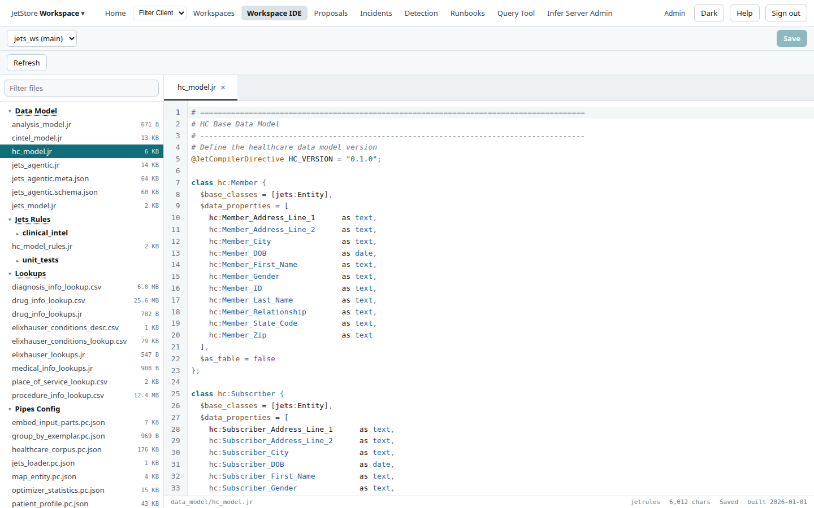
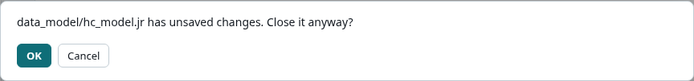
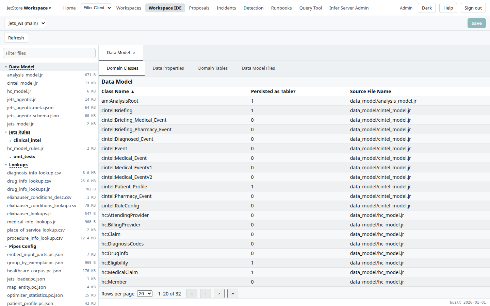

The *Workspace IDE* is the editor of a workspace: its files in a tree, each opened in a tab, the
changes saved on this installation listed and revertible, and what the compiler made of the data
model, the rules and the lookups. How a saved file becomes an override, and why it takes a compile
and a commit to make it last, is in [Workspaces](/docs/user/concepts/workspaces/).

**Reach it** from *Workspace IDE* in the top bar, which opens the active workspace, or with **Open**
on the [Workspaces](/docs/user/screens/workspaces/) screen, which opens the selected one at
`/workspaces/<name>/home`. A runbook run's *Edit future steps* link opens it too. It needs the
`workspace_ide` capability: the top bar entry is disabled without it, and a user who reaches the
screen anyway sees *Read only* and cannot save.

## The bars at the top

| Control | What it does |
|---|---|
| **Workspace picker** | The workspace being edited, with its branch. Choosing another opens it. |
| **Save** | Saves the file in the current tab. Enabled when the tab has unsaved changes and the file is not read-only. `Ctrl+S` does the same in the editor. |
| **Refresh** | Reads the file tree and the changes table again. |
| **Workspace guide** | Beside *Save*: opens this installation's guide to the workspace at the page for the open file (below). Shown only when the installation has a guide to the workspace open in the IDE, and to every user, since the guide needs no capability. |

## The workspace guide

An installation's documentation has a fourth guide, named for its workspace: its domain, lookups and
rules, generated from the compiled workspace, and the pages the workspace's own people wrote.
**Workspace guide** opens it in the documentation's tab, the one *Help* uses, at the page for the file
open in the editor:

| File open in the editor | Page opened |
|---|---|
| A data-model file | its page of the domain: its classes, their properties and its domain tables |
| A lookup's source file | the lookups page |
| A main rule file | its rules page: the rules it includes, their descriptions and its unit tests |
| A rule file that main rule files include | the rules section's overview |
| A page of the workspace's `docs/` folder | that page |
| Any other file, or none | the guide's landing page |

The button is not shown when the installation's documentation has no guide to the workspace open in
the IDE: an installation built without one, or another workspace opened here. The guide describes the
workspace as it was compiled into the deployed image, so an edit saved here, a page of `docs/`
included, is not in it until it is committed to the workspace's repository and the images are
rebuilt. The top bar's *Help* still opens this page. How a workspace writes its guide is in
[Document a workspace](/docs/developer/how-to/document-a-workspace/).

## The file tree

The left panel lists the workspace's files by section: *Data Model*, *Jets Rules*, *Lookups*,
*Pipes Config*, *User Flows*, *Table Configurations*, *Process Configuration*, *Reports*, *Runbooks*,
*Documentation* and the others the workspace has, each file
with its size. **Filter files** narrows the tree to the names that match.

- **A file** opens in a tab of the editor.
- **The caret of a section** expands or collapses it.
- **The name of *Data Model*, *Jets Rules* or *Lookups*** opens that section's compiled view (below),
  rather than expanding it.

**Documentation** lists the workspace's `docs/` folder: the pages its people write for the
[workspace guide](#the-workspace-guide), Markdown files in `docs/` and its subfolders, and the guide's
settings file, `docs/workspace_docs.json`. A page opens, is edited and is saved like any other file,
and **Workspace guide** opens that page in the guide. The section has no **Add File**: a new page is
added in the workspace's repository. How to write a page is in
[Document a workspace](/docs/developer/how-to/document-a-workspace/).

## Editing a file

Every file opens in its own tab, whatever its size. The editor highlights JetRules, JSON, SQL and the
other formats a workspace holds. A tab with unsaved changes shows a dot, and its status bar says
*Modified*:

The status bar shows the file's path, its language, *Read only* when it cannot be edited, its size and
whether it is saved. Files JetStore installs into every workspace are read-only: a workspace changes
what one of them does by extending it, as
[Workspace assets JetStore installs](/docs/developer/workspace/assets/) explains. A Markdown file,
such as the workspace's `README.md`, is read-only too, except a page under `docs/`.

**Saving checks the file first.** A JSON file that does not parse is refused before it is sent. The
server then checks the file types it knows, such as user flows, table documents, SQL scripts and the
guide's `workspace_docs.json`, and refuses a save that would break them, saying why. A saved file becomes an **override**: it is held in
the database, takes precedence over the file in the image, and appears in *Workspace Changes*.

Closing a tab with unsaved changes asks first; **OK** discards them.

## Workspace Changes

With no tab open, the right panel shows the workspace's overrides: every file saved on this
installation and not yet committed.

| Column | What it shows |
|---|---|
| **Workspace Name** | The workspace. |
| **Change OID** | The identifier of the stored content. |
| **File Name** | The file's path in the workspace. |
| **Content Type** | The kind of file. |
| **Change Status** | The state of the change. |
| **User Email** | Who saved it. |
| **Last Update** | When it was saved. |

**Delete/Revert Changes** reverts the selected overrides, and **Delete/Revert ALL Changes** reverts
every one, each after a confirmation: the file in the image applies again. A file added since the
installation was deployed is deleted, and the confirmation says so. **Delete/Revert ALL Changes keeps
the compiled files** (`workspace.db`, `lookup.db`, `workspace.tgz`, `reports.tgz`) from the last compile,
so compile again after reverting. A change that has been
committed and pushed from the [Workspaces](/docs/user/screens/workspaces/) screen leaves this table.

## Compiled views

A compiled view shows what the last compile made of a section, read from `workspace.db`, in tabs:

| View | Tabs |
|---|---|
| **Data Model** | *Domain Classes*, *Data Properties*, *Domain Tables*, *Data Model Files* |
| **Jets Rules** | *Jet Rules*, *Rule Terms*, *Files Relationship*, *Jet Rules Files* |
| **Lookups** | *Lookup Tables*, *Lookup Columns* |

The *Data Model Files* and *Jet Rules Files* tabs also have **Add File**, which creates an empty file
in the section, and **Delete**, which deletes the selected files. A compiled view reflects the last
compile, so it does not show an edit until the workspace is compiled again.

## See also

- [Work on a workspace](/docs/user/how-to/work-on-a-workspace/)
- [Your first rule change](/docs/user/tutorials/first-rule-change/)
