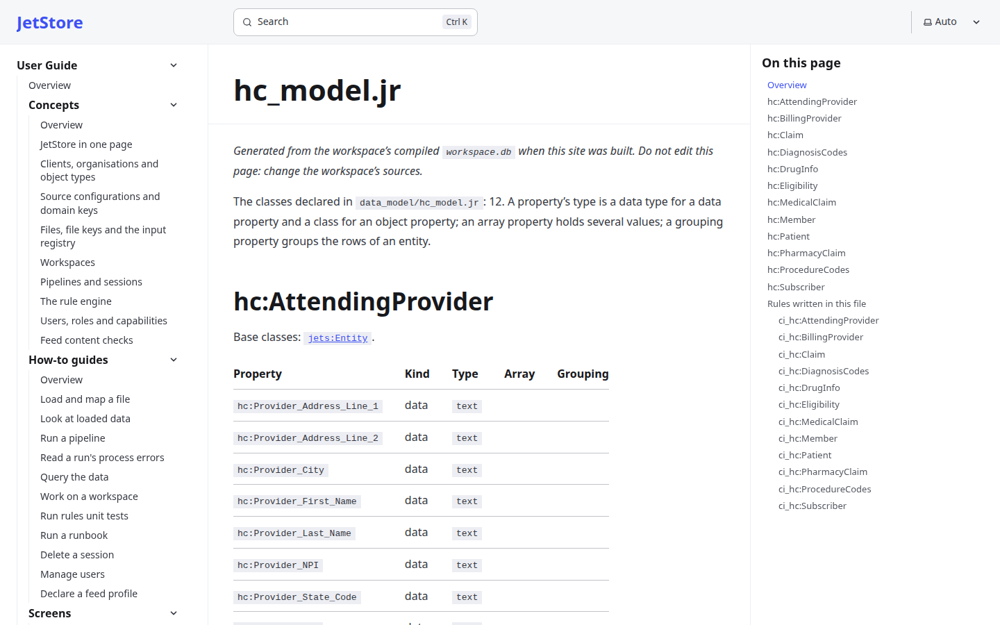
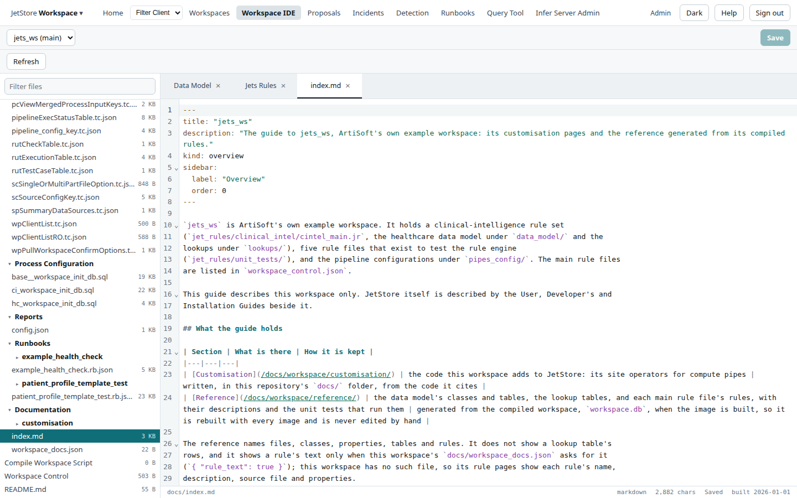
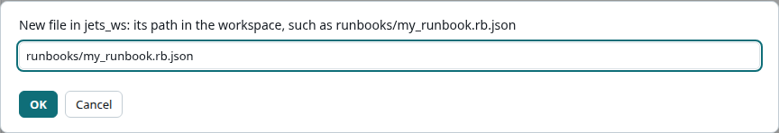
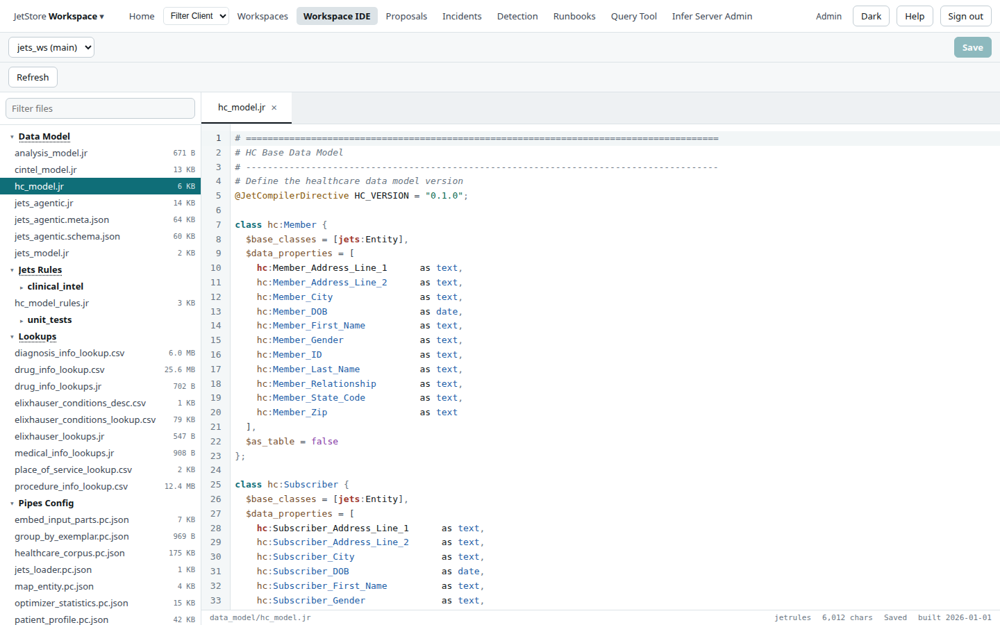
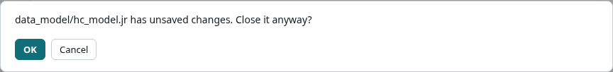
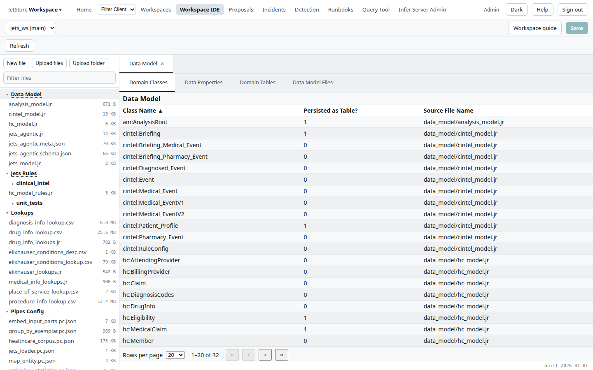
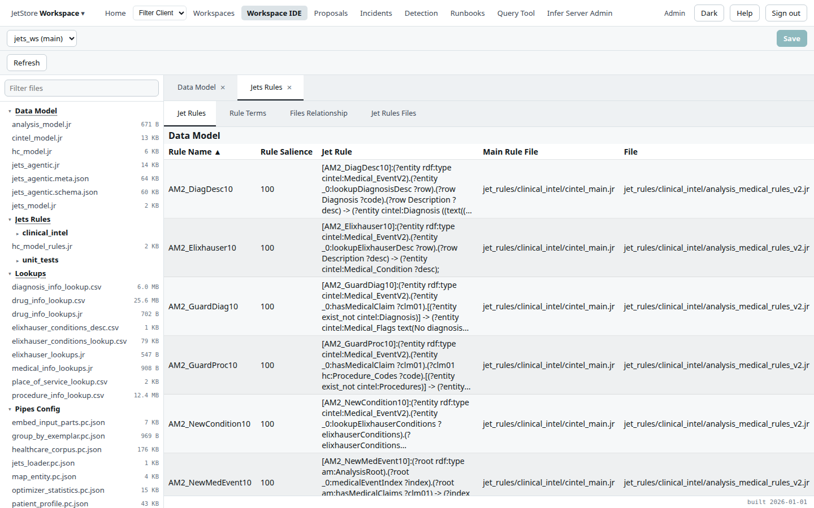
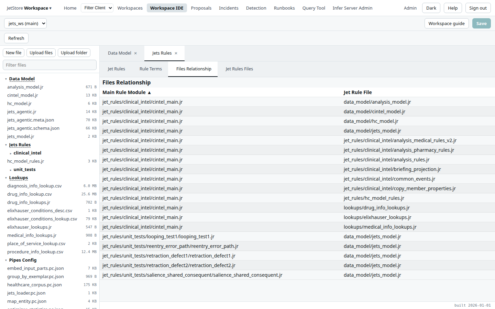

The *Workspace IDE* is the editor of a workspace: its files in a tree, each opened in a tab, new files
and folders added from your computer, the changes saved on this installation listed and revertible, and what the compiler made of the data
model, the rules and the lookups. How a saved file becomes an override, and why it takes a compile
and a commit to make it last, is in [Workspaces](/docs/user/concepts/workspaces/).

**Reach it** from *Workspace IDE* in the top bar, which opens the active workspace, or with **Open**
on the [Workspaces](/docs/user/screens/workspaces/) screen, which opens the selected one at
`/workspaces/<name>/home`. A runbook run's *Edit future steps* link opens it too. It needs the
`workspace_ide` capability: the top bar entry is disabled without it, and a user who reaches the
screen anyway sees *Read only* and cannot save.

## The bars at the top

| Control | What it does |
|---|---|
| **Workspace picker** | The workspace being edited, with its branch. Choosing another opens it. |
| **Save** | Saves the file in the current tab. Enabled when the tab has unsaved changes and the file is not read-only. `Ctrl+S` does the same in the editor. |
| **Refresh** | Reads the file tree and the changes table again. |
| **Workspace guide** | Beside *Save*: opens this installation's guide to the workspace at the page for the open file (below). Shown only when the installation has a guide to the workspace open in the IDE, and to every user, since the guide needs no capability. |

## The workspace guide

An installation's documentation has a fourth guide, named for its workspace: its domain, lookups and
rules, generated from the compiled workspace, and the pages the workspace's own people wrote.
**Workspace guide** opens it in the documentation's tab, the one *Help* uses, at the page for the file
open in the editor:

| File open in the editor | Page opened |
|---|---|
| A data-model file | its page of the domain: its classes, their properties and the rules written in it, such as the compiler's generated rules |
| A lookup's source file | the lookups page |
| A main rule file | its rules page: the files it includes, the rules written in it with their descriptions, and its unit tests |
| A rule file that main rule files include | its own rules page: the main rule files that include it, and the rules written in it with their descriptions |
| A page of the workspace's `docs/` folder | that page |
| Any other file, or none | the guide's landing page |

The button is not shown when the installation's documentation has no guide to the workspace open in
the IDE: an installation built without one, or another workspace opened here. The guide describes the
workspace as it was compiled into the deployed image, so an edit saved here, a page of `docs/`
included, is not in it until it is committed to the workspace's repository and the images are
rebuilt. The top bar's *Help* still opens this page. How a workspace writes its guide is in
[Document a workspace](/docs/developer/how-to/document-a-workspace/).

## The file tree

The left panel lists the workspace's files by section: *Data Model*, *Jets Rules*, *Lookups*,
*Pipes Config*, *User Flows*, *Table Configurations*, *Process Configuration*, *Reports*, *Runbooks*,
*Documentation* and the others the workspace has, each file
with its size. **Filter files** narrows the tree to the names that match.

- **A file** opens in a tab of the editor.
- **New file**, **Upload files** and **Upload folder**, above the tree, add files to the workspace
  ([Adding files](#adding-files), below).
- **The caret of a section** expands or collapses it.
- **The name of *Data Model*, *Jets Rules* or *Lookups*** opens that section's compiled view (below),
  rather than expanding it.

**Documentation** lists the workspace's `docs/` folder: the pages its people write for the
[workspace guide](#the-workspace-guide), Markdown files (`.md` or `.mdx`) in `docs/` and its
subfolders, and the guide's settings file, `docs/workspace_docs.json`. A page opens, is edited and is
saved like any other file, and **Workspace guide** opens that page in the guide. A saved page needs no
compile: nothing compiles it, and the guide shows it once it is committed and the images are rebuilt.
A new page is added with **New file**, or uploaded, as any file is ([Adding files](#adding-files)). How to write a page is in
[Document a workspace](/docs/developer/how-to/document-a-workspace/).

## Adding files

Three controls above the tree add files to the workspace on this installation, without a deployment.
Each needs `workspace_ide`, as **Save** does, and is disabled without it.

| Control | What it does |
|---|---|
| **New file** | Asks for the file's path in the workspace, starting in the folder of the file open in the editor: for example `runbooks/table_counts.rb.json`, or `runbooks/table_counts/counts.sql`, whose folder is made if the workspace has none. The file opens in a new, empty tab, marked unsaved. Nothing is written until you press **Save**, and the save is refused if a file of that name is there by then: a new file never overwrites one. Closing the tab before saving discards it. |
| **Upload files** | Picks one or more files on your computer and asks which workspace folder to put them in: the folder of the file open in the editor, or another, or none for the workspace's root. |
| **Upload folder** | Picks a folder on your computer and uploads every file in it, its subfolders included, keeping their paths: a folder `runbooks` picked and put at the workspace's root becomes `runbooks/…`. |

**Before an upload adds anything, it shows what it will do** and asks for **OK**: the files that are
new, the ones that replace a file of the same name, the ones left out because the IDE does not list
them, and the warnings any file's checks found. Every file that is added goes through the checks a
save makes (below), and **an upload is all or nothing**: when any file is refused, the banner lists
every refused file with the reason, and none is added, so a runbook never arrives without its SQL.
The files of one upload are checked together, so a form and the table it draws, or
`reports/config.json` and the reports files it runs, can be uploaded at once.

**What can be added is what the tree lists.** A file goes under one of the sections, with a file type
that section shows: `.rb.json` and `.sql` under *Runbooks*, `.jr` and `.csv` under *Jets Rules*,
`.md` and `.mdx` under *Documentation*, and so on, or a `.md` note at the root. A file the tree would
not list, such as a `notes.txt` in a runbook's folder or a hidden file in a folder picked whole, is
left out of an upload and named in its confirmation, and refused by **New file**. A file the IDE
shows read-only cannot be added either, and the file's path must stay inside the workspace. A
workspace file is text: an upload that holds a file that is not, such as a spreadsheet or an archive,
adds nothing and says which file it is.

**An added file is an override, as a saved one is.** It appears in *Workspace Changes*, takes effect
when the workspace is compiled if the compile reads it, and is kept by every restart of the
installation until it is committed to the workspace's repository. Its **Delete/Revert Changes**
deletes it, since the workspace as deployed has no copy of it to return to, and with it a folder the
upload or *New file* made, once nothing else is in it. The tree is read again after every revert.

## Editing a file

Every file opens in its own tab, whatever its size. The editor highlights JetRules, JSON, SQL and
Markdown; other files, such as a lookup's CSV, show as plain text. A tab with unsaved changes shows a dot, and its status bar says
*Modified*:

The status bar shows the file's path, its language, *Read only* when it cannot be edited, its size and
whether it is saved. Files JetStore installs into every workspace are read-only: a workspace changes
what one of them does by extending it, as
[Workspace assets JetStore installs](/docs/developer/workspace/assets/) explains. A Markdown file,
such as a `README.md` beside the pipelines, is read-only too, except a page under `docs/` and the
workspace's own `README.md`, at the top of the tree. Saving that README makes no start of JetStore
compile the workspace.

**Saving checks the file first.** A JSON file that does not parse is refused before it is sent. The
server then checks the file types it knows, such as user flows, table documents, SQL scripts,
pipeline definitions and the guide's `workspace_docs.json`, and refuses a save that would break them,
saying why. A pipeline definition (`.pc.json`) is refused only for what would stop the pipeline when
it starts, whatever the run: a value the definition's format cannot hold, no `cluster_config`, an
output table column whose `rdf_type` is not in the
[closed list of column types](/docs/developer/compute-pipes/output-tables/#column-types), or a check
the start makes of the whole definition before any step runs (an empty conditional step, a
`column_encodings` entry with no column, a text template that does not compile or whose key is used
twice, a writer setting on an input channel, `latest_session_only` on a channel that does not read a
staged `file_key`, or `use_jet_rules_go: true`). A page of `docs/`
is refused when the documentation build would refuse it for its front matter: none, YAML that does not
parse, or no `title`, `description` or `kind` (one of `tutorial`, `how-to`, `reference`,
`explanation` or `overview`). The editor shows a page's front matter, its opening `---` block, as
YAML. A file in the place of the workspace guide's generated pages, under `docs/reference/` or named
`docs/reference.md` or `docs/reference.mdx`, in any case, is refused whatever it holds, with a message
saying that place is generated. A page's links are checked when the images are built. A
`reports/config.json` is refused when a reports file it runs could not run: a statement with no name
comment above it, a date pattern `{D:` that is not closed, or a report whose name gives no output
format and whose `statementProperties` declare none. A reports file under `reports/` is refused for the
same reasons when `reports/config.json` runs it. A SQL file under `runbooks/` is refused when it holds
a statement no runbook step may run, such as `BEGIN`, `COMMIT`, `SET ROLE` or `COPY`.

**A save can succeed with warnings.** A check may find something that does not stop the file working
but that you should know about: in a pipeline definition, every key the pipeline does not know and so
ignores (a misspelt setting is one that silently does not apply), and an output table column with no
`rdf_type`, which creating the table needs; in a user flow's form, a table it draws that the
workspace's `table_configs/` does not hold. The file is saved, and the banner says so in the warning
colours, listing each warning at its place in the file (a JSON Pointer such as
`/pipes_config/0/apply/1/device_writer_type`, or a line) until you dismiss it.

A saved file becomes an **override**: it is held in
the database, takes precedence over the file in the image, and appears in *Workspace Changes*.

Closing a tab with unsaved changes asks first; **OK** discards them.

## Workspace Changes

With no tab open, the right panel shows the workspace's overrides: every file saved on this
installation and not yet committed.

| Column | What it shows |
|---|---|
| **Workspace Name** | The workspace. |
| **Change OID** | The identifier of the stored content. |
| **File Name** | The file's path in the workspace. |
| **Content Type** | The kind of file. |
| **Change Status** | The state of the change. |
| **User Email** | Who saved it. |
| **Last Update** | When it was saved. |

**Delete/Revert Changes** reverts the selected overrides, and **Delete/Revert ALL Changes** reverts
every one, each after a confirmation: the file in the image applies again. A file added since the
installation was deployed is deleted, and the confirmation says so. **Delete/Revert ALL Changes keeps
the compiled files** (`workspace.db`, `lookup.db`, `workspace.tgz`, `reports.tgz`) from the last compile,
so compile again after reverting. A change that has been
committed and pushed from the [Workspaces](/docs/user/screens/workspaces/) screen leaves this table.

## Compiled views

A compiled view shows what the last compile made of a section, read from `workspace.db`, in tabs:

| View | Tabs |
|---|---|
| **Data Model** | *Domain Classes*, *Data Properties*, *Domain Tables*, *Data Model Files* |
| **Jets Rules** | *Jet Rules*, *Rule Terms*, *Files Relationship*, *Jet Rules Files* |
| **Lookups** | *Lookup Tables*, *Lookup Columns* |

*Jet Rules* lists each rule with its salience and its text as written, the *Main Rule File* it is
compiled under, and its *File*, the file it is written in: the main rule file itself or one it
includes. A rule in a file that two main rule files include is listed once under each.
*Files Relationship* lists, for each main rule file, every file it includes, directly or through
another included file. *Jet Rules Files* lists the included rule files as well as the main ones, with
*Main Rule File?* telling them apart.

The *Data Model Files* and *Jet Rules Files* tabs also have **Add File**, which creates an empty file
in the section, and **Delete**, which deletes the selected files. **Add File** adds the file as
[Adding files](#adding-files) describes, as an override listed in *Workspace Changes*: a name that is
there already, or that the tree would not list, is refused, and so is an empty file its checks refuse,
such as an empty `.json`. A compiled view reflects the last
compile, so it does not show an edit until the workspace is compiled again.

## See also

- [Work on a workspace](/docs/user/how-to/work-on-a-workspace/)
- [Your first rule change](/docs/user/tutorials/first-rule-change/)
