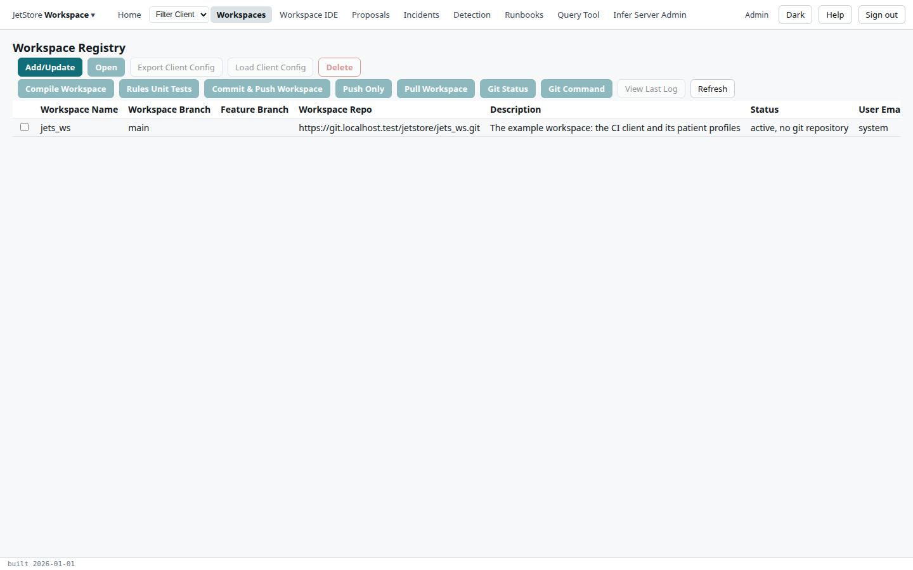
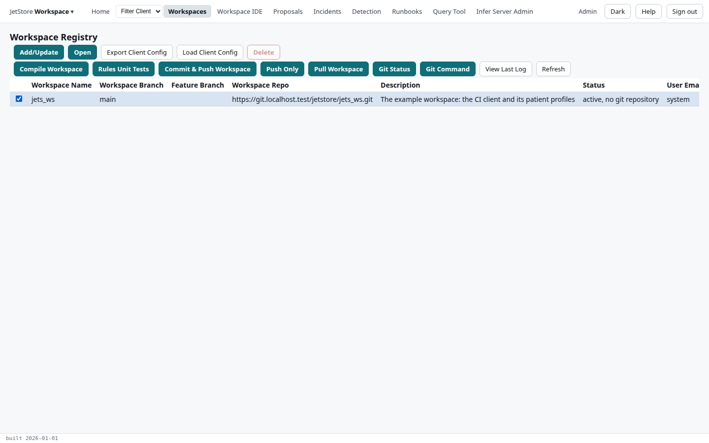
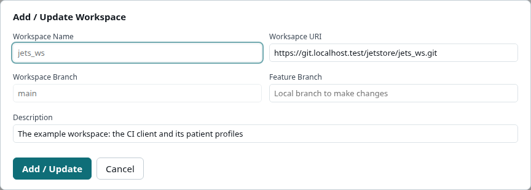
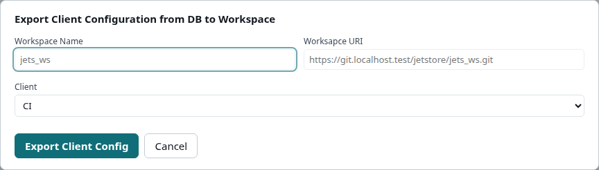
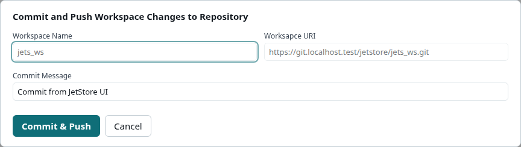
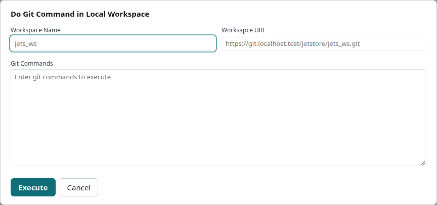

The *Workspaces* screen (*Workspace Registry*) lists the workspaces registered on the installation,
each with its git repository and branch, and is where a workspace is opened, compiled, committed,
pulled, and where a client's configuration is exported into it or loaded from it. What a workspace is,
and why a change to it must be compiled and committed, is explained in
[Workspaces](/docs/user/concepts/workspaces/).

**Reach it** from *Workspaces* in the top bar. It needs the `workspace_ide` capability: without it,
the entry is shown disabled.

## The table

One row per registered workspace. Tick a row to select it: the buttons act on the selected workspace,
and most are disabled until a row is selected.

| Column | What it shows |
|---|---|
| **Workspace Name** | The workspace's name, which is also its key and its folder name on the installation. |
| **Workspace Branch** | The branch of the repository the workspace is taken from. |
| **Feature Branch** | The local branch changes are made on, when there is one. |
| **Workspace Repo** | The git repository the workspace is versioned in. |
| **Description** | Free text. |
| **Status** | Whether the workspace is the **active** one, and the state of its last operation: `in progress` while a compile runs, `error` when the last git operation failed. |
| **User Email** | Who made the last change. |
| **Last Update** | When the row last changed, which is usually the last compile. The table is sorted on it, newest first. |

## Actions on the first row

| Button | What it does | Enabled when |
|---|---|---|
| **Add/Update** | Opens the *Add / Update Workspace* dialog: with no row selected it registers a new workspace, with one it updates the selected one. | always |
| **Open** | Opens the selected workspace in the [Workspace IDE](/docs/user/screens/workspace-ide/). | a row is selected and nothing is in progress on it |
| **Export Client Config** | Opens a dialog that writes one client's configuration from the database into the workspace, as `process_config/<client>_workspace_init_db.sql`. | a row is selected |
| **Load Client Config** | Opens the [Load Client Configurations](/docs/user/screens/flows/load-client-configurations/) flow for the selected workspace, which loads client configuration files from the workspace into the database. | a row is selected |
| **Delete** | Asks for confirmation, then deletes the installation's local copy of the workspace and its row. The repository is not touched. | a row is selected that is not the active workspace |

The *Add / Update Workspace* dialog has **Workspace Name**, **Workspace URI** (the repository),
**Workspace Branch**, **Feature Branch** and **Description**. All but the description are required.
The name and the branch cannot be changed on the active workspace. **Add / Update** registers the
workspace and, when its folder does not exist yet, checks the branch out from the repository.

## Actions on the second row

| Button | What it does |
|---|---|
| **Compile Workspace** | Compiles the selected workspace: the rules into `workspace.db`, the lookups into `lookup.db`, with the user flows and table documents checked. The status shows `in progress` until it finishes; **Refresh** to see it change. Only the active workspace can be compiled. |
| **Rules Unit Tests** | Opens the [Rules Unit Tests](/docs/user/screens/flows/rules-unit-tests/) flow for the selected workspace. |
| **Commit & Push Workspace** | Opens a dialog asking for a **Commit Message**, then commits the workspace's changes, the saved overrides included, to its branch and pushes them. Once pushed, the overrides are cleared, since the repository now holds them. |
| **Push Only** | Pushes commits already made, without compiling. Changes no commit carries, the overrides included, are not sent; the log says so. |
| **Pull Workspace** | Opens the [Pull Workspace Changes](/docs/user/screens/flows/pull-workspace-changes/) flow. |
| **Git Status** | Opens a dialog that runs `git status` in the installation's copy of the workspace. |
| **Git Command** | Opens a dialog that runs the git commands you type, one per line, in the installation's copy of the workspace. |
| **View Last Log** | Shows the output of the last git operation on the workspace. |
| **Refresh** | Reads the table again. |

Committing and pushing use the identity and token of your [Git Profile](/docs/user/screens/git-profile/).
The result of each git operation is kept as the workspace's last log.

## Capabilities

Every button that writes, and every dialog's confirming button, needs `workspace_ide`, as does the
screen itself. An installation without access to a git repository still offers the git buttons; they
record a notice in the last log instead of running git, and an override stays in the database until
it can be committed.
