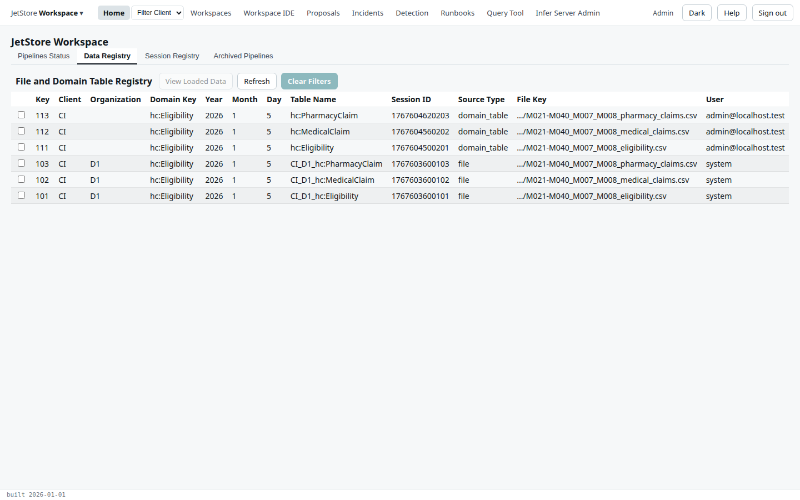
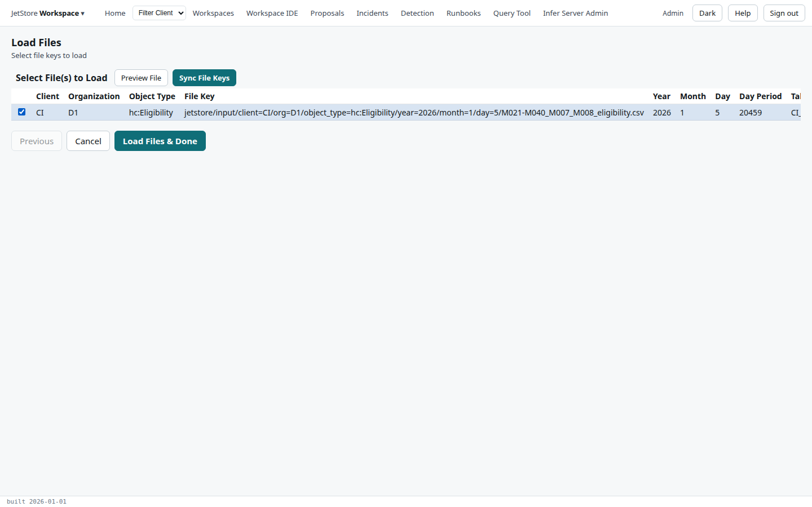
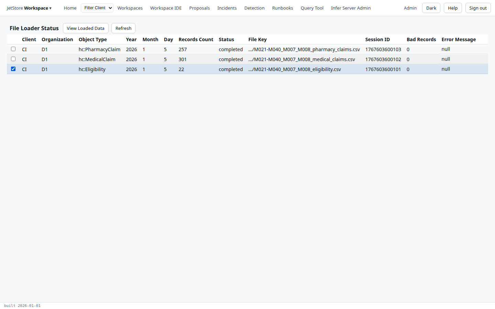
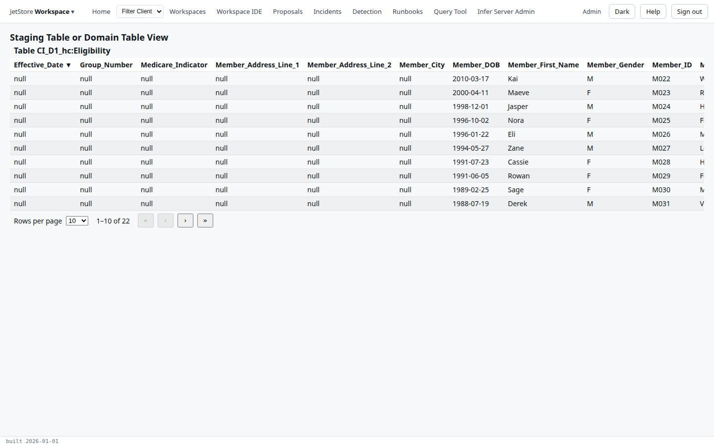
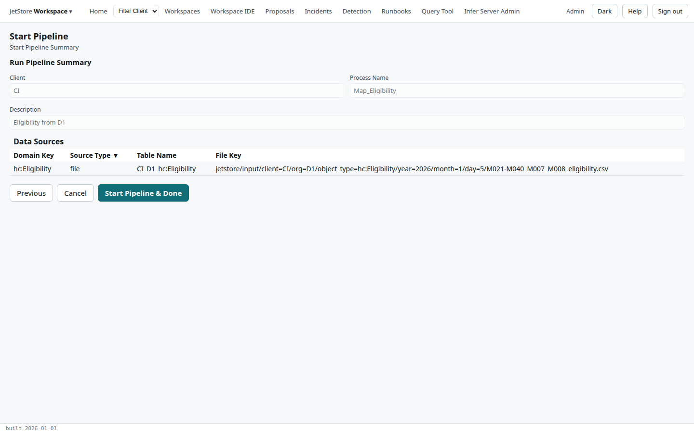
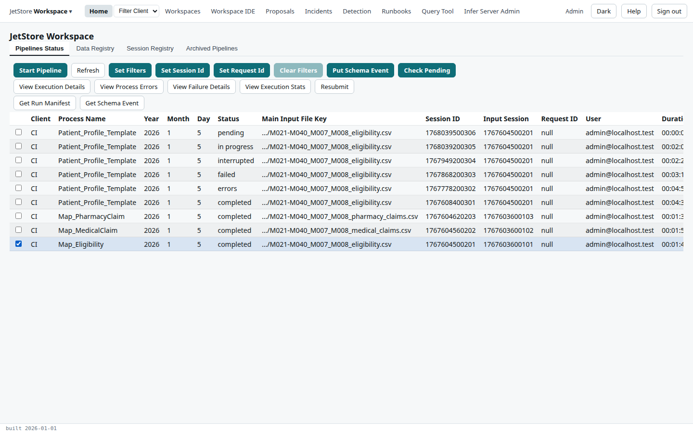
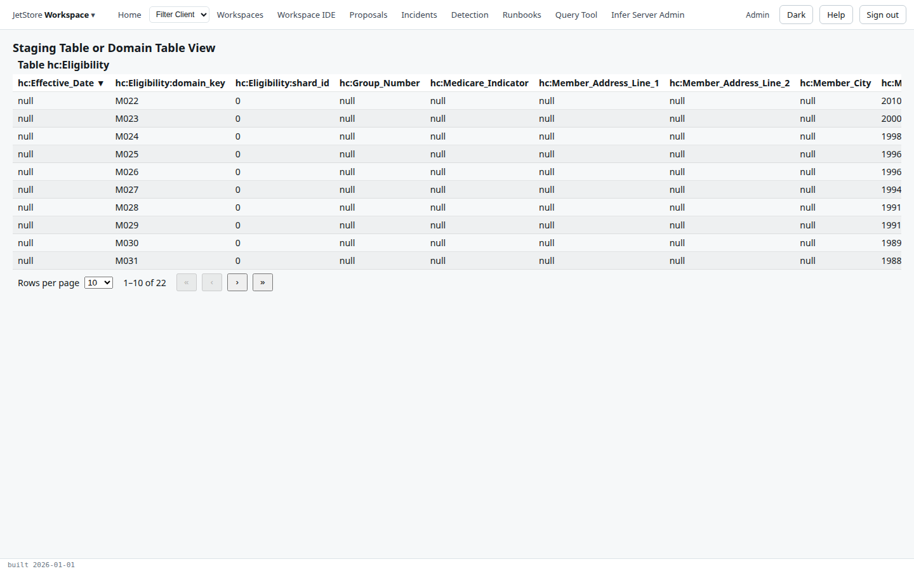
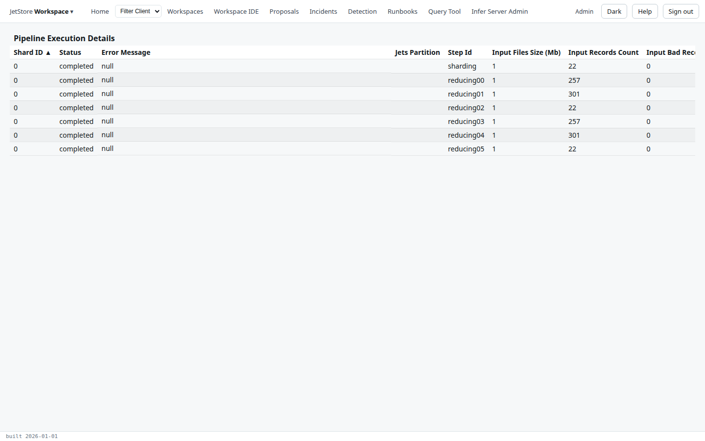
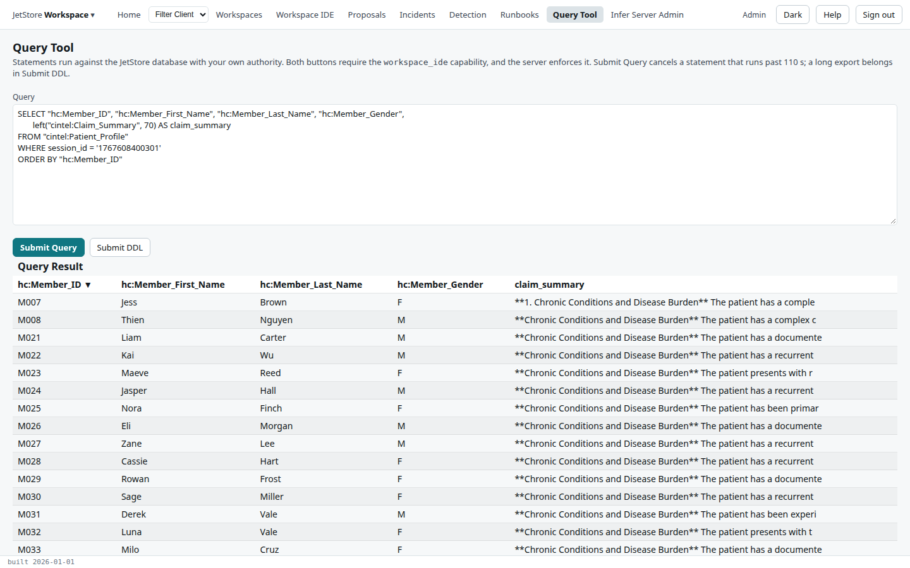

In this tutorial you follow one file through JetStore. The client `CI` has sent its eligibility file
for January 2026, `M021-M040_M007_M008_eligibility.csv`, from its vendor `D1`. You will check that
it arrived, load it to look at its rows, map it onto the data model with `Map_Eligibility`, and read
the profiles `Patient_Profile_Template` builds for each patient.

You need an account with the `run_pipelines` and `workspace_ide` capabilities, on an installation
running the `jets_ws` workspace with its `CI` configuration loaded. Some steps start work that the
installation does in the background, reading and writing its S3 bucket; each says how long it takes
and what you see when it is done.

## 1. The file arrives

The vendor copies the file into the installation's bucket, at a path that says what it is:

```
jetstore/input/client=CI/org=D1/object_type=hc:Eligibility/year=2026/month=1/day=5/M021-M040_M007_M008_eligibility.csv
```

`client=CI`, `org=D1` and `object_type=hc:Eligibility` name the source configuration that describes
the file, and `year`, `month` and `day` its source period. JetStore registers the file within a few
seconds of its arrival. [Files and the input registry](/docs/user/concepts/files-and-the-input-registry/)
explains what registering does.

Open **Home** and its **Data Registry** tab. The file is the row with source type `file` and table
`CI_D1_hc:Eligibility`, with a session id of its own: `1767603600101`.



The `domain_table` rows above it are what the mapping pipelines wrote from these files. On an
installation where the file has only just arrived, they are not there yet: you are about to make
the first of them.

## 2. Load the file to look at it

Registering a file does not copy its rows into the database. To see what the vendor sent, load it
into its staging table.

1. Open the brand menu, **JetStore Workspace**, and choose **Source Mapping**.
2. Tick the source `CI_D1_hc:Eligibility` and press **Load Data**. The *Load Files* flow lists the
   files that arrived for this source.
3. Tick the January file, and press **Load Files & Done**.



The loader runs on the installation, in the background; it is done when its status, in the next
step, is `completed`.

## 3. Check what the loader read

1. Open **Source Mapping** again from the brand menu, and press **Loader Status**.
2. The *File Loader Status* screen has a row per load. The January eligibility file loaded **22**
   records with **0** bad records, and its status is `completed`.



3. Tick the eligibility row and press **View Loaded Data**. These are the vendor's own columns,
   exactly as they arrived, one row per member.



Look at the columns before you go further: they are what the source mapping expects to find. A
missing or renamed column is the usual reason a new vendor's file maps badly.

## 4. Map the file with Map_Eligibility

`Map_Eligibility` reads the file, applies the source mapping to each row and writes the result to
the `hc:Eligibility` table, under a session of its own.
[Source configurations and domain keys](/docs/user/concepts/source-configurations/) explains the mapping.

1. Open **Home**. On the **Pipelines Status** tab, press **Start Pipeline**.
2. Tick `Map_Eligibility` and press **Next**.
3. Tick the January file, session `1767603600101`, as the main input, and press **Next**.
4. Check the summary: client `CI`, process `Map_Eligibility`, and the file as its one data source.
   Press **Start Pipeline & Done**.



## 5. Watch the run, and read what it wrote

The run appears at the top of **Pipelines Status**. It shows `pending`, then `submitted` while it
runs; press **Refresh** to follow it. The run takes a few minutes, and ends `completed`.



When it completes, its table is registered. Open the **Data Registry** tab, tick the `domain_table`
row for `hc:Eligibility`, session `1767604500201`, and press **View Loaded Data**. The columns now
carry the data model's names, `hc:Member_ID` and the rest, and each row carries the member as its
domain key.



## 6. Patient_Profile_Template runs

`Patient_Profile_Template` reads `hc:Eligibility` as its main input and merges in the medical and
pharmacy claims tables, mapped the same way by `Map_MedicalClaim` and `Map_PharmacyClaim`. For `CI` it
is automated: it starts by itself once all three tables are registered for the period, and takes a
few minutes.

On **Pipelines Status**, tick its completed run, session `1767608400301`, and press **View Execution
Details**. Each step is a row: the run shards the eligibility and both claims, sorts each member's
records together, and in its last step hands each member to the rule engine, which writes 22 profiles.



[Pipelines and sessions](/docs/user/concepts/pipelines-and-sessions/) explains the steps and the
statuses.

## 7. Read the profiles

The profiles are rows of the `cintel:Patient_Profile` table, tagged with the run's session. Open the
**Query Tool**, paste this query and press **Submit Query**:

```sql
SELECT "hc:Member_ID", "hc:Member_First_Name", "hc:Member_Last_Name", "hc:Member_Gender",
       left("cintel:Claim_Summary", 70) AS claim_summary
FROM "cintel:Patient_Profile"
WHERE session_id = '1767608400301'
ORDER BY "hc:Member_ID"
```



There is one profile per member, 22 in all. The claim summary is the briefing the template wrote from
what the rules concluded about each patient's claims.

## What you have done

You followed one file from the bucket to a pipeline's output: you saw it registered, loaded it to
check its columns, mapped it into the data model, and read the profiles built from it, each step
traceable by its session. Next:

- [Your first rule change](/docs/user/tutorials/first-rule-change/), to change what the rules conclude;
- the [how-to guides](/docs/user/how-to/), for each of these steps on its own;
- [Home](/docs/user/screens/home/), for every column and button of the tabs you used.
