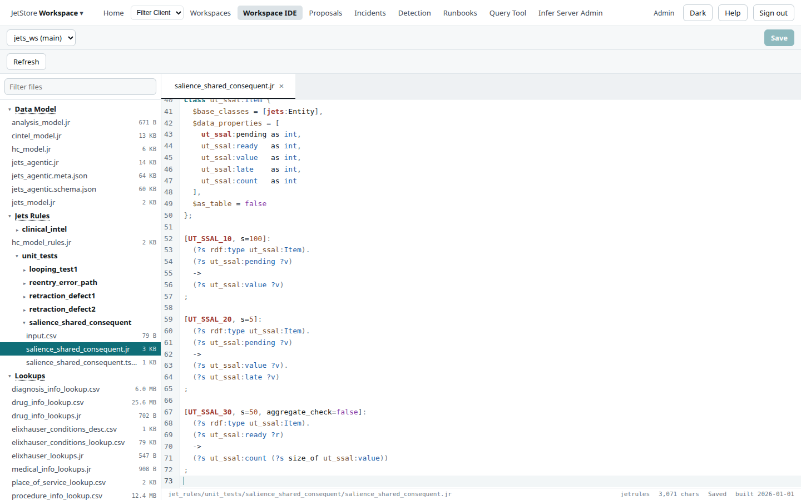
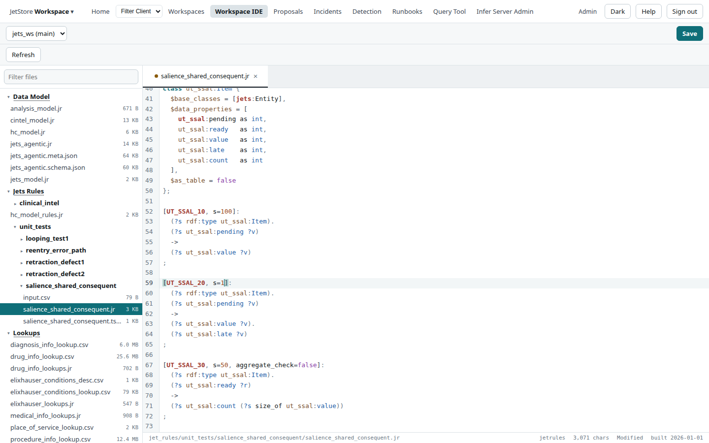
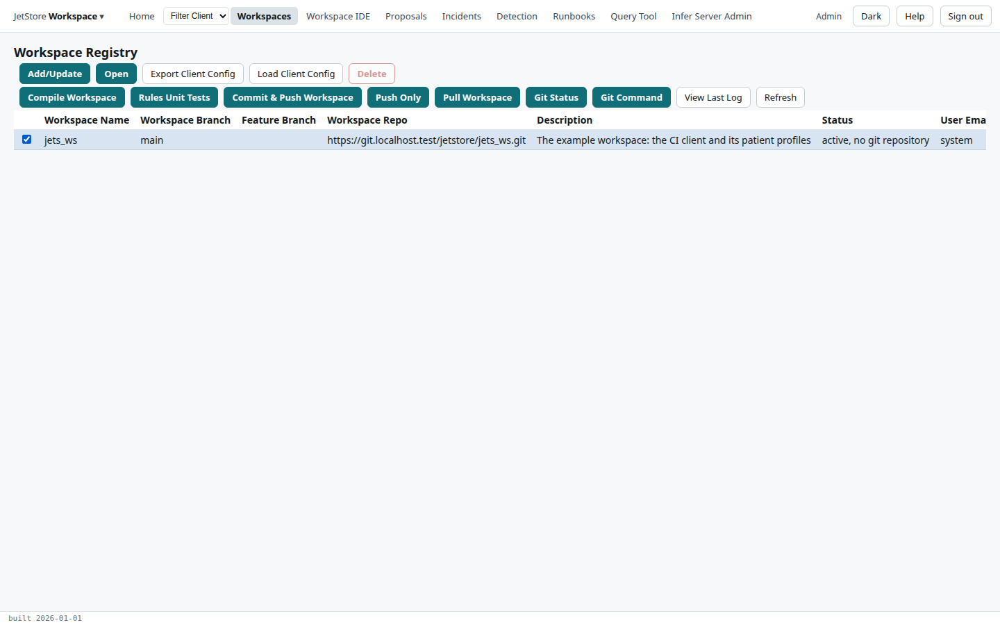
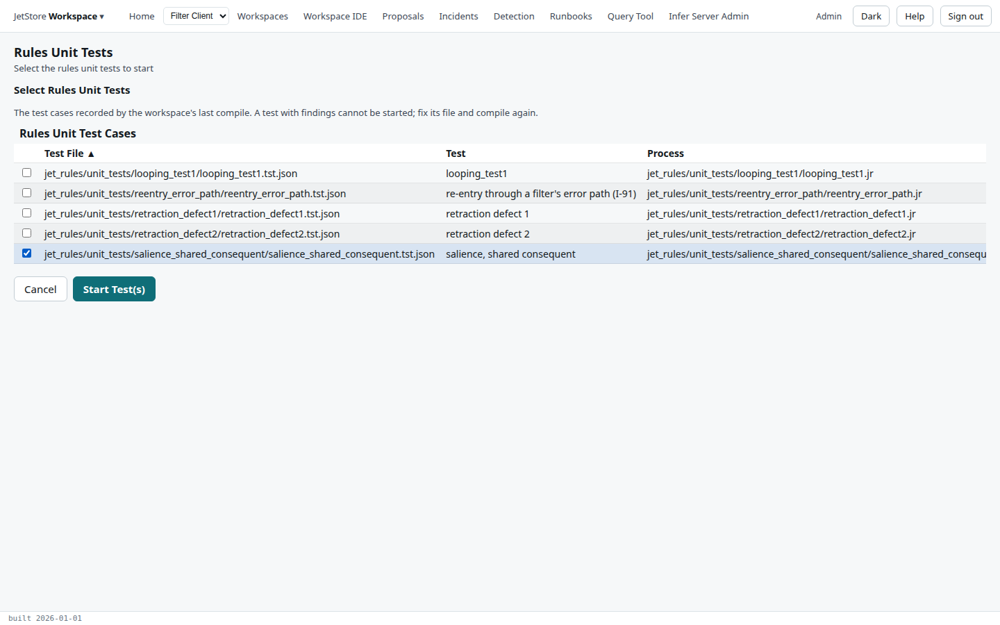
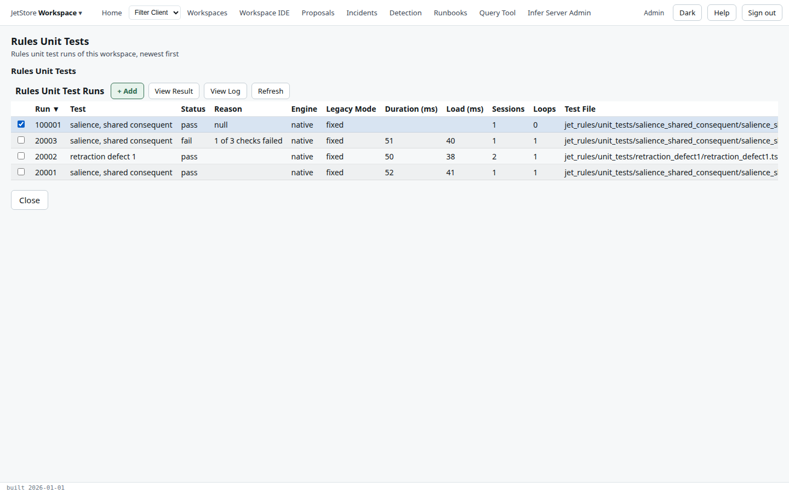
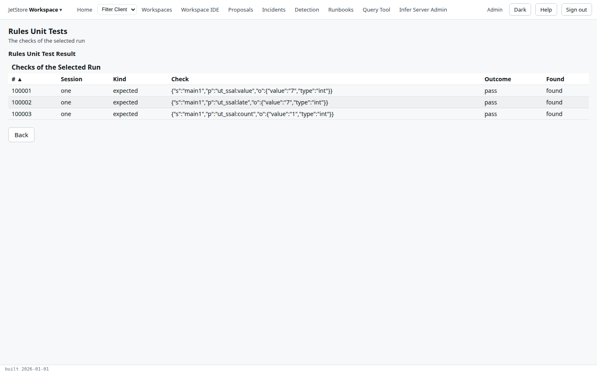
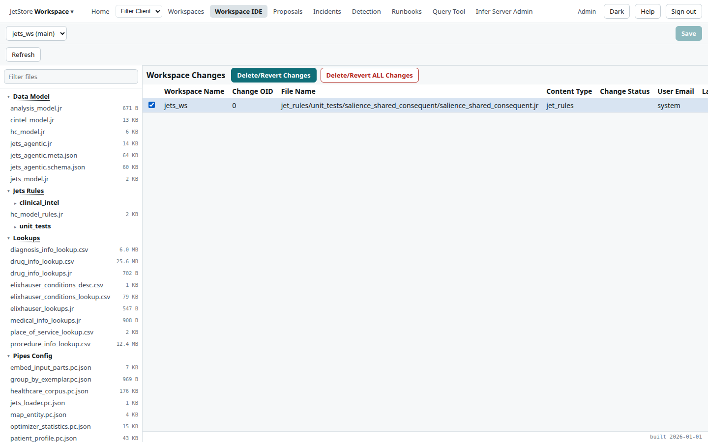

In this tutorial you change one rule in the `jets_ws` workspace, compile the workspace so the change
takes effect, and run the unit test that pins what the rule does. At the end you revert the change, so
the workspace is as you found it.

You need an account with the `workspace_ide` capability. [Workspaces](/docs/user/concepts/workspaces/)
explains what a workspace is and why a change must be compiled, and
[The rule engine](/docs/user/concepts/rule-engine/) what a rule is.

## 1. Open the rule file

The rules you will change are small on purpose: they belong to a unit test, not to a pipeline, so
nothing in production reads them.

1. Open the **Workspace IDE** from the top bar. The file tree on the left lists the workspace by
   part: data model, rules, lookups, pipeline definitions and the rest.
2. Under **Jets Rules**, expand `unit_tests`, then `salience_shared_consequent`, and open
   `salience_shared_consequent.jr`.
3. Scroll to the end of the file.

Each rule has a name and options in square brackets, its conditions, an arrow `->`, and what it
concludes. `s=` is the rule's **salience**: when several rules can fire, the higher salience fires
first. Read the three:

- `UT_SSAL_10`, at salience 100, copies an item's `ut_ssal:pending` value to `ut_ssal:value`;
- `UT_SSAL_20`, at salience 5, does the same and also writes `ut_ssal:late`;
- `UT_SSAL_30`, at salience 50, counts the item's values once it is `ready`.

Because `UT_SSAL_10` fires first, the value exists before the count, so the count is 1 whatever
salience `UT_SSAL_20` has. The unit test beside the file checks exactly that.

## 2. Change the rule, and save

1. On the line `[UT_SSAL_20, s=5]:`, change `5` to `1`. A dot on the file's tab, and **Modified**
   in the status bar, show the change is not saved.

2. Press **Save**. The status bar says **Saved**.

The saved file is kept in the installation's database as a change to the workspace. It takes
precedence over the file the installation was deployed with, but the rules the pipelines run do not
change yet.

## 3. Compile the workspace

1. Open **Workspaces** from the top bar.
2. Tick `jets_ws` and press **Compile Workspace**.

The compile runs on the installation, in the background: the workspace's status says the compile is
in progress, and changes again when it is done; press **Refresh** to follow it. A mistake in a rule is reported here, by the compiler, rather
than by a pipeline later: **View Last Log** shows the compile's messages.

## 4. Run the rule's unit test

1. With `jets_ws` still ticked, press **Rules Unit Tests**. The flow opens on the workspace's test
   runs, newest first.
2. Press **+ Add**. The test cases are those the last compile recorded.
3. Tick `salience_shared_consequent.tst.json`, and press **Start Test(s)**.

4. The run appears in the list. Press **Refresh** until its status is `pass`; a test this small takes
   a few seconds.

5. Tick the run and press **View Result**. Each row is one check the test file makes: three expected
   triples, each found.

The test still passes: `UT_SSAL_20` now fires later, and still writes `ut_ssal:late`, and the count is
still 1. Had your change broken what the test pins, the run would say `fail`, and **View Result**
would name the check that failed.

## 5. Put the rule back

1. Open the **Workspace IDE**. With no file open, it lists the **Workspace Changes**: the files saved
   on this installation and not yet committed.

2. Tick `salience_shared_consequent.jr`, press **Delete/Revert Changes**, and confirm with **OK**. The
   file is back as it was deployed, and the list is empty.
3. Compile the workspace again, as in step 3, so the rules the pipelines run are the original ones.

## What you have done

You edited a rule, compiled it, and ran the test that checks it, which is the loop every rule change
goes through. A change you mean to keep is committed to the workspace's git repository instead of
reverted, so the next deployment carries it: see
[Work on a workspace](/docs/user/how-to/work-on-a-workspace/). For the tests themselves, see
[Run rules unit tests](/docs/user/how-to/run-rules-unit-tests/); to write one, the Developer's Guide's
[rules unit tests](/docs/developer/testing/rules-unit-tests/). The screens you used are described on
[Workspace IDE](/docs/user/screens/workspace-ide/), [Workspaces](/docs/user/screens/workspaces/) and
[Rules Unit Tests](/docs/user/screens/flows/rules-unit-tests/).
